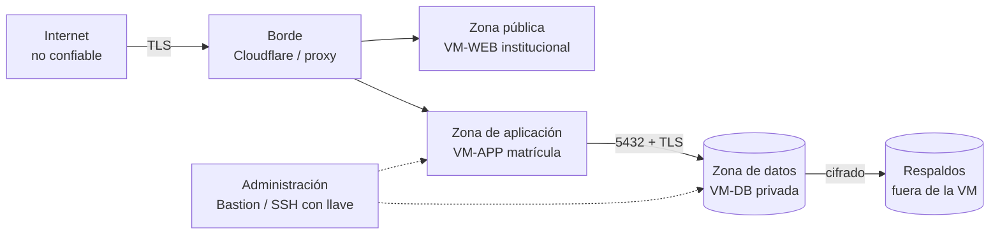

# Seguridad, estándares y buenas prácticas

Complementa el [marco legal](01-marco-legal-y-normativo.md). Mismo criterio de verificación (✔✔ / ✔ / ?). **Actualización 20-oct-2026:** el equipo aportó el texto en español de **ISO/IEC 27002:2022 (tercera edición)**, un PDF escaneado de 165 páginas que se leyó con OCR yendo al índice y a los controles pertinentes. Los números y nombres de control de la sección 4 **están verificados contra ese texto**. Lo demás (OWASP, NIST, 27701, WCAG) se contrastó en la web.

## 1. Estándares de referencia y para qué sirve cada uno

| Estándar | Qué aporta al proyecto | Cómo se usa (sin buscar certificación) | Verif. |
| :--- | :--- | :--- | :---: |
| **ISO/IEC 27001:2022** / **NTP-ISO/IEC 27001:2022** | Sistema de gestión de seguridad (SGSI). Es la norma nacional que las entidades públicas usan para su SGSI. | Marco de gestión: alcance, riesgos, controles, mejora continua. | ✔ |
| **ISO/IEC 27002:2022** (tercera edición, texto en español del equipo) | Catálogo de controles en 4 temas (organizacionales 5.x, de personas 6.x, físicos 7.x, tecnológicos 8.x). | Lista de verificación de controles (sección 4). | ✔✔ |
| **ISO/IEC 27701:2025** (publicada 14-oct-2025, **independiente** de la 27001) | Sistema de gestión de **privacidad** (PIMS). | Guía para el registro de tratamientos, roles y derechos. | ✔✔ |
| **ISO/IEC 29100**, **29134**, **27017** y **27018** | Marco de privacidad, guía de **evaluación de impacto a la privacidad (PIA)**, seguridad en la nube y protección de PII en nubes públicas. La propia ISO 27002 los remite en los controles 5.23 y 5.34. | La EIPD del **art. 40 del reglamento** se basa en **NTP-ISO/IEC 27005** y **NTP-ISO 31000** (no en la 29134); 27017 y 27018 sirven para evaluar a Oracle. | ✔✔ |
| **ISO/IEC 25010:2023** | Modelo de calidad: nueve características (adecuación funcional, eficiencia de desempeño, compatibilidad, **capacidad de interacción**, fiabilidad, seguridad, mantenibilidad, flexibilidad, seguridad funcional). | Clasificar los atributos de calidad del documento de arquitectura. | ✔ |
| **ISO/IEC 40500:2025** = **WCAG 2.2** | Accesibilidad web (la norma ISO reproduce el texto de WCAG 2.2). | Objetivo AA en todas las pantallas. | ✔✔ |
| **ISO/IEC/IEEE 42010** | Descripción de arquitecturas (vistas, puntos de vista, partes interesadas). | Estructura del documento de arquitectura. | ? |
| **OWASP Top 10:2025** | Los diez riesgos más comunes en aplicaciones web (sección 3). | Lista de amenazas y mapa de controles. | ✔✔ |
| **OWASP ASVS 5.0.0** (30-may-2025; unos 350 requisitos en 17 capítulos; niveles L1, L2, L3; los ID incluyen la versión) | Qué verificar en la aplicación. | **Objetivo L2** (sección 5). | ✔✔ |
| **NIST SP 800-63B-4** | Reglas de autenticación y contraseñas (sección 6). | Política de contraseñas y MFA. | ✔✔ |
| **NIST SSDF (SP 800-218)**, **CSF 2.0** | Desarrollo seguro y gestión del riesgo. | Orientan el pipeline de CI/CD y el plan de respuesta. | ? |
| **CIS Benchmarks** (Docker, Ubuntu, PostgreSQL) y **OWASP Cheat Sheets** | Endurecimiento concreto. | Listas de verificación para las VM y los contenedores. | ? |
| **GDPR** | Referencia conceptual de las mismas ideas que el reglamento peruano (minimización, EIPD, notificación). | Solo como apoyo; no es de aplicación. | ? |

**Recomendación de proporcionalidad.** Son 5 usuarios, pero los datos son de personas, parte menores de edad, en un sistema expuesto a Internet de una entidad pública. Propongo **ASVS L2** como meta (no L1: los datos justifican más), sin certificar ni exigir L3.

## 2. Activos y zonas de confianza

| Activo | Por qué importa |
| :--- | :--- |
| Registros de estudiantes y matrículas (DNI, fecha de nacimiento, dirección, correo, celular) | Datos personales de menores y adultos. Atractivos para fraude y suplantación. |
| Convenios y becas | Pueden revelar situación económica (dato sensible). |
| Constancias de matrícula | Documento con el membrete de la institución: **falsificable**. |
| Credenciales de las 5 personas usuarias | Dan acceso a todo lo anterior. |
| Bitácora de auditoría | Su valor depende de que no se pueda alterar. |
| Copias de respaldo | Contienen todo; deben estar cifradas y fuera de la VM. |
| Cuenta de Oracle y dominio | Su pérdida deja el sistema sin servidor o sin dirección. |

Se cruzan cinco fronteras: Internet → borde, borde → aplicación, aplicación → datos, datos → respaldos y administración → servidores. Cada cruce exige autenticación o validación explícita. **La web institucional no tiene ningún camino a la base de datos de matrícula.**

## 3. OWASP Top 10:2025 aplicado a este sistema

| Riesgo | Cómo se manifestaría aquí | Controles propuestos |
| :--- | :--- | :--- |
| **A01 Control de acceso roto** (incluye SSRF) | Un Directivo edita matrículas; una persona abre la ficha de otro estudiante cambiando un ID en la URL; descarga una constancia ajena; el servidor consulta una URL controlada por un atacante (si se integra RENIEC o webhooks). | Política de **denegar por defecto** (política de autorización de respaldo); autorización por rol **y por recurso**; identificadores no secuenciales en las URL; pruebas de acceso por rol; lista cerrada de destinos salientes. |
| **A02 Configuración incorrecta** | Puerto 5432 abierto; credenciales por defecto; errores con detalles; cabeceras ausentes; contenedores como root. | Endurecimiento CIS; contenedores sin privilegios; red privada para la BD; cabeceras (HSTS, CSP, X-Content-Type-Options, Referrer-Policy); `ASPNETCORE_ENVIRONMENT=Production`; escaneo de configuración. |
| **A03 Fallas en la cadena de suministro** | Paquete NuGet o imagen Docker comprometidos; acción de GitHub sin fijar; secretos en el repositorio. | Versiones fijas y `NuGet audit`; Dependabot; Trivy; SBOM (CycloneDX); acciones fijadas por *hash*; imágenes de base oficiales y ligeras; revisión de licencias. |
| **A04 Fallas criptográficas** | HTTP sin TLS; respaldos sin cifrar; contraseñas con resumen débil. | TLS 1.2+ (preferir 1.3) y HSTS; resumen de contraseñas robusto (PBKDF2 de Identity o Argon2id); cifrado en reposo del volumen y **cifrado propio del respaldo**; gestión de claves fuera de la VM. |
| **A05 Inyección** | SQL por texto concatenado; **inyección de fórmulas en Excel/CSV** (un apellido que empiece con `=` o `+`); HTML en campos libres. | EF Core con parámetros; sin SQL concatenado; codificación automática de Razor; **sanear celdas** al exportar; validación de entrada con límites. |
| **A06 Diseño inseguro** | Anular matrículas sin motivo ni rastro; enumerar DNI con la búsqueda; el mismo usuario registra y aprueba un descuento; sin límites a la verificación pública de constancias. | Modelo de amenazas (sección 7); separación de funciones; **anulación como estado con motivo obligatorio**; límites de tasa; reglas críticas también en la BD (doble defensa). |
| **A07 Fallas de autenticación** | Contraseñas débiles; relleno de credenciales; recuperación insegura; sesiones que no vencen. | Política NIST (sección 6); **MFA (TOTP) para todo el personal**; bloqueo temporal; **sin registro público**; sesión con vencimiento; recuperación asistida por el administrador. |
| **A08 Fallas de integridad de software y datos** | Imagen alterada en el registro; despliegue sin verificar; bitácora editable; constancia falsificada. | Imágenes firmadas o por *digest*; CI con ramas protegidas; **bitácora solo de inserción**; constancia con código único, *hash* y **verificación por QR**. |
| **A09 Fallas de registro y alertas** | Nadie se entera de 200 ingresos fallidos; la bitácora guarda contraseñas; no hay registro de **quién consultó** a un estudiante. | Bitácora de seguridad y de negocio; alertas por umbral (correo); **registro de sesión, lecturas, modificaciones, eliminaciones, importaciones y exportaciones, conservado como mínimo 2 años: es obligatorio (DS 016-2024-JUS, art. 46)**; sin datos sensibles en logs; copia fuera del host y, según la guía de nube de la PCM, **copia en el CETPRO**. |
| **A10 Manejo inadecuado de condiciones excepcionales** | Una excepción deja una matrícula a medias; si falla la autorización, el sistema permite; la BD caída muestra un error con trazas. | Manejador global de excepciones; **fallar cerrado**; transacciones atómicas; tiempos de espera; mensajes genéricos con un identificador de seguimiento. |

## 4. Controles ISO/IEC 27002:2022 relevantes (verificados en el texto)

Se leyeron los controles que importan a este sistema. Lo que sigue es lo que **dice la norma** y **qué decisión nos fuerza**.

| Control | Qué exige la norma (resumen del texto) | Decisión para el sistema |
| :--- | :--- | :--- |
| **5.23 Servicios en la nube** | Definir una política y los **requisitos de seguridad** para usar la nube; repartir responsabilidades con el proveedor; exigir **ubicaciones aprobadas** (país o región) para la información; contar con **estrategia de salida**, copia de seguridad, devolución de datos y **aviso previo de cambios** (nueva jurisdicción, subcontratistas). | Política breve de uso de Oracle; región elegida y documentada; plan de salida (el stack es portable); revisar los términos de Oracle. |
| **5.29 y 5.30 Seguridad y TIC durante una interrupción** | Los **RTO y RPO** salen de un **análisis de impacto del negocio**; los planes de continuidad de las TIC deben **probarse** con ejercicios y aprobarse por la dirección. | RPO y RTO propuestos (informe 03) a validar con la Dirección; pruebas trimestrales. |
| **5.31 Requisitos legales y contractuales** | **Identificar, documentar y mantener actualizados** los requisitos legales, incluido el **traslado de información a través de fronteras**. | El [informe 01](01-marco-legal-y-normativo.md) es el registro inicial; revisión semestral. |
| **5.33 Protección de registros** | Proteger los registros contra pérdida, destrucción, **falsificación** y acceso no autorizado; elaborar un **calendario de conservación** y permitir su destrucción posterior. | Calendario de retención por tipo de registro (pendiente de la UGEL); constancias con código verificable. |
| **5.34 Privacidad y PII** | Política y procedimientos de privacidad; **designar una persona responsable** (oficial de privacidad). Referencias: ISO/IEC 29100, 27701 y **29134 (PIA)**. | Oficial de datos personales (obligatorio para entidades públicas); EIPD breve. |
| **5.37 Procedimientos operativos documentados** | Documentar los procedimientos de operación: instalación segura, **respaldo**, **recuperación**, manejo de errores, contactos y escalamiento. | Manual de operación (runbook) como parte de la documentación. |
| **6.6 Acuerdos de confidencialidad** | Acuerdos de confidencialidad **firmados** por el personal y **otras partes**. | Firmar con las 5 personas usuarias y con el equipo desarrollador. |
| **8.5 Autenticación segura** | No mostrar datos antes del ingreso; **mensajes que no ayuden a un atacante**; **proteger contra fuerza bruta**; **registrar intentos** fallidos y exitosos; alertar tras varios fallos; **mostrar la fecha del último ingreso y los intentos fallidos desde entonces**; permitir ver la contraseña por **accesibilidad**; cerrar sesiones inactivas; MFA en sistemas críticos. | Pantalla de ingreso con "último ingreso" e intentos fallidos; bloqueo temporal; MFA. |
| **8.10 Eliminación de información** | Eliminar la información cuando ya no sea necesaria; **verificar el método de eliminación del proveedor de nube**; conservar prueba de la eliminación. | Trabajos de retención y borrado; confirmar el borrado en Oracle. |
| **8.11 Enmascaramiento de datos** | Mostrar a cada usuario **solo los datos mínimos**; técnicas de enmascaramiento y seudonimización; **evitar PII en identificadores de recursos y URL**. | **Nunca usar el DNI en una URL**; DNI parcial en listados. |
| **8.13 Copia de seguridad** | Política de respaldo; registros y **procedimientos de restauración documentados**; copia **remota y protegida**; **probar la restauración** sin sobrescribir los originales y compararla con el RTO; **cifrar** las copias; respaldar también el entorno en la nube. | Respaldo cifrado a dos lugares; prueba de restauración en un entorno limpio. |
| **8.15 Registro** | Registrar accesos exitosos y rechazados, cambios de configuración, **uso de privilegios**, creación y modificación de identidades y **transacciones de los usuarios**; **proteger los registros** (solo agregar, *hashing*); **sincronizar el reloj**; **enmascarar** datos al enviar registros a terceros; los registros pueden contener PII. | Bitácora de solo inserción; hora sincronizada (NTP); sin PII innecesaria en logs. |
| **8.25 a 8.29 Desarrollo seguro** | Requisitos de seguridad de la aplicación: confianza en la identidad, **segregación de acceso**, protección en reposo y tránsito, validación de entradas, **restricciones a los campos de texto libre** que podrían almacenar datos sensibles, no repudio y registro. | El campo `observaciones` debe tener **advertencia y límite**: no registrar salud ni ingresos. |
| **8.30 Desarrollo subcontratado** | Acordar **propiedad del código y licencias**, prácticas seguras, **modelo de amenazas** para los desarrolladores, pruebas de aceptación, evidencia de pruebas contra vulnerabilidades y **seguridad del entorno de desarrollo**. | Acuerdo con el CETPRO/UNSCH sobre titularidad y licencia; este informe hace de modelo de amenazas. |
| **8.31 Separación de entornos** | Separar desarrollo, prueba y producción; **etiquetas visibles del entorno** en los menús; **una sola persona no debe cambiar desarrollo y producción sin revisión**. | Etiqueta de entorno en la interfaz; despliegues con aprobación de un segundo integrante. |
| **8.32 Gestión de cambios** | Planificar, autorizar, probar y registrar los cambios, con contingencia. | Despliegue por canal con aprobación y registro. |
| **8.33 Información de prueba** | **No copiar información confidencial (PII) a desarrollo y pruebas**; autorización y registro si se copia; borrarla al terminar. | Datos sintéticos siempre. |

Otros controles aplicables sin cambios de decisión: 5.15 control de acceso, 5.17 información de autenticación, 5.19 a 5.22 proveedores, 5.24 a 5.28 incidentes, 8.2 acceso privilegiado, 8.8 vulnerabilidades técnicas, 8.9 configuración, 8.16 monitoreo, 8.17 sincronización del reloj, 8.20 a 8.22 redes y 8.24 criptografía.

## 5. Estrategia de verificación (ASVS 5.0)

1. **L2 por capítulos relevantes**: autenticación, sesión, autorización, validación, criptografía, comunicación segura, configuración, protección de datos y registro. En los demás capítulos basta L1.
2. Convertir cada requisito aplicable en un **control con ID propio** (CTL-xx) y estado (Especificado, Decisión, Pendiente), como hace el ejemplo del equipo.
3. Verificación en CI: análisis estático (CodeQL), dependencias (`dotnet list package --vulnerable`, Dependabot), imágenes (Trivy), secretos (gitleaks), pruebas dinámicas (OWASP ZAP *baseline*) antes de cada despliegue mayor, y una **prueba de restauración**.
4. No citar números de requisito del ASVS hasta consultarlos en el texto 5.0.0 (hay un mapeo desde 4.0.3).

## 6. Autenticación y sesión

| Tema | Propuesta | Fundamento |
| :--- | :--- | :--- |
| Contraseña | **15 caracteres como mínimo** si es el único factor; 8 si se usa solo dentro de una autenticación multifactor. Aceptar hasta 64 o más, aceptar espacios y pegar. **Rechazar** valores de una lista de contraseñas comunes o filtradas. **Sin reglas de composición.** Sin vencimiento periódico; cambiar solo ante sospecha. | NIST SP 800-63B-4 ✔✔ |
| MFA | TOTP obligatorio para las 5 personas; códigos de respaldo; restablecimiento por el administrador. | A07; ISO 27002 8.2 |
| Bloqueo | Bloqueo temporal tras varios fallos, respuesta uniforme que no revela si la cuenta existe. | OWASP A07 |
| Sesión | Cookie `HttpOnly`, `Secure`, `SameSite`; vencimiento por inactividad **con aviso previo** y borrador guardado (ver UX); cierre de sesión revoca. | A07; UX |
| Cuentas | **Sin autorregistro.** Altas solo por el Administrador; desactivar en vez de borrar. | Mínimo privilegio |
| Autenticación accesible | Permitir gestores de contraseñas y no usar pruebas cognitivas (WCAG 3.3.8). | WCAG 2.2 AA |
| Implementación | **ASP.NET Core Identity** con roles (Administrador, Matrícula, Directivo) en vez de la tabla `usuario` propia; mantener los campos de auditoría. | Recomendación del equipo |

## 7. Amenazas específicas del dominio

| ID | Amenaza | Riesgo | Control principal |
| :--- | :--- | :---: | :--- |
| AM-01 | **Abuso interno**: una persona del personal consulta o vende listas de estudiantes. Es el caso más probable en una institución. | Alto | Registro de lecturas y exportaciones; mínimo privilegio; revisión periódica; enmascarar DNI en listados; sanción informada. |
| AM-02 | **Falsificación de constancias** con el membrete del CETPRO. | Alto | Código único y **verificación pública mínima por QR** con límite de tasa. |
| AM-03 | **Relleno de credenciales / phishing** contra las 5 cuentas. | Alto | MFA, bloqueo, alertas, capacitación breve. |
| AM-04 | **Exfiltración** por una vulnerabilidad de la aplicación. | Alto | Cuenta de BD con mínimo privilegio; red privada; límites de paginación; registro de exportaciones. |
| AM-05 | **Pérdida o cifrado de datos** (ransomware, falla, error humano, reclamación de Oracle). | Alto | Respaldo cifrado fuera de la VM y fuera de Oracle; restauración probada; infraestructura como código. |
| AM-06 | **Enumeración** de DNI mediante la búsqueda o la verificación pública. | Medio | Límites de tasa; respuestas uniformes; no revelar datos en la verificación. |
| AM-07 | **Inyección en exportaciones** (Excel, PDF). | Medio | Sanear celdas; plantillas fijas. |
| AM-08 | **Cadena de suministro** (NuGet, imágenes, GitHub Actions) y **secretos en el repositorio**. | Medio | Escaneo, versiones fijas, secretos fuera del repo. |
| AM-09 | **Caída del Internet** del CETPRO o de Oracle. | Medio | Procedimiento de contingencia en papel y respaldo reciente. |
| AM-10 | **Pérdida del acceso a la cuenta** de Oracle o al dominio. | Medio | Dos administradores, correo institucional neutro, MFA, RPO y RTO definidos. |
| AM-11 | Ingeniería social: pedir por teléfono "la lista" o una constancia. | Medio | Procedimiento de verificación de identidad; sin entrega de datos por teléfono. |

## 8. Operación segura

- **Entornos separados** (desarrollo, pruebas, producción) y **datos sintéticos** fuera de producción.
- **Contenedores**: usuario sin privilegios, sistema de archivos de solo lectura cuando sea posible, `healthcheck`, límites de memoria y CPU, imágenes multi-arquitectura (ARM64 y x86-64).
- **PostgreSQL**: autenticación SCRAM, TLS entre aplicación y BD, `pg_hba` restringido a la IP de la VM-APP, **tres roles** (migraciones, aplicación, solo lectura para reportes), la aplicación no modifica la bitácora.
- **Sistema operativo**: Ubuntu Server LTS mínimo, SSH solo con llave, actualizaciones de seguridad automáticas, firewall.
- **Secretos**: variables de entorno por contenedor o gestor de secretos (OCI Vault figura entre los servicios gratuitos, ✔ una fuente); nunca en Git.
- **Registro y alertas**: bitácora de seguridad (ingresos fallidos, cambios de rol, exportaciones, lecturas de fichas); alertas por correo; retención de dos años como propuesta; copias fuera del servidor.
- **Respaldo**: volcado diario cifrado con prueba de restauración; en temporada de matrícula valorar copias más frecuentes. RPO y RTO por acordar (ver informe de despliegue).
- **Respuesta a incidentes**: detectar, contener, **documentar siempre** (art. 35), evaluar si corresponde notificar y, **si el incidente expone grandes volúmenes, afecta a muchas personas, involucra datos sensibles o causa perjuicio evidente**, **notificar a la autoridad en 48 horas** (y al titular si lo afecta, y al CNSD si es digital), recuperar y aprender (art. 34).

## 9. Medidas de seguridad que exige el DS 016-2024-JUS (arts. 46 a 52, 57)

Leídas del texto oficial. Lo que el sistema debe soportar, no solo "buenas prácticas":

| Art. | Exigencia | Cómo se cumple en el diseño |
| :--- | :--- | :--- |
| 46.1 | Gestión de accesos **de alta a baja**, autenticación, privilegios con **verificación al menos semestral** | Módulo de usuarios con desactivación, **informe semestral de privilegios** y tarea recordatoria al Administrador. |
| 46.2 | Monitoreo y revisión periódica de medidas y **capacitación** del personal | Plan de capacitación breve para las 5 personas usuarias. |
| 46.3 | **Registros** de sesión y de procesamiento, visualización, modificación, eliminación, importación y exportación; **≥ 2 años**; continuos y de disponibilidad inmediata | Bitácora de solo inserción con lecturas y exportaciones; retención mínima de 2 años, parametrizable hacia arriba. |
| 46.4 | Medidas contra **copias no autorizadas**; mensajería o correo **no institucional** solo si está aprobado | Exportaciones limitadas por rol y registradas; sin envío de datos por mensajería. |
| 47 | **Documento de seguridad** con fecha cierta, inventario de datos y sistemas, marcando los sensibles | Se genera a partir de este informe y del documento de arquitectura. |
| 48, 51 | **Respaldos al menos semanales**, con **verificación de integridad y recuperación completa** | Diario cifrado y prueba de restauración. |
| 52 | Datos hacia fuera de las instalaciones: **autorización del titular del banco, cifrado, firma o *checksum*** | Respaldo cifrado con *checksum*; autorización por escrito del responsable. |
| 57.2 | Personal ajeno sin acceso a datos: contrato con **prohibición y secreto** | Cláusula en el acuerdo con el equipo y terceros. |

## Fuentes

- **DS 016-2024-JUS**, texto oficial (El Peruano, 30-nov-2024), arts. 34 a 52 y 57, aportado por el equipo.
- [OWASP Top 10:2025](https://top10.owasp.org/2025/0x00_2025-Introduction).
- [OWASP ASVS (versión 5.0.0)](https://owasp.org/www-project-application-security-verification-standard/) y [novedades de ASVS 5.0](https://softwaremill.com/whats-new-in-asvs-5-0/).
- [NIST SP 800-63B-4, autenticadores](https://pages.nist.gov/800-63-4/sp800-63b/authenticators) y [resumen de Sakimura](https://www.sakimura.org/en/2025/10/7710/).
- [ISO/IEC 27701:2025 (DNV)](https://www.dnv.com/assurance/Management-Systems/new-iso/transition/revision-of-iso-iec-27701/), [ISO/IEC 40500:2025](https://www.iso.org/standard/91029.html), [ISO/IEC 25010:2023](https://www.iso.org/standard/78176.html).
- [WCAG 2.2: novedades (W3C)](https://www.w3.org/WAI/standards-guidelines/wcag/new-in-22/).
- **ISO/IEC 27002:2022**, tercera edición, texto en español aportado por el equipo (`Contexto/Normativa/ISO 2022-esp.pdf`), controles 5.23, 5.29 a 5.31, 5.33, 5.34, 5.37, 6.6, 8.5, 8.10, 8.11, 8.13, 8.15, 8.25 a 8.33.
- Documentación de ejemplo del equipo (`Contexto/DocumentacionEjemplo/docs/05-seguridad`), leída solo como referencia de estructura.
