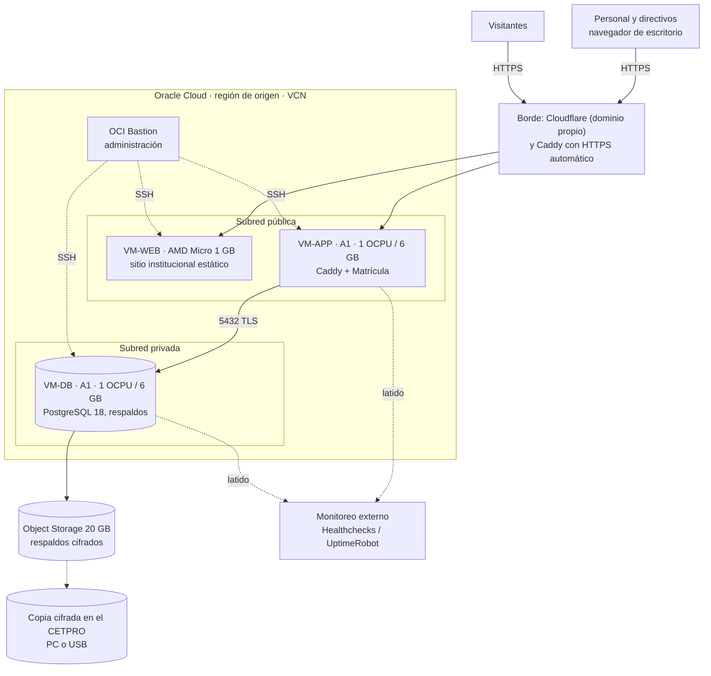

# Despliegue y continuidad en Oracle Cloud (Free Tier)

**Restricción del equipo (20-oct-2026): el proyecto debe ser gratuito.** Este informe responde a D2 (3 VM aisladas) y a cómo evitar el apagado o la pérdida de instancias sin pagar. Mismo criterio de verificación (✔✔ / ✔ / ?).

## 1. Qué dice hoy la documentación oficial de Oracle

| Recurso | Límite Always Free | Verif. |
| :--- | :--- | :---: |
| VM Ampere A1 (Arm) | **1.500 horas OCPU y 9.000 horas GB al mes** = **2 OCPU y 12 GB en total**, en 1 o 2 instancias. (Material antiguo hablaba de 4 OCPU y 24 GB.) | ✔✔ |
| VM AMD Micro (x86) | **2 instancias** de 1/8 OCPU y **1 GB** de RAM. | ✔✔ |
| Almacenamiento en bloque | **200 GB en total** (arranque + datos) y **5 copias de volumen**. Arranque mínimo 47 o 50 GB (la página se contradice): cuatro VM agotan el cupo. | ✔✔ |
| Object Storage | **20 GB** combinados y 50.000 solicitudes al mes (cuenta solo Always Free). | ✔✔ |
| Balanceador, VCN, Bastion | 1 balanceador flexible de 10 Mbps; hasta 2 VCN; **Bastion gratuito**. | ✔ |
| Salida de datos | 10 TB al mes. | ✔ |
| Monitoring, Notifications, Logging, Vault | Figuran entre los servicios gratuitos (por ejemplo, 1.000 correos al mes en Notifications y 10 GB al mes en Logging). Cuotas de Vault no verificadas. | ✔ |
| NAT gateway, IP reservada | **No aparecen** en la página oficial. Verificar en la consola. | ? |
| Región | Los recursos Always Free se crean en la **región de origen** de la cuenta. | ✔ |
| Superar el cupo A1 | Todas las instancias A1 se **deshabilitan y se eliminan a los 30 días**, salvo que se pase a una cuenta de pago. | ✔✔ |
| Tarjeta | Para abrir la cuenta Oracle pide tarjeta de crédito, o débito que funcione como crédito; **no acepta prepago ni de un solo uso**. | ✔ |

**Regiones en Latinoamérica** (no hay región en Perú): Querétaro, São Paulo, Vinhedo, Santiago, Valparaíso y Bogotá. La capacidad de A1 varía y suele fallar al crear la instancia. ✔

## 2. El riesgo: "instancias inactivas"

Texto oficial: *"Idle Always Free compute instances may be reclaimed by Oracle."* Una instancia es **inactiva** si, durante **7 días**, se cumplen **las tres** condiciones:

- CPU: percentil 95 **menor a 20 %**.
- Red: utilización **menor a 20 %**.
- Memoria: utilización **menor a 20 %** (**solo en formas A1**).

Hallazgos que cambian la estrategia:

1. **Basta con superar uno de los tres umbrales** para que no sea "inactiva". La CPU es el más fácil de controlar.
2. **Pay As You Go no figura como exención** en la documentación oficial. La afirmación de que evita el apagado viene de un correo de 2023 citado por terceros. Un comentarista de un foro afirma que su instancia en una cuenta con tarjeta estuvo inactiva sin ser reclamada, lo que no prueba nada.
3. **Con costo cero conviene no pasar a Pay As You Go**: una cuenta que sigue en Free Tier no puede generar cargos, y la exención no está confirmada. Si el equipo consigue una confirmación escrita de Oracle (soporte o foro oficial), se reevalúa.
4. Las AMD Micro **no tienen** el criterio de memoria: casi siempre quedarán "inactivas". **No poner nada crítico en ellas.**

## 3. Estrategia en capas, sin costo

| # | Capa | Medida | Costo | Recomendación |
| :--: | :--- | :--- | :---: | :---: |
| P1 | Prevención | **Script de `keepalive` calibrado** ([anexo](anexos/keepalive/README.md)): una ráfaga de CPU de baja prioridad cada hora, que lleva el p95 de CPU a ~40 %; opcionalmente retener memoria en las A1. Mide el p95 local y avisa si baja. | 0 | **Sí** |
| P2 | Prevención | **Trabajo real programado**: respaldo cifrado, **prueba de restauración** nocturna y escaneos (Trivy). Suma CPU y memoria legítimas. | 0 | **Sí** |
| P3 | Prevención | **Nada crítico en las AMD Micro** (sitio estático, salto o monitoreo). | 0 | **Sí** |
| P4 | Detección | **Latido externo** (Healthchecks.io) enviado por el script; monitoreo de disponibilidad desde fuera de Oracle (UptimeRobot, Healthchecks); alarma de OCI Monitoring con correo por Notifications. | 0 | **Sí** |
| P5 | Recuperación | **Infraestructura como código** (OpenTofu/Terraform + cloud-init) y Compose en Git; imágenes multi-arquitectura; reconstruir en horas. | 0 | **Sí** |
| P6 | Recuperación | **Respaldo cifrado en dos lugares**: Object Storage de Oracle (20 GB) y una copia **en el CETPRO** (PC o USB). Opcional: nube gratuita de terceros, siempre cifrada. | 0 | **Sí** |
| P7 | Recuperación | **Modo degradado en el CETPRO**: el mismo Compose puede levantarse en una PC de la institución con el último respaldo si Oracle falla de forma prolongada. | 0 | Valorar |
| P8 | Higiene | Correo **institucional neutro** y MFA en la cuenta de Oracle; **dos administradores**; registrar la región de origen; no superar 2 OCPU / 12 GB en A1. | 0 | **Sí** |
| P9 | Continuidad | **Modo de contingencia en papel** y carga posterior; capacitación del personal. | 0 | **Sí** |
| P10 | Opcional | Pasar a Pay As You Go **solo** si se confirma que evita la reclamación y con presupuesto y alertas configurados. | 0 si se controla | No por ahora |

### Cómo funciona el `keepalive` y cuánto cuesta

- **Cálculo**: el percentil 95 supera el 20 % si más del 5 % de las muestras (≈ 72 minutos al día) lo supera. Con una ráfaga de **7 minutos al 40 % cada hora** son **168 minutos al día** (≈ 12 %). Margen de más del doble.
- **Coste real**: ~2,8 minutos de un núcleo por hora. Insignificante frente a la capacidad de la VM.
- **Seguridad de la carga**: prioridad mínima, cede ante trabajo real y se omite si la VM ya está ocupada.
- **Verificación**: Metrics Explorer de Oracle (`CpuUtilization[1m].percentile(0.95)`) y el informe local diario.
- **Límites**: no hay garantía de Oracle; el criterio puede cambiar; **no se verificaron** los términos de uso sobre carga artificial. Se mitiga con las capas P4 a P9.

## 4. Topología propuesta (3 VM aisladas)

| VM | Forma | Contenido | Pública | Notas |
| :--- | :--- | :--- | :---: | :--- |
| **VM-WEB** | AMD Micro (1/8 OCPU, 1 GB) | Servidor web mínimo con el sitio institucional **estático**. | Sí | Sin credenciales ni ruta a la BD. Puede ser reclamada: se reconstruye desde Git; opcionalmente con un espejo en un hosting estático gratuito. |
| **VM-APP** | A1, 1 OCPU y 6 GB | Proxy inverso (Caddy), aplicación de matrícula en contenedor y `keepalive`. | Sí | Sin estado: se reconstruye desde imágenes. |
| **VM-DB** | A1, 1 OCPU y 6 GB | PostgreSQL 18, tareas de respaldo y `keepalive`. | **No** | Solo acepta 5432 desde VM-APP; administración por Bastion. |

Disco: tres VM de 50 GB usan 150 de los 200 GB; sobran 50 GB.

**Reglas de red (propuesta)**

| Origen | Destino | Puerto | Estado |
| :--- | :--- | :--- | :--- |
| Internet | VM-WEB y VM-APP | 443 (80 solo para el certificado) | Permitido |
| VM-APP | VM-DB | 5432 | Permitido |
| Bastion | Las tres VM | 22 | Permitido (llave) |
| Cualquier otro | VM-DB | todos | **Denegado** |
| VM-WEB | VM-APP y VM-DB | todos | **Denegado** |

## 5. Lista de verificación de costo cero

| Necesidad | Opción gratuita | Verif. | Observación |
| :--- | :--- | :---: | :--- |
| Cómputo y disco | Oracle Always Free (2 A1, 2 Micro, 200 GB) | ✔✔ | Dentro de los límites. |
| Respaldos | Object Storage 20 GB + copia en el CETPRO | ✔✔ | Cifrar siempre; son datos de estudiantes. |
| **Dominio y DNS** | **Decisión del equipo (20-oct-2026): se comprará un dominio propio y lo asumirá el equipo.** No hay subdominio institucional disponible (Q14). | ? | **Único costo**, fuera del presupuesto del CETPRO. Costo anual y registrador por confirmar (precios de `.pe` y `.com` no verificados). Con dominio propio se habilita **Cloudflare** (DNS gratuito, TLS y Tunnel) como borde; **Caddy** sigue como respaldo si el equipo prefiere no depender de Cloudflare. |
| TLS | Let's Encrypt mediante Caddy | ✔ | Revisar los límites de emisión. |
| Protección del borde | Caddy + NSG de Oracle + límites de tasa en la app + CrowdSec o fail2ban; Cloudflare gratuito si hay dominio | ? | Cuotas de Cloudflare no confirmadas. |
| Monitoreo externo | Healthchecks.io y UptimeRobot (50 monitores, 5 min según fuentes de terceros) | ✔ / ? | Revisar condiciones de uso comercial de UptimeRobot. |
| Alertas | Correo institucional; OCI Notifications (1.000 correos al mes) | ✔ | |
| CI/CD | GitHub Actions y registro de contenedores, con las cuotas gratuitas | ? | Compilar imágenes Arm con `buildx`. |
| Secretos | Variables de entorno cifradas con `sops` y `age`; OCI Vault | ✔ | |
| Escaneo de seguridad | Trivy, gitleaks y OWASP ZAP (código abierto) | ? | |
| Licencias de software | .NET, PostgreSQL, Caddy y Docker (libres) | ✔ | Revisar las condiciones de **QuestPDF** (versión Community) y **ClosedXML**. |
| Correo del sistema | No hace falta en el MVP: sin autorregistro y restablecimiento por el administrador | — | Si se agrega, usar el correo institucional. |

## 6. Dimensionamiento inicial (a validar con mediciones)

| VM | Memoria estimada | Comentario |
| :--- | :--- | :--- |
| VM-APP (6 GB) | Sistema y Docker ~0,5 GB; aplicación .NET ~0,2 a 0,4 GB; proxy < 0,2 GB. Total ~1 GB. | Sobrada. La memoria natural queda **bajo el 20 %** (1,2 GB): por eso conviene `HOLD_MEM_MB` y la ráfaga de CPU. |
| VM-DB (6 GB) | Sistema ~0,4 GB; PostgreSQL con `shared_buffers` de 1 a 1,5 GB. | Buena. |
| VM-WEB (1 GB) | Menos de 200 MB. | Suficiente para contenido estático. |

## 7. Continuidad: objetivos propuestos

| Objetivo | Propuesta | Por validar |
| :--- | :--- | :--- |
| **RPO** | 24 h en general; **4 h en temporada de matrícula** (copias horarias o archivado continuo). | Dirección |
| **RTO** | ≤ 4 h hábiles. | Dirección |
| Disponibilidad | Sin SLA; objetivo ≥ 99 % mensual con reinicio automático. | — |
| Pruebas | Restauración completa **antes de cada despliegue mayor** y cada trimestre. | Equipo |
| Contingencia | Procedimiento en papel y carga posterior. | Dirección |

La ISO/IEC 27002:2022 (control 5.30) indica que RTO y RPO salen de un **análisis de impacto del negocio** y que los planes de continuidad de las TIC deben **probarse**; el control 8.13 pide probar las restauraciones y compararlas con el RTO.

## 8. Alternativas

| Alternativa | Pros | Contras | Veredicto |
| :--- | :--- | :--- | :--- |
| **2 VM** (BD aparte; sitio y matrícula juntos) | Menos piezas. | Un compromiso del sitio público alcanza los secretos de la matrícula. | Mínimo aceptable |
| **3 VM** (esta propuesta) | Aísla por zona de confianza. | Más mantenimiento. | **Recomendada** |
| **Sitio institucional en hosting estático gratuito** (Cloudflare Pages, GitHub Pages u Object Storage) | Sin servidor que reclamar ni parchear. | Se sale de "todo en Oracle". | Valorar, o como espejo |
| **Instancia de pago** | Elimina el riesgo de esa VM. | **Costo**, contra la restricción. | Descartada |
| **Autonomous Database de Oracle** | Gestionada. | Es Oracle DB, no PostgreSQL. | Descartada |

## 9. Recomendaciones de la guía de nube de la PCM aplicadas

Las recomienda la guía de la SeGDi (Res. 001-2018-PCM/SEGDI), que es **orientadora y no obligatoria**, pero conviene seguirlas porque la responsabilidad final es de la entidad.

| Recomendación de la guía | Cómo se aplica aquí |
| :--- | :--- |
| **Cifrar antes de enviar** y que la entidad custodie las claves | Los respaldos se cifran en la VM-DB con una clave que **guarda el CETPRO** (no se deja en la nube en claro). |
| **No gestionar altas y bajas de usuarios en la nube** | Es una recomendación que el diseño **no cumple** (Identity vive en la app). Se mitiga con administración restringida, MFA y revisión semestral de privilegios. Se documenta como riesgo aceptado. |
| **Registros de actividad preferentemente en la propia entidad** | **Copia periódica cifrada de la bitácora** en el CETPRO (además de la retención en Oracle). |
| Proveedor con **ISO 27001, 27017 y 27018** o equivalente | **Pendiente verificar** las certificaciones de Oracle en su portal de cumplimiento. |
| La entidad **elige la localización** de los datos | Región de origen elegida y documentada; **comunicar el flujo transfronterizo** (art. 21.2 del reglamento). |
| Contratos con acuerdo de nivel de servicio | **No aplica al Free Tier** (sin SLA). Se compensa con respaldo, RPO y RTO. |
| **Documentar el uso aceptable** del servicio | Política de uso aceptable breve para el personal. |
| Informar a la SeGDi del uso de nube (trimestral) | **Consultar a la UGEL** si el CETPRO está en alcance. |

## Fuentes

- Lineamientos para el uso de servicios en la nube (PCM, Res. SeGDi 001-2018-PCM/SEGDI), textos aportados por el equipo.
- [Always Free Resources (Oracle)](https://docs.oracle.com/en-us/iaas/Content/FreeTier/freetier_topic-Always_Free_Resources.htm), [versión alternativa](https://docs.oracle.com/en-us/iaas/Content/FreeTier/resourceref.htm), [Free Tier (Oracle)](https://docs.oracle.com/iaas/Content/FreeTier/freetier.htm), [Regiones de Oracle](https://www.oracle.com/es/cloud/architecture-and-regions/).
- [Instancias inactivas: nota de terceros](https://blog.51sec.org/2023/02/oracle-cloud-cleaning-up-idle-compute.html) y [comentarios en Hacker News](https://news.ycombinator.com/item?id=36010572) (no oficiales).
- [Límites de emisión de Let's Encrypt](https://letsencrypt.org/docs/rate-limits/).
- ISO/IEC 27002:2022 (texto en español aportado por el equipo): controles 5.23, 5.29, 5.30, 8.13 y 8.15.
