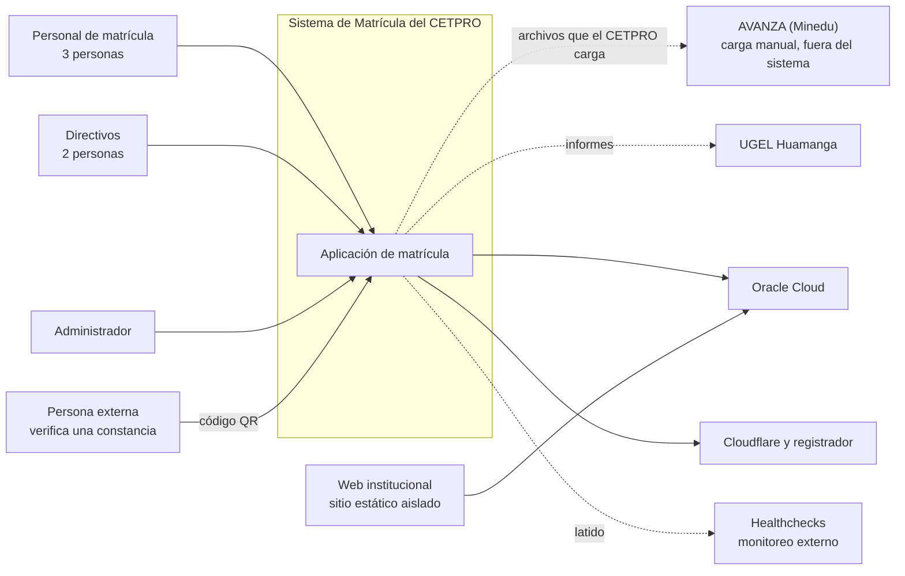

# Necesidad del negocio

## 1. Contexto y problema

El CETPRO público "Joaquín López Antay" (Ayacucho, UGEL Huamanga) matricula a sus estudiantes de forma **presencial y en una ficha impresa**; luego el personal **vuelve a digitar** los mismos datos en AVANZA, el sistema del Minedu donde el CETPRO registra su información académica. La entrevista al personal administrativo y a la Dirección lo resume así: «se matriculan en formato impreso que luego se llena de manera escrita al sistema AVANZA».

**Problema central:** el CETPRO no tiene un registro propio, estructurado y consultable de sus estudiantes y matrículas. El doble registro genera demoras y riesgo de error, no hay emisión automática de constancias y no existe un Reglamento Institucional que formalice las reglas (edad mínima, plazos, cupos, becas).

**Qué cambia con el sistema.** El estudiante se registra **una sola vez** en el sistema; a partir de ese registro se generan automáticamente la constancia de estudios, la nómina de matriculados, el registro de matrícula (Anexo 1) y los archivos en el formato de las plantillas de AVANZA. El sistema **no reemplaza ni se integra con AVANZA**: AVANZA no ofrece API, así que su carga sigue siendo manual y queda a cargo del CETPRO (ver sección 3).

**Dos sistemas aislados.** Además de la matrícula, el equipo desarrolla la **web institucional** (sitio estático). Son independientes: la web no tiene ninguna ruta hacia la base de datos de matrícula (RC-04, AD-14).

**Un proyecto con restricciones fuertes.** Es un servicio social de la UNSCH, con un equipo estudiantil pequeño, **costo cero** (salvo el dominio, que asume el equipo), sobre Oracle Cloud Free Tier y desarrollado con **Spec-Driven Development asistido por IA** (RC-01, RC-02, RC-05, RC-07).

## 2. Objetivos del negocio

| ID | Objetivo | Justificación |
| :--- | :--- | :--- |
| **OB-01** | Eliminar el doble registro: matricular una sola vez y generar los archivos de apoyo para AVANZA. | Es el cuello de botella descrito en la entrevista. |
| **OB-02** | Tener un registro propio, centralizado y estructurado de estudiantes, matrículas y catálogo académico. | Hoy no existe y todo depende de la ficha en papel. |
| **OB-03** | Emitir de forma automática y verificable la constancia de estudios, la nómina y el registro de matrícula (Anexo 1). | Reduce trabajo y evita la falsificación de constancias. |
| **OB-04** | Cumplir las obligaciones y los plazos del Registro de Matrícula (LAG, DL 1375), en especial el registro en AVANZA dentro del mes del inicio del periodo. | Reportar tarde es infracción grave para el CETPRO. |
| **OB-05** | Dar acceso diferenciado por rol, respetando la forma de trabajo y las atribuciones actuales del CETPRO. | El Directivo solo consulta; el Personal de matrícula opera. |
| **OB-06** | Proteger los datos personales de los estudiantes (parte menores de edad) y dejar trazabilidad de todo acceso y cambio. | Ley 29733 y DS 016-2024-JUS; el CETPRO es entidad pública. |
| **OB-07** | Operar a costo cero y con una continuidad razonable pese a la falta de SLA de Oracle Free Tier. | Restricción del proyecto. |
| **OB-08** | Ofrecer una experiencia simple, accesible y rápida a personal sin formación técnica, que registra con la persona delante. | La tarea más frecuente es registrar una matrícula. |
| **OB-09** | Permitir que el CETPRO ajuste las reglas no formalizadas sin depender del equipo ni de un despliegue. | No existe un Reglamento Institucional. |
| **OB-10** | Construir el sistema con documentación como fuente de verdad (SDD) y sin exponer datos reales a herramientas de IA. | Mantenibilidad del equipo estudiantil y privacidad. |

## 3. Alcance y límites

El sistema cubre únicamente el **Registro de Matrícula** (DL 1375, art. 45-C), en modalidad presencial y para uso en computadoras de escritorio.

| Frontera | Dentro del sistema | Fuera del sistema |
| :--- | :--- | :--- |
| **AVANZA** | Generar los archivos de apoyo (Excel con el formato de sus plantillas y Anexo 1 en PDF). | **La carga en AVANZA**, sus credenciales y quién la realiza. AVANZA **no ofrece API**: es un límite del proyecto. |
| **Notas, certificados y títulos** | — | Todo el Registro de Notas y de Certificados Modulares. |
| **RENIEC** | Capturar nombres y apellidos tal como figuran en el documento. | La validación (la hace AVANZA al cargar). |
| **Cobros** | Registrar el derecho de inscripción (monto, beca, comprobante). | Cobrar, pasarelas de pago, comprobantes electrónicos. |
| **Comunicaciones** | Alertas y recordatorios dentro del sistema. | Correo, WhatsApp, SMS. |
| **Firma digital** | Código único y verificación por QR de la constancia. | Firma digital de documentos. |
| **Dispositivos y modalidades** | Escritorio y modalidad presencial. | Móviles, semipresencial y a distancia. |
| **Docentes y horarios** | Docente como dato informativo de la oferta. | Horarios, asistencia y planillas. |
| **Web institucional** | Sistema 2, aislado, sin acceso a la base de matrícula. | Cualquier integración con la matrícula. |
| **Procesos en papel** | Documentos imprimibles (ficha, constancia). | Firmas, archivo físico y otros trámites; el sistema no los impone. |

**Regla para el desarrollo:** lo de la columna «Fuera» no se especifica ni se implementa mientras no cambie antes el ERS. Esta tabla forma parte del contexto obligatorio de `AGENTS.md`.

## 4. Actores

| Actor | Rol | Qué necesita realizar |
| :--- | :--- | :--- |
| **Personal de matrícula** (3 personas) | Opera el sistema a diario. | Registrar, editar, anular y consultar matrículas; ratificar; licencias y convalidaciones; emitir constancias; generar nómina, Anexo 1 y archivos para AVANZA. |
| **Directivo** (2 personas, incluida la Dirección) | Supervisa; solo consulta. | Ver reportes y nóminas, la bitácora, y responder solicitudes de derechos; aprobar el informe de privilegios. Sin editar matrículas. |
| **Administrador** *(propuesta; por ahora el equipo desarrollador, luego la Dirección)* | Tareas técnicas. | Usuarios, parámetros, respaldos; sin acceso a datos de estudiantes por defecto. |
| **Persona externa** | Verifica un documento. | Comprobar una constancia por su código QR (respuesta mínima). |
| **Estudiante** *(titular de los datos, no usa el sistema)* | Se matricula en el mostrador. | Ejercer sus derechos sobre sus datos (información, acceso, rectificación, cancelación, oposición). |
| **AVANZA (Minedu)** *(externo)* | Destino del registro oficial. | Recibe la carga manual del CETPRO; no se conecta con el sistema. |
| **UGEL Huamanga / DRE Ayacucho** *(externo)* | Supervisa al CETPRO. | Recibe informes cuando corresponda. |
| **Oracle Cloud, Cloudflare, Healthchecks** *(externos)* | Infraestructura. | Alojar, proteger y vigilar el servicio. |
| **Actor malicioso** *(modelo)* | Abusa del sistema. | Sirve para modelar amenazas (ver [modelo de amenazas](../05-seguridad/01-modelo-de-amenazas.md)). |

## 5. Necesidades del negocio

Prioridad: **Alta** (núcleo del problema), **Media**, **Baja** (puede diferirse).

| ID | Actor | Necesidad | Prioridad | Justificación |
| :--- | :--- | :--- | :---: | :--- |
| **NN-01** | Personal de matrícula | Registrar la matrícula de un estudiante una sola vez, con los datos que AVANZA exige y con las validaciones de la LAG (edad, matrícula única, requisito del ciclo Técnico). | Alta | OB-01, OB-04. Es el cuello de botella actual. |
| **NN-02** | Personal de matrícula | Emitir la constancia de estudios en PDF, con código verificable. | Alta | OB-03. La entrevista pide la constancia en PDF. |
| **NN-03** | Personal de matrícula y Directivo | Obtener la nómina de matriculados y el registro de matrícula (Anexo 1), por programa, módulo, periodo y turno. | Alta | OB-03. Los reportes se hacen por módulo. |
| **NN-04** | Personal de matrícula | Generar archivos con el formato de las plantillas de AVANZA y saber qué datos faltan antes de cargarlos. | Alta | OB-01. AVANZA no admite celdas vacías; la carga es externa. |
| **NN-05** | Personal de matrícula | Mantener el catálogo: programas, planes con su resolución, módulos, unidades, periodos, ofertas y docentes. | Alta | Sin catálogo no hay matrícula; AVANZA exige el orden plan, módulos, unidades, estudiantes. |
| **NN-06** | Dirección | Controlar quién accede a qué (roles y permisos) y que el Directivo solo consulte. | Alta | OB-05. Respeta las atribuciones del CETPRO. |
| **NN-07** | Personal de matrícula | Gestionar reingresos, traslados, licencia de estudios, reincorporación y convalidación según la LAG. | Media | La entrevista: se matricula en el programa de procedencia si el plan coincide. |
| **NN-08** | Personal de matrícula | Registrar convenios, becas o exoneraciones y el derecho de inscripción sin guardar evidencia de ingresos. | Media | Convenios con descuento de hasta 50 %. |
| **NN-09** | Personal de matrícula | Ratificar la matrícula en cada periodo académico sin volver a capturar los datos. | Media | LAG 11.2.2. |
| **NN-10** | Personal de matrícula, Directivo, Administrador | Recibir alertas de los plazos y obligaciones (registro en AVANZA dentro del mes, licencias por vencer, derechos de los titulares, privilegios, respaldo). | Alta | OB-04. Reportar tarde es infracción grave. |
| **NN-11** | Dirección | Proteger los datos personales y dejar trazabilidad: bitácora, aviso de privacidad, solicitudes de derechos, incidentes. | Alta | OB-06. Obligación legal de una entidad pública. |
| **NN-12** | Dirección y Administrador | Cambiar reglas no formalizadas (edad mínima, plazos, cupo, tope de beca, alertas) sin desplegar. | Alta | OB-09. No existe un Reglamento Institucional. |
| **NN-13** | Equipo y Dirección | Operar sin costo recurrente y con respaldo y recuperación probados. | Alta | OB-07. Restricción del proyecto. |
| **NN-14** | Persona externa | Comprobar que una constancia es auténtica. | Media | OB-03. Riesgo de falsificación. |
| **NN-15** | Todos los usuarios | Usar el sistema con comodidad en escritorio, con teclado, sin formación técnica y sin perder lo escrito. | Alta | OB-08. |
| **NN-16** | Equipo desarrollador | Mantener el sistema con SDD asistido por IA, con la documentación como fuente de verdad y sin datos reales en las herramientas. | Alta | OB-10. |

## 6. Diagrama de contexto

## 7. Referencias

- Plantilla de entrevista aplicada al personal administrativo y a la Dirección del CETPRO (2026).
- DL 1375 (2018) y RVM 188-2020-MINEDU, Lineamientos Académicos Generales (LAG).
- Ley 29733 y DS 016-2024-JUS; ver el [marco legal](03-marco-legal.md).
- Manual de usuario de AVANZA, módulo de Registro de Datos de CETPRO, v3.5 (octubre 2025).
- Documento de Análisis (ERS) v1.1 y Documento de Arquitectura v0.4, líneas base de esta carpeta.
