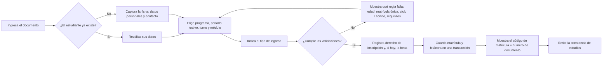
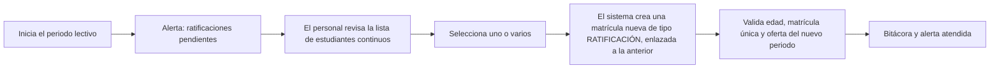
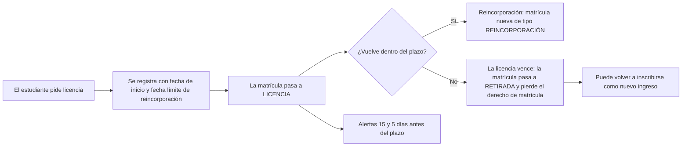
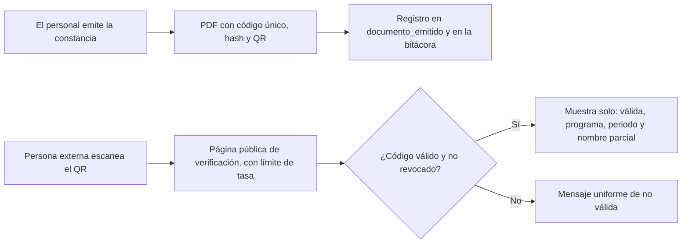
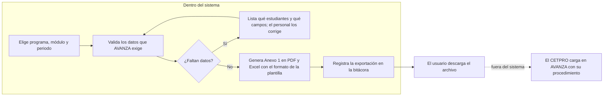
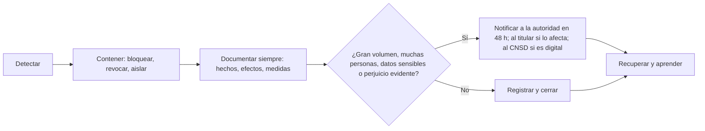

# Procesos de negocio

Resumen de los procesos principales de punta a punta, con los actores, los casos de uso del ERS y las specs que los implementan. El detalle de comportamiento vive en cada spec; aquí se ve el recorrido completo y **dónde termina el sistema**.

## 1. Casos de uso

Actores: Personal de matrícula, Directivo, Administrador y Persona externa.

| Cód. | Caso de uso | Actor principal | Est. | Spec |
| :--- | :--- | :--- | :---: | :--- |
| CU-01 | Registrar matrícula de estudiante | Personal de matrícula | M | `estudiantes`, `matricula-registro` |
| CU-02 | Registrar o editar programa de estudios | Personal de matrícula | M | `catalogo-academico` |
| CU-03 | Registrar módulo formativo y unidades didácticas | Personal de matrícula | M | `catalogo-academico` |
| CU-04 | ~~Registrar notas~~ | — | R | — |
| CU-05 | Emitir constancia de estudios | Personal de matrícula | M | `docs-constancia` |
| CU-06 | Generar nómina de matriculados | Personal de matrícula y Directivo | M | `docs-reportes` |
| CU-07 | ~~Reporte de notas~~ | — | R | — |
| CU-08 | Autenticarse en el sistema | Todos | M | `identidad-seguridad` |
| CU-09 | Ratificar matrícula | Personal de matrícula | N | `matricula-ratificacion-licencia` |
| CU-10 | Registrar licencia de estudios | Personal de matrícula | N | `matricula-ratificacion-licencia` |
| CU-11 | Reincorporar a un estudiante | Personal de matrícula | N | `matricula-ratificacion-licencia` |
| CU-12 | Registrar convalidación | Personal de matrícula | N | `matricula-convalidacion` |
| CU-13 | Generar registro de matrícula (Anexo 1) y archivos para AVANZA | Personal de matrícula y Directivo | N | `docs-reportes`, `docs-archivos-avanza` |
| CU-14 | Verificar una constancia | Persona externa | N | `docs-constancia` |
| CU-15 | Administrar usuarios y permisos | Administrador | N | `identidad-seguridad` |
| CU-16 | Administrar parámetros institucionales | Administrador | N | `parametros-institucionales` |
| CU-17 | Atender una alerta | Según rol | N | `transversal-alertas` |
| CU-18 | Atender una solicitud de derechos | Directivo | N | `cumplimiento-privacidad` |
| CU-19 | Registrar un incidente de seguridad | Directivo y Administrador | N | `cumplimiento-privacidad` |
| CU-20 | Revisar la bitácora y los privilegios | Directivo y Administrador | N | `transversal-auditoria`, `identidad-seguridad` |

## 2. Registrar una matrícula (CU-01)

**Actor:** Personal de matrícula. **Precondición:** sesión con segundo factor; la oferta y el módulo están activos. **Specs:** `estudiantes`, `matricula-registro`, `docs-constancia`.

| Flujo alternativo | Qué ocurre |
| :--- | :--- |
| **A1** Reincorporado o trasladado | Se registra la convalidación antes de confirmar (CU-12). |
| **A2** Faltan datos que AVANZA exige | Se permite guardar y el sistema **alerta** los faltantes. |
| **A3** Se corta la conexión | Se conserva el borrador (RF-42). |
| **A4** Ya existe matrícula vigente en ese programa y periodo | Se rechaza (RN-13). |

**Puntos de control:** la edad se valida con el parámetro vigente y se guarda el valor aplicado (RN-01); el ciclo Técnico exige primaria completa (RN-14); el código lo fija la base de datos (RN-09); cada acto se registra en la bitácora (RF-34).

## 3. Ratificación de la matrícula (CU-09)

Cada 18 semanas (un periodo académico) los estudiantes continuos ratifican su matrícula (RN-10).

**Spec:** `matricula-ratificacion-licencia`.

## 4. Licencia de estudios y reincorporación (CU-10 y CU-11)

El plazo de reserva (`plazo_reserva_licencia_dias`) está **por definir con la Dirección** (P-04): mientras no tenga valor, el sistema no inventa uno. La reincorporación crea una matrícula nueva; la anterior permanece en LICENCIA (estado final) y la licencia pasa a REINCORPORADO.

## 5. Convalidación (CU-12)

Para reincorporados, trasladados o que se retiraron antes (RN-05, RN-12).

| Paso | Quién | Resultado |
| :---: | :--- | :--- |
| 1 | Personal de matrícula | Elige el tipo: aprendizajes previos, entre planes, por unidades de competencia o con Educación Básica. |
| 2 | Personal de matrícula | Registra la **resolución directoral**, la justificación y la ruta formativa complementaria. |
| 3 | Sistema | Entre planes, valida que cada unidad tenga **≥ 80 % de similitud** (parámetro). |
| 4 | Sistema | Registra las unidades convalidadas como excepciones de la matrícula y deja la bitácora. |

La resolución directoral **la emite la Dirección fuera del sistema**; el sistema registra sus datos.

## 6. Constancia de estudios y verificación (CU-05 y CU-14)

## 7. Nómina, Anexo 1 y archivos para AVANZA (CU-06 y CU-13)

**El sistema nunca carga en AVANZA, no guarda credenciales de AVANZA y no impone quién carga.** Solo prepara los archivos y alerta el plazo (RN-16). El orden en AVANZA (plan, módulos, unidades, estudiantes) se muestra como lista **informativa**. La plantilla de estudiantes de AVANZA se descarga con el periodo lectivo y el programa elegidos, así que el archivo se genera por esa combinación; si supera el máximo de filas que admite AVANZA (500 está documentado para notas; por verificar para estudiantes), se divide en partes.

## 8. Solicitud de derechos de los titulares (CU-18)

| Paso | Quién | Resultado |
| :---: | :--- | :--- |
| 1 | Personal de matrícula | Registra la solicitud con constancia de recepción; el sistema calcula la fecha límite (información 8, acceso 20, rectificación/cancelación/oposición 10 días hábiles, contados desde el día siguiente). Si la solicitud llega al equipo técnico, este la traslada al CETPRO en un máximo de 3 días (DS art. 66.4). |
| 2 | Sistema | Alerta a la mitad del plazo y 2 días antes. |
| 3 | Directivo | Responde dentro del plazo (ampliable una sola vez por igual plazo, con justificación, **salvo el derecho de información**: DS art. 71.1). |
| 4 | Sistema | Registra la respuesta, quién la dio y cuándo; todo en la bitácora. |

## 9. Incidente de seguridad (CU-19)

## 10. Acceso, parámetros y revisión de privilegios (CU-08, CU-15, CU-16, CU-20)

| Proceso | Pasos |
| :--- | :--- |
| **Ingreso** | Usuario y contraseña individuales, más código TOTP; la pantalla muestra el último ingreso y los intentos fallidos desde entonces; bloqueo temporal tras 5 fallos. |
| **Alta y baja** | El Administrador crea la cuenta, entrega una contraseña temporal y registra el segundo factor; desactiva (no borra) al salir la persona. |
| **Parámetros** | El Administrador edita un valor; queda versionado con vigencia y el Directivo recibe un aviso del cambio. Cada acto guarda el valor aplicado. |
| **Revisión semestral** | A los 6 meses se genera el informe de privilegios; el Directivo lo aprueba; la alerta avisa a Administrador y Directivo. |

## 11. Alertas (CU-17)

Ciclo **Activa → Atendida o Descartada**, con quién y cuándo. Las alertas y sus destinatarios iniciales están en [actores y permisos](05-actores-y-permisos.md) y se parametrizan (qué alertas, con cuánta anticipación y a qué roles). El sistema no sabe si algo se cargó en AVANZA: la alerta se **atiende o se descarta a mano**.

| Alerta | Cuándo salta (valor inicial) | Destinatarios iniciales |
| :--- | :--- | :--- |
| Plazo de registro de la matrícula | 7 y 2 días antes de cumplirse un mes del inicio del periodo | Personal de matrícula y Directivo |
| Datos faltantes para exportar | Al generar el archivo y al cerrar el periodo | Personal de matrícula |
| Ratificaciones pendientes | Al iniciar el periodo | Personal de matrícula y Directivo |
| Licencia por vencer | 15 y 5 días antes del plazo de reserva | Personal de matrícula |
| Solicitud de derechos con plazo | A la mitad y 2 días antes | Directivo |
| Revisión semestral de privilegios | Cada 6 meses | Administrador y Directivo |
| Seguridad (ingresos fallidos masivos, cuenta bloqueada, exportaciones inusuales) | Por umbral | Administrador y Directivo |
| Respaldo fallido o restauración vencida | Al fallar o a los 90 días sin prueba | Administrador |
| Parámetro crítico modificado | Al cambiar la edad mínima, un plazo o un tope | Directivo |
| Retención: datos por depurar | 30 días antes | Administrador y Directivo |

## 12. Contingencia sin Internet o con Oracle caído

| Situación | Procedimiento |
| :--- | :--- |
| El CETPRO pierde Internet | Se matricula en papel con la **ficha oficial** y se carga después; el borrador se conserva si la caída es corta. |
| Oracle reclama o apaga una VM | `keepalive`, respaldo y reconstrucción desde Git y el respaldo cifrado (RTO ≤ 4 h). |
| Pérdida prolongada de Oracle | Opcional: levantar el mismo Compose en una PC del CETPRO con el último respaldo. |

Detalle en [despliegue](../02-arquitectura-de-software/05-despliegue.md) y [operación segura](../05-seguridad/07-operacion-segura.md).
