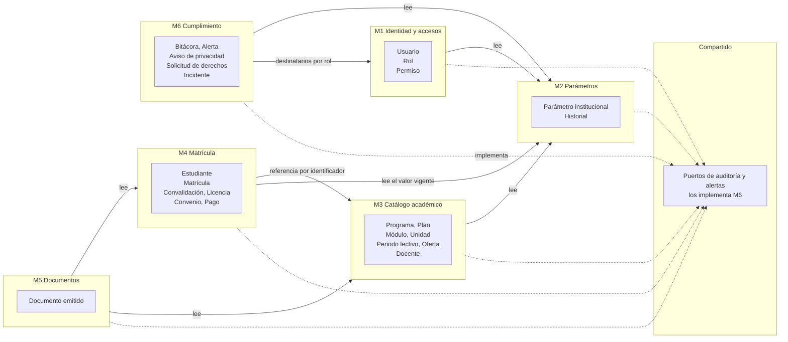
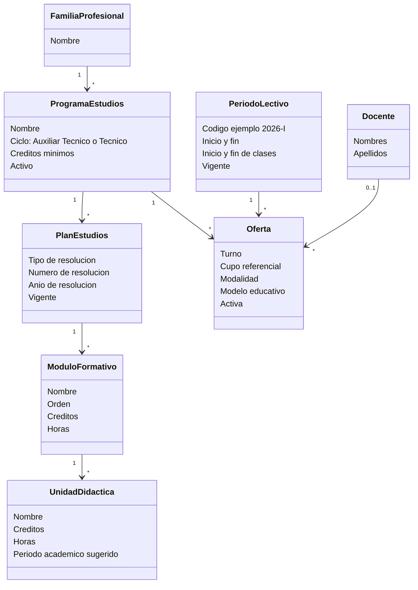
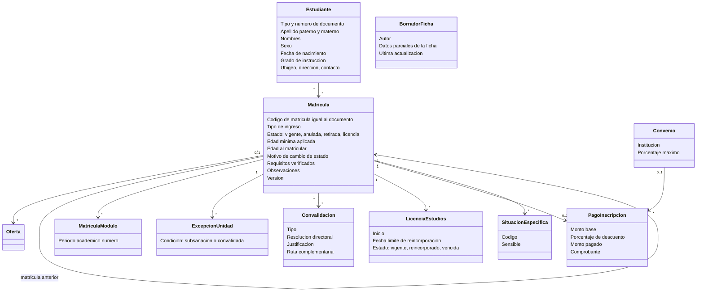
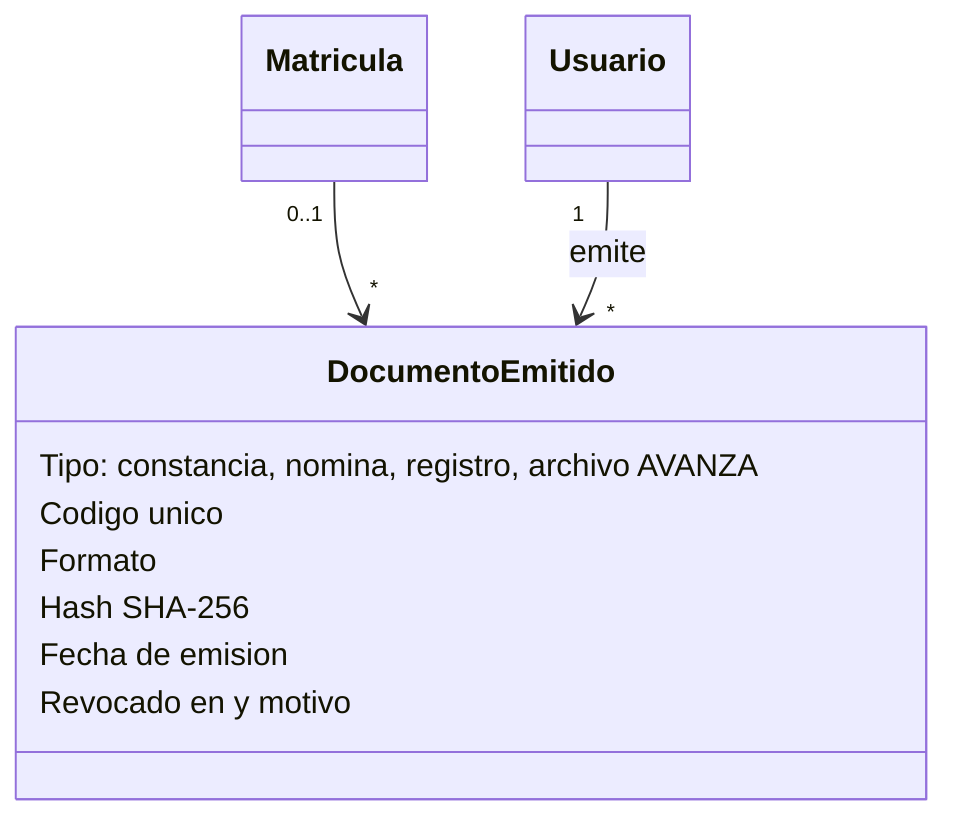
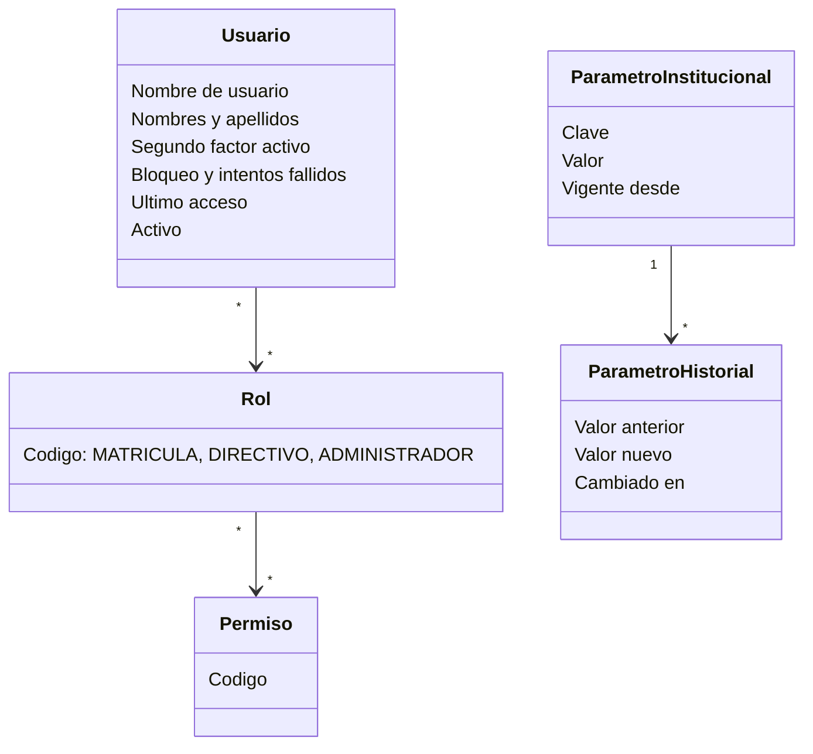
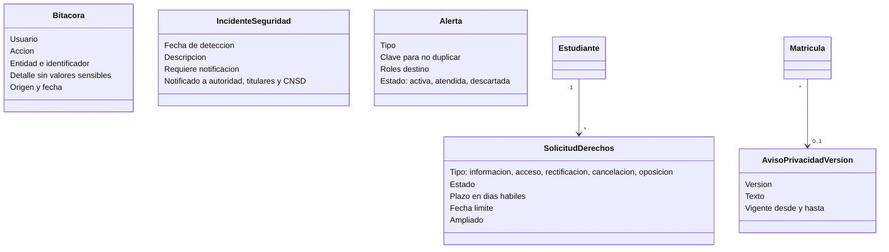

# Modelo de dominio

Describe las entidades del negocio, sus relaciones y sus invariantes, con el lenguaje del [glosario](../glossary.md). No es el modelo de datos: la estructura de tablas se define en el [diseño](../03-diseno-de-software/05-modelo-de-datos.md). Se agrupa por contexto, es decir, por el módulo (M1 a M6) que es dueño de cada concepto.

## 1. Contextos y fronteras

Un módulo **no usa las entidades de otro**: se comunican por contratos de la capa de Aplicación (AD-01). Las dependencias hacia M6 pasan por los puertos de auditoría y alertas del kernel compartido (`Compartido`): así M1 a M5 no dependen de M6 y no hay ciclos entre módulos; la única dependencia de M6 hacia otro módulo es la consulta de destinatarios por rol (M6 → M1). La base de datos es una sola, pero cada módulo es dueño de sus tablas y las reglas críticas viven en el dominio **y** en PostgreSQL (doble defensa).

## 2. Catálogo académico (M3)

**Invariantes**

1. Un programa del ciclo Auxiliar Técnico tiene al menos 40 créditos; uno del ciclo Técnico, al menos 80 (RN-03).
2. El plan guarda la **resolución de autorización** (tipo, número y año) antes de registrar módulos, como exige AVANZA.
3. Hay **un solo periodo lectivo vigente** a la vez.
4. Una oferta es única por programa, periodo lectivo y turno. El **cupo referencial no es un límite** (RN-04).
5. Las unidades didácticas se **derivan del módulo**; solo se registran sus excepciones (subsanación o convalidada).
6. No se borra el catálogo: se **desactiva** (RN-03).

## 3. Matrícula (M4)

**Invariantes**

1. **El código de matrícula es el número de documento** del estudiante (RN-09) y lo fija la base de datos.
2. El estudiante debe tener la **edad mínima vigente** al matricularse; la matrícula guarda el valor aplicado y la edad (RN-01).
3. **Una sola matrícula VIGENTE** por estudiante, programa y periodo lectivo (RN-13); lo garantiza un índice único parcial.
4. El **ciclo Técnico** exige que el grado de instrucción cumpla primaria completa (RN-14).
5. **Anular exige motivo** y es un estado, nunca un borrado (RN-15). Transiciones válidas: `VIGENTE → ANULADA | RETIRADA | LICENCIA` y `LICENCIA → RETIRADA`.
6. El estudiante, la oferta, el código y la edad aplicada **no cambian** una vez registrada la matrícula; se anula y se registra una nueva.
7. Los módulos de la matrícula pertenecen al programa de su oferta.
8. El **descuento** del pago no excede el tope del parámetro ni el máximo del convenio, y `monto_pagado = monto_base × (1 − descuento)` (RN-06).
9. La **convalidación entre planes** exige la similitud mínima del parámetro (RN-12).
10. Una **ratificación** o **reincorporación** crea una matrícula nueva enlazada a la anterior (RN-10, RN-11).
11. Registrar una licencia pasa la matrícula a `LICENCIA`; solo puede haber una licencia vigente por matrícula (RN-11).
12. Nunca se guarda copia del DNI, evidencia de ingresos ni documentos de discapacidad (RN-17). La situación específica es un catálogo restringido.
13. Los **requisitos verificados** (RF-43) registran cuáles de la lista configurable se verificaron y cuándo, nunca los documentos.
14. Un **borrador de la ficha** (RF-42) guarda datos parciales de quien la llena: solo su autor y el Personal de matrícula lo ven, se elimina al confirmar la matrícula o al vencer (vigencia por definir, parámetro) y sus valores nunca van a la bitácora. Es el único lugar donde viven datos personales sin matrícula confirmada.
15. Tras una reincorporación, la matrícula anterior **permanece en `LICENCIA`** y la licencia pasa a `REINCORPORADO`; solo la matrícula nueva está vigente.

## 4. Documentos (M5)

**Invariantes:** la constancia lleva código único y *hash*; una constancia revocada exige motivo (quién puede revocar lo define la spec `docs-constancia`; propuesta: el Personal de matrícula); toda exportación (nómina, Anexo 1, archivo para AVANZA) queda en la bitácora. Las celdas de Excel se **sanean** (sin fórmulas inyectadas).

## 5. Identidad y parámetros (M1 y M2)

**Invariantes**

1. No hay autorregistro; las altas las hace el Administrador. Un usuario desactivado conserva su historial pero no ingresa.
2. Todo el personal tiene segundo factor (RN-07).
3. Un parámetro con valor `null` está **por definir**: leerlo es un error explícito, nunca un valor inventado.
4. Cada cambio de parámetro conserva el valor anterior, el nuevo, la fecha y el usuario (RF-32).

## 6. Cumplimiento (M6)

**Invariantes**

1. La **bitácora es de solo inserción**: no se actualiza ni se borra, salvo la depuración autorizada por retención (≥ 2 años). Nunca guarda contraseñas ni valores sensibles, solo nombres de columnas e identificadores (RNF-12).
2. Una solicitud de derechos tiene fecha límite calculada por tipo (8, 20 o 10 días hábiles) y es ampliable una sola vez, salvo la de información (DS art. 71.1).
3. Un incidente se documenta siempre; la notificación a la autoridad solo se registra si el incidente la exige (DS art. 34).
4. No puede haber dos alertas **activas** con la misma clave; una alerta cerrada exige fecha de atención.
5. El aviso de privacidad es **versionado**; la matrícula guarda la versión con la que se informó al estudiante.

## 7. Relación con los requisitos

| Concepto | Requisitos |
| :--- | :--- |
| Programa, plan, módulo, unidad, periodo, oferta, docente | RF-09, RF-10, RF-11, RF-24, RF-25; RN-03, RN-04 |
| Estudiante y situación específica | RF-01, RF-40, RF-41; RN-02, RN-09, RN-17 |
| Matrícula y estados | RF-01 a RF-04, RF-08, RF-21; RN-01, RN-10, RN-13 a RN-15 |
| Licencia y reincorporación | RF-22, RF-23; RN-11 |
| Borrador de la ficha y requisitos verificados | RF-42, RF-43 |
| Convalidación | RF-05; RN-05, RN-12 |
| Convenio y pago de inscripción | RF-06, RF-07; RN-06 |
| Documento emitido | RF-16, RF-17, RF-26, RF-27, RF-28 |
| Usuario, rol, permiso | RF-19, RF-20, RF-29, RF-39; RN-07 |
| Parámetro institucional | RF-32; RNF-11 |
| Bitácora, aviso, solicitudes, incidentes, alertas | RF-33 a RF-38; RNF-12; RNF-LEG-01 a RNF-LEG-11 |
