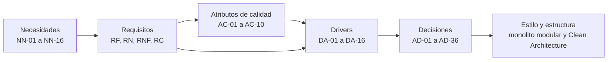

# Drivers arquitectónicos

Un **driver arquitectónico** es un requisito, atributo de calidad o restricción que condiciona de forma significativa la estructura del sistema. Se seleccionaron los que, si cambiaran, obligarían a cambiar la arquitectura.

## 1. Cadena de derivación

## 2. Drivers

| ID | Driver arquitectónico | Tipo | Origen | ¿Por qué influye en la arquitectura? | Decisiones |
| :--- | :--- | :--- | :--- | :--- | :--- |
| **DA-01** | Cumplir el reglamento de datos personales como **entidad pública** (ODP, registro, transferencia, incidentes, bitácora, respaldos). | Legal | DS 016-2024-JUS arts. 21, 34 a 52 | Módulo de cumplimiento, bitácora de lecturas, retención, puertas de salida a producción. | AD-10, AD-12, AD-29, AD-31 |
| **DA-02** | El **registro de matrícula** sigue la LAG y se carga en **AVANZA** (por periodo lectivo, programa, módulo y periodo académico; DNI validado con RENIEC; sin celdas vacías; reportar tarde es infracción grave). | Negocio y legal | LAG 11 y 17; Anexo 1; manual de AVANZA v3.5 | Modelo con periodo de 18 semanas, ratificación, licencia, código = documento y módulo en la matrícula; exportación a las plantillas con validación previa y alerta de plazo. | AD-03, AD-18 a AD-26, AD-28, AD-30, AD-32 |
| **DA-03** | **Reglas sin formalizar** (edad, plazos, cupos, requisitos). | Negocio | Entrevista; no hay Reglamento | Parámetros versionados; reglas en el dominio, no en el código. | AD-19, AD-27 |
| **DA-04** | **Costo cero** y recursos limitados. | Restricción | RC-01, RC-02 | Monolito, pocas piezas, imágenes multi-arquitectura, presupuesto de memoria. | AD-01, AD-02, AD-07, AD-15 |
| **DA-05** | **Riesgo de reclamación** de instancias y falta de SLA. | Calidad | Despliegue | `keepalive`, detección externa, infraestructura como código, respaldos fuera de Oracle. | AD-06, AD-08, AD-09 |
| **DA-06** | **Exposición a Internet** de datos de adolescentes (y de discapacidad). | Calidad | DS arts. 22, 34, 46 | Zonas aisladas, MFA, bitácora, cifrado, cabeceras. | AD-04, AD-05, AD-06, AD-11, AD-13, AD-17, AD-29 |
| **DA-07** | **Aislar** el sitio institucional de la matrícula y de la BD. | Seguridad | RC-04 | Tres VM y redes distintas. | AD-05, AD-14 |
| **DA-08** | **Pocos usuarios no técnicos**, solo escritorio. | Calidad | RNF-03, RNF-04, RNF-07 | Interfaz simple renderizada en servidor; sin SPA. | AD-02 |
| **DA-09** | **Dependencia de Internet** del CETPRO. | Riesgo | RNF-02, RNF-08 | Contingencia en papel, borradores guardados, copia local cifrada. | AD-08 |
| **DA-10** | **Trazabilidad** de todo cambio y consulta. | Legal | RF-08; DS art. 46 | Bitácora de solo inserción en la aplicación y la BD. | AD-03, AD-12 |
| **DA-11** | Plataformas **Arm64 y x86**. | Restricción | Oracle | Imágenes multi-arquitectura. | AD-07 |
| **DA-12** | **Entrega y mantenimiento** por equipo estudiantil. | Negocio | RC-05 | Documentación como código, pruebas de arquitectura, despliegue reproducible. | AD-01, AD-07 |
| **DA-13** | **Plazos legales y de reporte** (registro de matrícula, reincorporación, derechos, revisión de privilegios). | Legal y negocio | LAG 11.4 y 17.1; DS arts. 46 y 69 | Módulo de **alertas** parametrizable, con ciclo de vida. | AD-24, AD-34 |
| **DA-14** | **Respetar la forma de trabajo del CETPRO**: roles y atribuciones del ERS; lo externo (como la carga en AVANZA) no se impone. | Negocio | ERS; entrevista | Permisos por rol según el ERS; sin procesos externos acoplados. | AD-33 |
| **DA-15** | **Desarrollo con SDD asistido por IA**: las especificaciones aprobadas son la fuente de verdad y los documentos son el contexto de entrada. | Proceso | RC-07; RNF-10, RNF-18 | IDs estables, specs con criterios EARS trazados a pruebas, `AGENTS.md`, `SpecCheck`, puertas humanas, límites explícitos. | AD-35 |
| **DA-16** | **Privacidad en el uso de IA**: ningún dato personal real llega a una herramienta de IA, a las pruebas ni al repositorio. | Legal y seguridad | DS 016-2024-JUS; RNF-LEG-13 | Datos sintéticos, agente sin acceso a producción ni a secretos, escaneo de secretos, herramientas aprobadas. | AD-16, AD-36 |

## 3. Riesgos y compromisos

| ID | Riesgo | Prob. | Impacto | Mitigación |
| :--- | :--- | :---: | :---: | :--- |
| R-01 | Oracle **reclama o apaga** una VM por inactividad. (amenaza AM-16) | M | A | `keepalive`, trabajo real, latido externo, infraestructura como código, respaldos fuera de Oracle. |
| R-02 | **Abuso interno** (consultas o exportaciones indebidas). (amenaza AM-01) | M | A | Bitácora de lecturas y exportaciones, mínimo privilegio, enmascarar documento en listados, revisión semestral. |
| R-03 | **Falsificación de constancias**. (amenaza AM-02) | M | A | Código único y verificación QR con límite de tasa. |
| R-04 | **Pérdida de datos** por falla o ransomware. (amenaza AM-05) | B | A | Respaldo cifrado en dos lugares, restauración probada. |
| R-05 | **Sin Internet** en el CETPRO. (amenaza AM-09) | M | M | Contingencia en papel y modo degradado local. |
| R-06 | **Incumplimiento legal** (ODP, registro, flujo transfronterizo). | A | A | Puertas de salida (AD-31) antes de operar con datos reales. |
| R-07 | **Reglas mal entendidas** por no haber Reglamento Institucional. | A | M | Parámetros configurables y validación con la Dirección. |
| R-08 | **Pérdida de la cuenta** de Oracle. (amenaza AM-10) | B | A | Dos administradores, correo institucional neutro, MFA. |
| R-09 | **Cuotas de Oracle cambian**. | M | M | Diseño dentro del límite inferior documentado; stack portable. |
| R-10 | **Fuga por una vulnerabilidad** de la aplicación. (amenaza AM-04) | B | A | ASVS L2, pruebas de seguridad, BD privada, cuenta de BD de mínimo privilegio. |
| R-11 | El **registro de notas** sigue digitándose a mano en AVANZA. | A | M | Se documenta como fuera de alcance; posible segunda fase. |
| R-12 | **Licencias** de QuestPDF o ClosedXML no aptas. | B | M | Revisarlas antes de integrarlas; alternativa abierta. |
| R-13 | **Dependencia de un proceso externo**: la carga en AVANZA la hace el CETPRO a su manera. | M | M | El sistema solo genera archivos y alertas; no asume quién carga ni guarda credenciales (AD-33). |
| R-14 | **Cambian las plantillas o reglas de AVANZA**. | M | M | Mapeo de columnas configurable, validación previa y pruebas con las plantillas vigentes. |
| R-15 | **Reportar tarde** a AVANZA (infracción grave). | M | A | Alerta del plazo de un mes tras el inicio del periodo, atendible o descartable. |
| R-16 | **Nombres que RENIEC no valida** en AVANZA. | M | B | Capturar nombres tal como figuran en el documento; avisar diferencias frecuentes; consulta RENIEC por PIDE como mejora futura. |
| R-17 | **Datos personales o secretos llegan a una herramienta de IA** o al repositorio. (amenaza AM-17) | M | A | AD-36: datos sintéticos, agente sin acceso a producción, `gitleaks`, repositorio privado, tratamiento como incidente. |
| R-18 | **Código o specs generados por IA con defectos**, dependencias inexistentes, licencias dudosas o normas citadas sin fuente. (amenaza AM-18) | M | M | Pruebas primero, revisión independiente, pruebas de arquitectura y seguridad, verificación de paquetes y licencias, puertas humanas. |
| R-19 | Las specs **asumen límites que el ERS no tiene** (por ejemplo, una integración con AVANZA) o se desfasan del ERS. | M | M | Límites del sistema obligatorios en `AGENTS.md`, IDs estables, `SpecCheck`, la spec vuelve a Draft si cambia el comportamiento. |

### Compromisos que condicionan el diseño

| Riesgo o compromiso | Mitigación |
| :--- | :--- |
| La **VM-WEB (AMD Micro)** casi siempre parecerá inactiva para Oracle (DA-05). | No aloja nada crítico; se reconstruye desde Git; espejo opcional en hosting estático. |
| El **cupo gratuito** de Oracle puede cambiar o no haber capacidad Arm al crear la VM (DA-04). | Reintentar la creación, mantener el mismo Compose para otra máquina y no superar 2 OCPU y 12 GB en Arm. |
| La **base separada** es un nuevo punto de falla (DA-06, DA-07). | Respaldo cifrado probado, RTO y RPO definidos, infraestructura como código. |
| **Cloudflare** es una dependencia de terceros en el camino de todas las solicitudes (DA-06). | Aceptable para este alcance; se documenta la alternativa de exponer Caddy directamente. |
| **Identity en la aplicación** contradice la recomendación de la PCM (DA-06). | MFA obligatoria para todo el personal y revisión semestral de privilegios. |
| El **equipo estudiantil** puede perderse o cambiar (DA-12). | Documentación como fuente de verdad, SDD, despliegue reproducible. |
