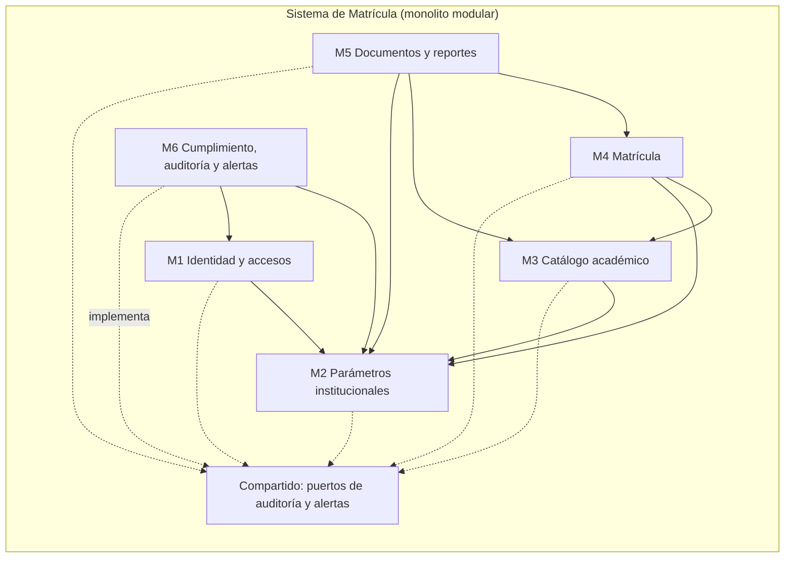
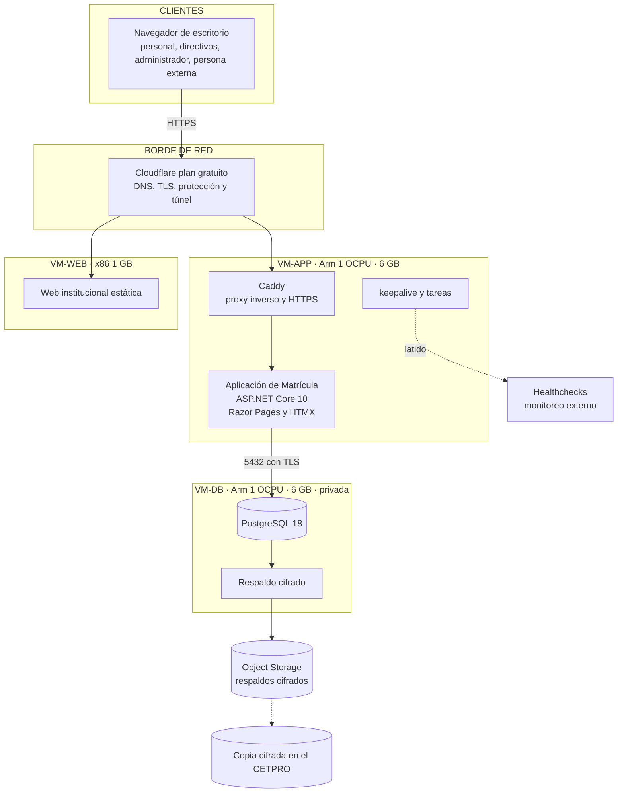

# Estilo arquitectónico

## 1. Estilo seleccionado

**Monolito modular con Clean Architecture**, desplegado como **un solo contenedor** de aplicación más una base PostgreSQL en otra VM.

- **Monolito**, porque hay cinco usuarios y un equipo pequeño: dividir en servicios sumaría coordinación, memoria y puntos de falla sin ventaja de escala (DA-04, DA-12).
- **Modular**, porque el dominio tiene límites claros (M1 a M6). Cada módulo es una carpeta vertical con sus propios casos de uso y los módulos se comunican solo por **contratos** de la capa de Aplicación.
- **Clean Architecture**: las dependencias apuntan hacia el dominio. Las reglas de negocio no conocen la base de datos, la web ni las librerías de PDF.
- **Renderizado en servidor** (Razor Pages) con **HTMX** para actualizar fragmentos: simple de mantener, sin SPA (DA-08).
- **Doble defensa**: las reglas críticas se validan en el dominio **y** como restricciones o disparadores en PostgreSQL (AD-03).

**Justificación:** la carga prevista es de 5 usuarios concurrentes y los recursos son 2 OCPU y 12 GB de Arm en total. Un conjunto de microservicios sumaría procesos, memoria y puntos de falla sin beneficio de escala. Un monolito sin estructura mezclaría reglas con persistencia y dificultaría probar y mantener; Clean Architecture compensa el tamaño reducido con límites claros dentro de la aplicación (AC-06).

## 2. Módulos

Las dependencias entre módulos son **solo hacia estos destinos y sin ciclos**; las pruebas de arquitectura lo verifican. Ningún módulo depende de M6: la auditoría y las alertas se piden por los puertos del kernel `Compartido`, que M6 implementa. La única dependencia de M6 hacia otro módulo es la consulta de destinatarios por rol (M6 → M1).

| Módulo | Responsabilidad | Casos de uso (ERS) | Datos principales |
| :--- | :--- | :--- | :--- |
| **M1 Identidad y accesos** | Autenticación con MFA, roles, altas y bajas, **revisión semestral de privilegios**. | CU-08, CU-15, CU-20 (privilegios); RF-19, RF-20, RF-29, RF-30, RF-39 | Usuarios, roles, permisos |
| **M2 Parámetros** | Valores configurables y versionados (edad mínima, plazos, cupo, becas, datos del CETPRO). | CU-16; RF-32 | `parametro_institucional` |
| **M3 Catálogo académico** | Familias, **programas** con su **plan y resolución**, **módulos**, **unidades**, **periodos lectivos**, ofertas, docentes. | CU-02, CU-03; RF-09 a RF-11, RF-24, RF-25 | Programa, plan, módulo, unidad, periodo, oferta, docente |
| **M4 Matrícula** | Estudiantes, **matrícula con módulo**, ratificación, licencia, reincorporación, convalidación, convenios y becas, derecho de inscripción, anulación con motivo. | CU-01, CU-09 a CU-12; RF-01 a RF-08, RF-21 a RF-23, RF-40 a RF-43 | Estudiante, matrícula, matrícula por módulo, convalidación, licencia, pago, convenio |
| **M5 Documentos y reportes** | **Constancia** con QR, **nómina**, **Anexo 1**, **archivos Excel con el formato de AVANZA** con validación previa, consultas, verificación pública. | CU-05, CU-06, CU-13, CU-14; RF-12, RF-16, RF-17, RF-26 a RF-28 | Documentos emitidos, vistas de reporte |
| **M6 Cumplimiento, auditoría y alertas** | **Bitácora** de solo inserción, aviso de privacidad versionado, solicitudes de derechos, incidentes, retención, **alertas**. | CU-17 a CU-20; RF-33 a RF-38 | Bitácora, avisos, solicitudes, incidentes, alertas |

**Segundo sistema (aislado): web institucional.** Sitio estático de información, **sin ninguna ruta hacia la BD ni hacia la aplicación de matrícula**. Se despliega en su propia VM (AD-14).

## 3. Diagrama de arquitectura

La vista de despliegue completa está en [despliegue](05-despliegue.md).

## 4. Componentes y responsabilidades

| Componente | Responsabilidad | Decisión |
| :--- | :--- | :--- |
| **Aplicación Matrícula** (`Cetpro.Web` sobre Application, Domain e Infrastructure) | Interfaz por rol, casos de uso, reglas de negocio, documentos y tareas programadas. | AD-01, AD-02 |
| **PostgreSQL 18** | Datos, restricciones, disparadores de doble defensa, bitácora inmutable y vistas. | AD-03, AD-12 |
| **Cloudflare y Caddy** | Cloudflare protege y cifra el acceso; Caddy enruta y entrega HTTPS al origen. | AD-06 |
| **Web institucional** | Sitio estático en una VM aparte, sin acceso a datos. | AD-14 |
| **`keepalive` y tareas** | Evita la reclamación de la VM, envía el latido y corre respaldos, retención y alertas. | AD-09, AD-34 |
| **Respaldos** | Volcado diario cifrado a Object Storage y copia en el CETPRO. | AD-08 |
| **Healthchecks** | Aviso externo si una VM deja de enviar señal. | AD-09 |

## 5. Reglas de comunicación

| Origen | Destino | Tipo | Propósito |
| :--- | :--- | :--- | :--- |
| Navegador | Cloudflare → Caddy → aplicación | HTTPS | Todas las solicitudes de la interfaz. |
| Aplicación | PostgreSQL | SQL por 5432 con TLS | Persistir y consultar; con la cuenta `cetpro_app` de mínimo privilegio. |
| Módulo | Módulo | Contrato de Application (interfaz interna) | Un módulo no usa las entidades de otro. |
| Aplicación y VM-DB | Healthchecks | HTTPS saliente | Latido. |
| VM-DB | Object Storage | HTTPS saliente | Subir respaldos cifrados. |
| Administración | Las tres VM | SSH por OCI Bastion con llave | Operación; sin SSH público. |
| Persona externa | Página de verificación | HTTPS, solo lectura mínima | Verificar una constancia. |
| Cualquier otro origen | VM-DB | — | **Denegado.** |
| VM-WEB | VM-APP y VM-DB | — | **Denegado.** |

## 6. Alternativas descartadas

| Alternativa | Motivo del descarte |
| :--- | :--- |
| **Microservicios** | Coordinación, comunicación y despliegue innecesarios para cinco usuarios y 12 GB de RAM en total. |
| **Monolito sin estructura** | Mezcla reglas y persistencia; difícil de probar y de mantener por un equipo estudiantil. |
| **SPA o Blazor** | Otro stack y más JavaScript; la interfaz es simple y se renderiza en servidor (AD-02). |
| **Sitio institucional dentro de la aplicación** | Rompería el aislamiento: un compromiso del sitio público alcanzaría los datos de matrícula (AD-14). |
| **Integración automática con AVANZA** | AVANZA no ofrece API; está fuera del alcance (límite del sistema). |
| **Correo o WhatsApp para alertas** | Costo, privacidad y dependencia de un canal externo (AD-34). |
| **Pagar Oracle** para evitar la reclamación | Contra la restricción de costo cero; la exención no está confirmada. |

## 7. Ventajas y limitaciones

| Ventajas | Limitaciones |
| :--- | :--- |
| Pocas piezas: despliegue y mantenimiento sencillos con Docker Compose. | Un solo proceso de aplicación: un defecto grave lo detiene entero. |
| Reglas de negocio aisladas y fáciles de probar. | Clean Architecture agrega interfaces y proyectos, lo que implica más código base para un sistema pequeño. |
| Se adapta a recursos gratuitos limitados y a Arm. | Sin SLA ni alta disponibilidad; se compensa con respaldo, infraestructura como código y contingencia. |
| Doble defensa: la base protege aunque falle la aplicación. | La BD separada añade una VM más que operar y un punto de falla. |
| Los módulos permiten dividir el trabajo en specs. | La disciplina de límites entre módulos depende de las pruebas de arquitectura. |
