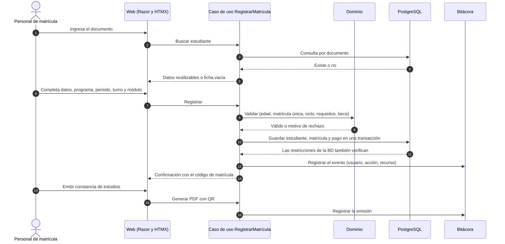
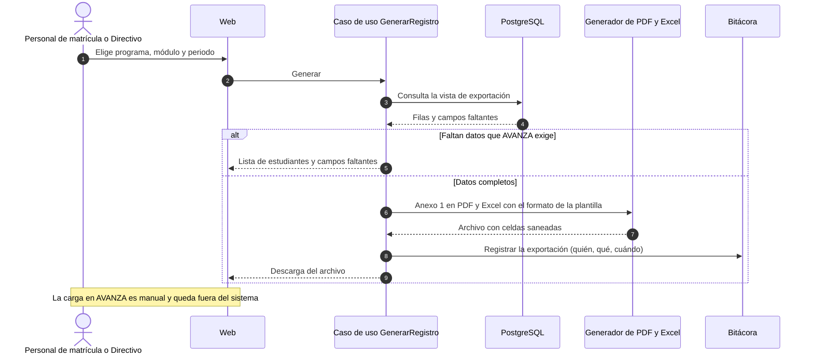
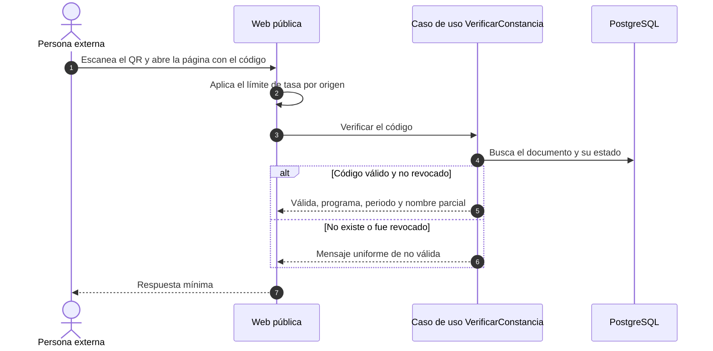

# Escenarios y flujos

## 1. Flujo principal: registrar una matrícula

En una sola transacción se guarda la matrícula y se escribe la bitácora: si no se puede auditar, la operación falla. La aplicación fija `cetpro.usuario_id` y `cetpro.ip_origen` al abrir la transacción para que la auditoría automática de la base sepa quién actúa.

## 2. Flujo secundario: nómina, Anexo 1 y archivos para AVANZA

## 3. Verificación pública de una constancia

## 4. Variantes del flujo principal

| Situación | Qué ocurre |
| :--- | :--- |
| El estudiante ya existe | Se reutilizan sus datos; no se pide de nuevo lo ya ingresado (WCAG 3.3.7). |
| Menor a la edad mínima | Se rechaza con el motivo («tiene 15 años; la edad mínima es 16») y no se guarda nada. |
| Ya hay matrícula vigente en ese programa y periodo | Se rechaza (RN-13); el índice único parcial lo garantiza aunque falle la aplicación. |
| Ciclo Técnico sin primaria completa | Se rechaza (RN-14). |
| Reincorporado o trasladado | Se exige la convalidación (resolución directoral, justificación, similitud) antes de confirmar. |
| Faltan datos que AVANZA exige | Se permite guardar; la alerta de datos faltantes avisa y la exportación lista qué falta. |
| Se corta la conexión durante la ficha | El borrador se conserva en el servidor; al volver se retoma la misma ficha. |
| Dos personas editan la misma matrícula | Control de concurrencia optimista (`version`): la segunda recibe un aviso y ve qué cambió. |
| Anulación | Exige motivo; la matrícula pasa a ANULADA y deja de aparecer en la nómina. |

## 5. Fallos parciales

| Situación | Resultado |
| :--- | :--- |
| Falla la escritura de la bitácora | La operación no se aplica. |
| La BD no responde | Mensaje claro, sin trazas; no se pierde lo escrito en pantalla; se activa la contingencia si se prolonga. |
| Se cae el Internet del CETPRO | Se usa la ficha en papel y se carga después. |
| Oracle apaga o reclama una VM | Se reconstruye desde Git y el respaldo cifrado (RTO ≤ 4 h). |
| Falla el respaldo nocturno | Alerta técnica al Administrador. |
| Falla la generación de PDF o Excel | Se informa el error y no se registra una emisión incompleta. |
| La sesión vence por inactividad | Aviso 2 minutos antes; el borrador se conserva. |

## 6. Escenarios de calidad probados

| Escenario | Atributo | Criterio de éxito |
| :--- | :--- | :--- |
| Persona de 15 años y edad mínima 16 | AC-01 | Rechazo en la aplicación y en la base. |
| Dos matrículas vigentes en el mismo programa y periodo | AC-01 | La segunda falla por el índice único parcial. |
| 200 ingresos fallidos | AC-02 | Bloqueo temporal y alerta; todo registrado. |
| Intento de editar o borrar la bitácora | AC-02 | Rechazado por el disparador. |
| Se pierde la VM de la base de datos | AC-03 | Restauración dentro de 4 h con pérdida ≤ 24 h. |
| Cambio de `edad_minima` | AC-07 | Aplica sin desplegar y queda en el historial de parámetros. |
