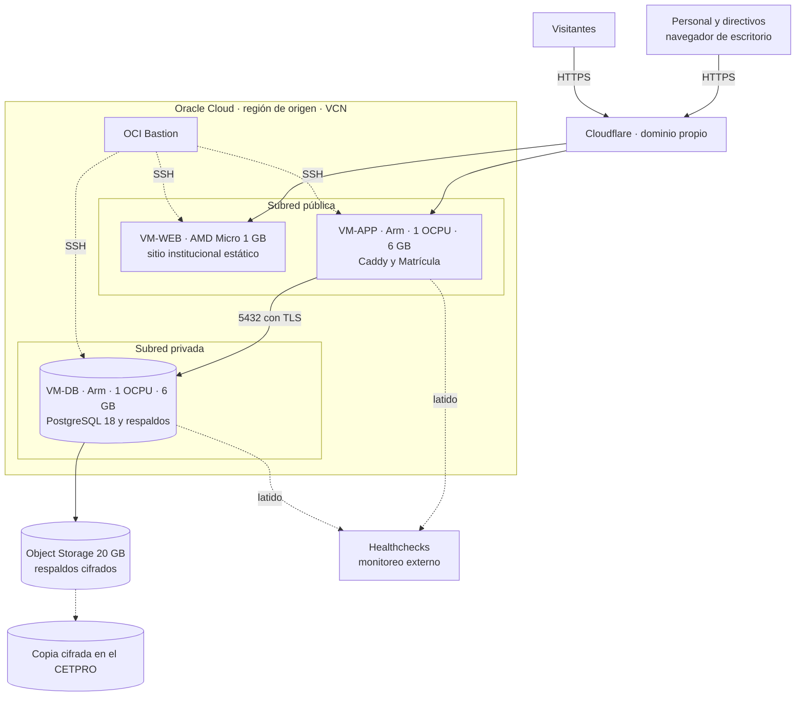

# Despliegue en Oracle Cloud Free Tier

**Restricción del equipo: el proyecto debe ser gratuito.** Este documento responde a las decisiones AD-05 a AD-09 y AD-14. Los datos del Free Tier se contrastaron con la documentación de Oracle y deben **verificarse en la consola al crear la cuenta**. Detalle y fuentes en [`Investigacion/03`](../../Investigacion/03-despliegue-y-continuidad-oracle.md).

## 1. Recursos disponibles (Always Free)

| Recurso | Límite | Verif. |
| :--- | :--- | :---: |
| VM Ampere A1 (Arm) | **2 OCPU y 12 GB en total**, en 1 o 2 instancias (material antiguo decía 4 OCPU y 24 GB). | ✔✔ |
| VM AMD Micro (x86) | **2 instancias** de 1/8 OCPU y 1 GB. | ✔✔ |
| Almacenamiento en bloque | **200 GB en total** (arranque + datos); arranque mínimo 47 o 50 GB. | ✔✔ |
| Object Storage | **20 GB** y 50.000 solicitudes al mes. | ✔✔ |
| Bastion, VCN | Bastion gratuito; hasta 2 VCN. | ✔ |
| Salida de datos | 10 TB al mes. | ✔ |
| Región | Los recursos se crean en la **región de origen** de la cuenta; no hay región en Perú. | ✔ |
| Superar el cupo A1 | Las instancias A1 se deshabilitan y eliminan a los 30 días salvo cuenta de pago. | ✔✔ |
| Tarjeta | Oracle pide tarjeta de crédito (o débito que funcione como crédito); no acepta prepago ni de un solo uso. | ✔ |

**Reclamación por inactividad.** Oracle puede reclamar una instancia Always Free que durante **7 días** tenga CPU (p95), red y memoria (solo en A1) por debajo del 20 %. Basta con superar uno de los tres umbrales. **Pay As You Go no figura como exención** en la documentación oficial; con costo cero no se pasa a él.

## 2. Distribución propuesta: tres VM aisladas

| VM | Forma | Contenido | Pública | Notas |
| :--- | :--- | :--- | :---: | :--- |
| **VM-WEB** | AMD Micro, 1/8 OCPU, 1 GB | Servidor web mínimo con el sitio institucional **estático**. | Sí | Sin credenciales ni ruta a la BD. Casi siempre parecerá «inactiva»: se reconstruye desde Git; espejo opcional en un hosting estático gratuito. |
| **VM-APP** | Arm A1, 1 OCPU, 6 GB | Caddy, la aplicación de matrícula (contenedor) y `keepalive`. | Sí | Sin estado: se reconstruye desde imágenes. |
| **VM-DB** | Arm A1, 1 OCPU, 6 GB | PostgreSQL 18, tareas de respaldo y `keepalive`. | **No** | Solo acepta 5432 desde VM-APP; administración por Bastion. |

Disco: tres VM de 50 GB usan 150 de los 200 GB.

### 2.1 ¿Conviene separar la base de datos?

**Veredicto: sí.** La VM-DB no tiene puerto abierto a Internet; si se vulnera la aplicación, el atacante no obtiene directamente los archivos de la base. Además, .NET y PostgreSQL no compiten por memoria, los respaldos son más limpios y las reglas de firewall son distintas. A cambio hay una VM más que operar y un nuevo punto de falla (si cae la VM-DB, cae el sistema), que se compensa con respaldo probado y reconstrucción desde código.

**Contingencia:** si Oracle solo concede una instancia, se usa una VM Arm de 2 OCPU y 12 GB con la base en un contenedor sin puertos publicados, en una red interna de Docker. Se pierde el aislamiento por VM pero se conserva el aislamiento por red.

## 3. Reglas de red

| Origen | Destino | Puerto | Estado |
| :--- | :--- | :--- | :--- |
| Internet | VM-WEB y VM-APP | 443 (80 solo para el certificado; ninguno si se usa el túnel) | Permitido |
| VM-APP | VM-DB | 5432 | Permitido |
| Bastion | Las tres VM | 22 (llave) | Permitido |
| VM-WEB | VM-APP y VM-DB | todos | **Denegado** |
| Cualquier otro origen | VM-DB | todos | **Denegado** |

Complementos: firewall del sistema operativo con las mismas reglas, secretos fuera del repositorio y SSH sin contraseña.

## 4. Sistema operativo y contenedores

- **Ubuntu Server LTS mínimo, sin entorno gráfico**, imagen oficial para Ampere A1; actualizaciones de seguridad automáticas.
- **Docker Compose** por VM, imágenes **multi-arquitectura** (Arm64 y x86-64), usuario sin privilegios, `healthcheck` y límites de memoria y CPU.
- Infraestructura como código: **OpenTofu** y **cloud-init**; Compose versionado en `infra/`.

## 5. Estrategia anti-reclamación (sin costo)

| # | Capa | Medida |
| :---: | :--- | :--- |
| P1 | Prevención | **`keepalive` calibrado**: una ráfaga de CPU de baja prioridad (7 minutos al 40 %) cada hora lleva el p95 de CPU a ~40 %; opcionalmente retiene memoria (`HOLD_MEM_MB`) en las A1. Mide el p95 local y avisa si baja. |
| P2 | Prevención | **Trabajo real programado**: respaldo cifrado, prueba de restauración nocturna y escaneos. |
| P3 | Prevención | **Nada crítico en las AMD Micro.** |
| P4 | Detección | **Latido externo** (Healthchecks) y monitoreo de disponibilidad desde fuera de Oracle. |
| P5 | Recuperación | **Infraestructura como código** y Compose en Git; reconstruir en horas. |
| P6 | Recuperación | **Respaldo cifrado en dos lugares**: Object Storage y copia en el CETPRO. |
| P7 | Recuperación | **Modo degradado en el CETPRO**: el mismo Compose en una PC con el último respaldo (opcional). |
| P8 | Higiene | Correo institucional neutro, MFA y **dos administradores** en la cuenta de Oracle; no superar 2 OCPU / 12 GB en A1. |
| P9 | Continuidad | **Contingencia en papel** y carga posterior. |

Cálculo del `keepalive`: el p95 supera el 20 % si más del 5 % de las muestras (≈ 72 minutos al día) lo supera; una ráfaga de 7 minutos al 40 % cada hora suma 168 minutos al día. Los scripts están en [`Investigacion/anexos/keepalive`](../../Investigacion/anexos/keepalive/README.md). No hay garantía de Oracle y no se verificaron sus términos sobre carga artificial: por eso existen las capas P4 a P9.

## 6. Respaldo y recuperación

| Elemento | Decisión |
| :--- | :--- |
| Objetivos | **RPO ≤ 24 h** (≤ 4 h en temporada) y **RTO ≤ 4 h**, por validar con la Dirección. |
| Frecuencia | Volcado **diario** (el reglamento exige mínimo semanal, art. 51). |
| Cifrado | Antes de salir de la VM-DB; la **clave la custodia el CETPRO**. |
| Destinos | Object Storage de Oracle (20 GB) **y** copia en el CETPRO; la bitácora se copia aparte. |
| Integridad | *Checksum* de cada copia (art. 52). |
| Prueba | Restauración completa **antes de cada despliegue mayor y cada trimestre**, comparada con el RTO. |

## 7. Entregas y entornos

- **Entornos:** desarrollo (local), pruebas (local o VM efímera con **datos sintéticos**) y producción, con etiqueta visible del entorno.
- **CI** (GitHub Actions, cuotas gratuitas): compilación sin advertencias, pruebas, pruebas de arquitectura, CodeQL, dependencias vulnerables, Trivy, gitleaks y SBOM.
- **CD:** imágenes multi-arquitectura en un registro de contenedores, despliegue con **aprobación de un segundo integrante** y registro del cambio (ISO 27002, 8.31 y 8.32).

## 8. Costo

| Concepto | Costo |
| :--- | :--- |
| Cómputo, disco, objetos, red | **0** (Always Free, dentro de los límites). |
| Cloudflare, Caddy, Let's Encrypt, GitHub, Healthchecks | **0** (planes gratuitos; cuotas por confirmar). |
| **Dominio** | **Asumido por el equipo** (costo anual por confirmar; P-02). |

## 9. Recomendaciones de la guía de nube de la PCM aplicadas

La guía (Res. SeGDi 001-2018-PCM/SEGDI) es **orientadora, no obligatoria**, pero la responsabilidad final es de la entidad.

| Recomendación | Cómo se aplica |
| :--- | :--- |
| Cifrar antes de enviar y que la entidad custodie las claves | Respaldos cifrados en la VM-DB con clave del CETPRO. |
| No gestionar altas y bajas de usuarios en la nube | **No se cumple** (Identity vive en la aplicación). Se mitiga con administración restringida, MFA y revisión semestral. Riesgo aceptado. |
| Registros de actividad preferentemente en la propia entidad | Copia periódica cifrada de la bitácora en el CETPRO. |
| Proveedor con ISO 27001, 27017 y 27018 | **Pendiente verificar** las certificaciones de Oracle. |
| La entidad elige la localización | Región de origen elegida y documentada; **comunicar el flujo transfronterizo** (art. 21.2). |
| Acuerdo de nivel de servicio | No aplica al Free Tier; se compensa con respaldo, RPO y RTO. |
| Documentar el uso aceptable | Política breve de uso aceptable para el personal. |

## 10. Pendientes de verificar

- Cupo Arm, número de instancias y condiciones del Free Tier en la cuenta real.
- Capacidad Arm en la región elegida (la elección no se cambia después).
- Disponibilidad de subred privada y de Bastion sin costo.
- Costo y registro del dominio y sus alternativas.
- Imágenes multi-arquitectura de todos los contenedores (PostgreSQL, Caddy y .NET ofrecen Arm64).
- Comportamiento bajo carga sobre 1 OCPU (ver [presupuesto de recursos](07-presupuesto-de-recursos.md)).
- Licencias de QuestPDF (versión Community) y ClosedXML.
- Certificaciones de Oracle y términos sobre uso de carga artificial.
