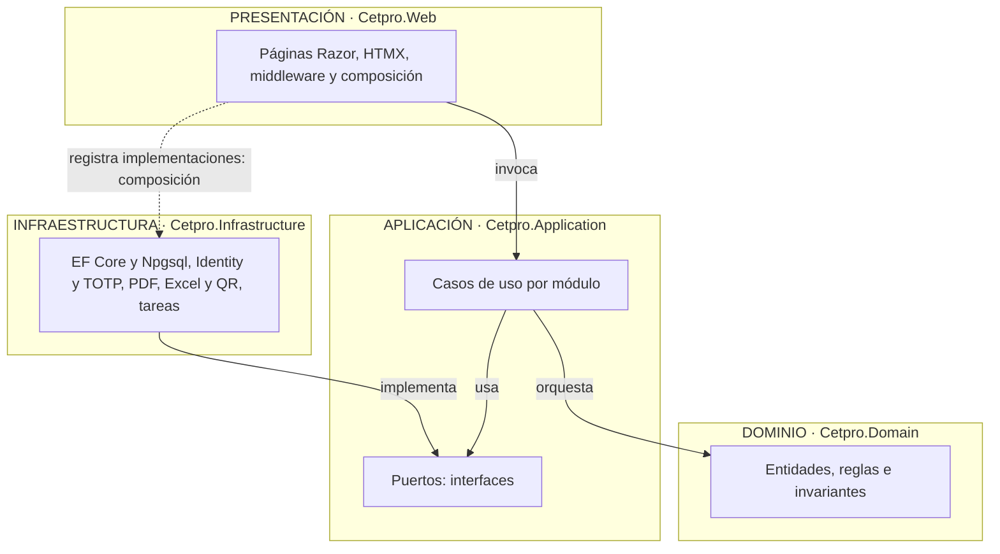
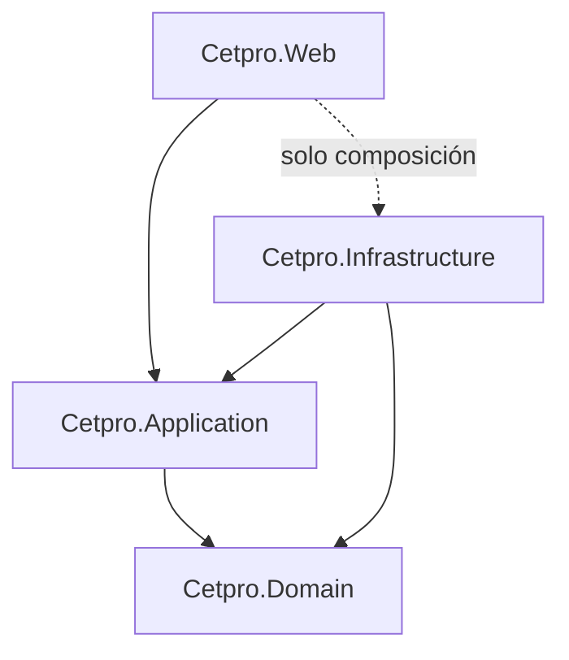
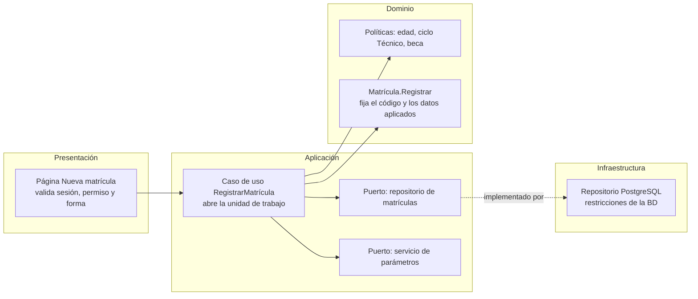

# Enfoque arquitectónico: Clean Architecture

Este documento desarrolla el enfoque que resume la [organización interna](02-organizacion-interna.md) y el [estilo arquitectónico](../02-arquitectura-de-software/03-estilo-arquitectonico.md): cómo se organizan las responsabilidades y las dependencias **dentro del monolito modular**. El estilo global decide *qué piezas hay*; Clean Architecture decide *cómo se ordena el código de cada pieza*. Se baja hasta la estructura de carpetas del repositorio y el flujo con especificaciones (SDD).

## 1. Resumen del enfoque

| Elemento | Descripción aplicada al Sistema de Matrícula |
| :--- | :--- |
| **Enfoque** | Clean Architecture (Arquitectura Limpia) dentro de un monolito modular. |
| **Objetivo** | Separar responsabilidades y controlar las dependencias hacia el dominio. |
| **Problema que resuelve** | Evita acoplar las reglas de matrícula (edad mínima, matrícula única, ciclo Técnico, beca, convalidación) a Razor, a PostgreSQL, a QuestPDF o a ClosedXML. |
| **Capas** | Dominio, Aplicación, Infraestructura y Presentación (Web). |
| **Beneficios** | Pruebas unitarias sin base de datos; cambio de librerías sin tocar las reglas; código ordenado y fácil de delegar a un agente de desarrollo. |
| **Drivers** | DA-02 (registro LAG/AVANZA), DA-03 (reglas sin formalizar), DA-12 (mantenimiento por equipo estudiantil), DA-15 (SDD). Decisión AD-01. |

**Por qué este enfoque.** El valor del sistema está en pocas reglas críticas (la edad mínima del parámetro vigente, una sola matrícula vigente por programa y periodo, el requisito del ciclo Técnico, el tope de beca, la máquina de estados de la matrícula). Si esas reglas dependieran de la base de datos o de la interfaz, serían difíciles de probar y de cambiar. Con la regla de dependencia, el dominio queda aislado y los cambios más probables (otro generador de PDF, otra política de convalidación, otro formato de AVANZA) se resuelven en una sola capa. El costo es más proyectos e interfaces; se compensa aplicando la versión completa solo donde hay lógica de negocio real (sección 6).

## 2. Regla de dependencia



**Regla:** el código solo puede depender de capas más internas. El Dominio no depende de nadie; la Aplicación solo del Dominio; Infraestructura y Presentación dependen de la Aplicación. Cuando un caso de uso necesita algo del exterior, define una interfaz (puerto) y la Infraestructura la implementa. La Presentación es además la **raíz de composición**: es el único lugar que conoce las implementaciones concretas (inyección de dependencias).

### Matriz de dependencias permitidas

| Capa ↓ puede usar → | Dominio | Aplicación | Infraestructura | Presentación |
| :--- | :---: | :---: | :---: | :---: |
| **Dominio** | — | No | No | No |
| **Aplicación** | Sí | — | No | No |
| **Infraestructura** | Sí | Sí | — | No |
| **Presentación (Web)** | Sí | Sí | Solo para registrar (composición) | — |

Ningún controlador o página accede directamente a `DbContext`. Un módulo no usa las entidades de otro: se comunica por contratos de la capa de Aplicación.

## 3. Las cuatro capas

### 3.1 Dominio

**Qué es:** el modelo del negocio expresado en código, sin ninguna dependencia técnica (ni EF, ni HTTP, ni JSON).

| Contiene | No contiene |
| :--- | :--- |
| Entidades y objetos de valor (documento, código de matrícula, periodo lectivo). | Acceso a datos, SQL, caché. |
| Reglas e invariantes que siempre deben cumplirse. | Llamadas HTTP o a servicios externos. |
| Políticas de dominio (edad, matrícula única, ciclo Técnico, beca, convalidación). | Atributos de serialización o de páginas. |
| Estados y transiciones válidas (matrícula, licencia, alerta, solicitud). | Conocimiento del usuario autenticado. |

**Reglas clave por módulo** (cada una será un criterio EARS en una spec):

| Módulo | Reglas del dominio |
| :--- | :--- |
| **M4 Matrícula** | La edad se valida con el parámetro vigente y se guarda el valor aplicado (RN-01). El código es el número de documento (RN-09). Una sola matrícula vigente por estudiante, programa y periodo (RN-13). El ciclo Técnico exige primaria completa (RN-14). Anular exige motivo (RN-15). El descuento no supera el tope ni el máximo del convenio (RN-06). La convalidación entre planes exige la similitud mínima (RN-12). Una licencia pasa la matrícula a LICENCIA (RN-11). |
| **M3 Catálogo** | Un programa Auxiliar Técnico tiene ≥ 40 créditos y uno Técnico ≥ 80. Un solo periodo lectivo vigente. Oferta única por programa, periodo y turno. Los módulos del plan pertenecen al programa. |
| **M1 Identidad** | Todo el personal tiene segundo factor. Bloqueo temporal tras N fallos. No hay autorregistro. |
| **M2 Parámetros** | Un parámetro en `null` está por definir y leerlo es un error explícito. Cada cambio conserva historial. |
| **M5 Documentos** | La constancia lleva código único y *hash*; una revocación exige motivo. Toda exportación se registra. |
| **M6 Cumplimiento** | La bitácora es de solo inserción. Una alerta activa por clave. El plazo de una solicitud se calcula por tipo. |

### 3.2 Aplicación

**Qué es:** los casos de uso del sistema; coordina el dominio y los puertos, sin saber cómo se guardan los datos ni cómo llegan las solicitudes.

| Contiene | No contiene |
| :--- | :--- |
| Un caso de uso por acción del usuario (*RegistrarMatrícula*, *AnularMatrícula*, *EmitirConstancia*, *GenerarArchivoAvanza*). | Reglas del negocio que pertenezcan al dominio. |
| Puertos hacia el exterior: repositorios, reloj, usuario actual, generadores de documentos. | Código de EF Core, QuestPDF o ClosedXML. |
| Transacciones y orden de los pasos (qué se hace primero y qué si falla). | Tipos de ASP.NET (páginas, `HttpContext`). |
| Políticas de autorización por permiso. | Consultas SQL. |

**Puertos previstos:**

| Puerto | Módulo | Implementación (Infraestructura) |
| :--- | :--- | :--- |
| Repositorios de estudiantes, matrículas, catálogo, parámetros, alertas, documentos y solicitudes | M1 a M6 | EF Core + Npgsql sobre PostgreSQL |
| Unidad de trabajo | Todos | Transacción de PostgreSQL; fija `cetpro.usuario_id` y `cetpro.ip_origen` con `SET LOCAL` |
| Usuario actual y permisos | Todos | Lectura de los *claims* de la sesión de Identity |
| Reloj | Todos | Reloj del sistema (hora de Lima en la presentación, UTC en la BD) |
| Servicio de parámetros | M2 | Lectura de `parametro_institucional` con caché corta |
| Generador de PDF | M5 | QuestPDF |
| Generador de Excel | M5 | ClosedXML (celdas saneadas) |
| Generador de QR y código | M5 | Librería de QR y *hash* SHA-256 |
| Registro de auditoría | M6 | Inserción en `auditoria.bitacora` (lecturas y exportaciones; los cambios los registran los disparadores) |
| Servicio de identidad y segundo factor | M1 | ASP.NET Core Identity con TOTP |

### 3.3 Infraestructura

**Qué es:** el código que habla con el mundo exterior; implementa los puertos de la Aplicación.

| Contiene | Ejemplos |
| :--- | :--- |
| Persistencia | `DbContext`, repositorios, mapeos, migraciones, control de concurrencia (`version`). |
| Identidad | Identity, almacén de usuarios, TOTP, bloqueo. |
| Documentos | Plantillas de PDF, exportación a Excel con el formato de AVANZA, QR. |
| Tareas programadas | Alertas, retención, respaldo, latido. |

Esta capa es la **frontera anticorrupción**: si cambia el formato de la plantilla de AVANZA, solo cambia aquí (y en el parámetro de mapeo).

### 3.4 Presentación (Web)

**Qué es:** la entrada HTTP, la interfaz y la composición.

| Responsabilidad | Detalle |
| :--- | :--- |
| Páginas Razor y fragmentos HTMX | Reciben la solicitud, validan la forma y llaman a un caso de uso. |
| Autenticación y autorización | Sesión de Identity, MFA y políticas por permiso. |
| Traducir errores | Convierte resultados de la Aplicación en mensajes y códigos HTTP. |
| Composición | Registra las implementaciones de Infraestructura, configura cabeceras y lee los secretos de las variables de entorno. |
| Empaquetado | `Dockerfile` multi-arquitectura. |

Las páginas **no contienen reglas de negocio**: si un `if` decide algo del negocio, pertenece al Dominio o a un caso de uso.

## 4. Mapa a la estructura del repositorio

```
SisJoaquin/
├── AGENTS.md  CLAUDE.md  README.md
├── .claude/                 skills y agentes del proyecto
├── docs/                    7 carpetas temáticas y glossary.md
├── specs/                   README.md, TRACEABILITY.md, plantillas y una carpeta por spec
├── progress/                CHANGELOG.md, blockers.md, log/
├── tools/SpecCheck/         validador de specs
├── src/
│   ├── Cetpro.Domain/       Matricula, Catalogo, Identidad, Parametros, Documentos, Cumplimiento, Compartido
│   ├── Cetpro.Application/  casos de uso por módulo y puertos
│   ├── Cetpro.Infrastructure/ EF Core, Identity, PDF/Excel/QR, tareas
│   └── Cetpro.Web/          Razor Pages, HTMX, estáticos
├── tests/
│   ├── Cetpro.Domain.Tests/  Cetpro.Application.Tests/
│   ├── Cetpro.Architecture.Tests/  Cetpro.Integration.Tests/  Cetpro.E2E/
│   └── load/                k6 (carga ligera)
├── infra/                   Compose, Caddy, OpenTofu, cloud-init, respaldo, keepalive
├── db/                      esquema SQL de referencia, pruebas de humo y migraciones
├── Entregables/             línea base del ERS y de la arquitectura, y la propuesta en .docx
└── Contexto/ Investigacion/ material de partida (solo referencia)
```

Los nombres de proyecto son una propuesta. Cada módulo (M1 a M6) es una **carpeta dentro de Dominio y Aplicación**, no un proyecto aparte. Las carpetas de Aplicación coinciden con los prefijos de las specs, de modo que **cada especificación se implementa en un lugar predecible**.

### 4.1 Referencias entre proyectos



Cada flecha es una referencia de proyecto. Al separar las capas en proyectos distintos, **el compilador impide** que, por ejemplo, el Dominio use Entity Framework.

### 4.2 Otras carpetas

| Carpeta | Rol respecto a Clean Architecture |
| :--- | :--- |
| `specs/` | `spec.md` describe comportamiento (EARS) sin tecnología; `plan.md` asigna cada pieza a una capa; `tasks.md` ordena el trabajo por capa. |
| `tests/` | Dominio y Aplicación sin base ni red; Infraestructura con PostgreSQL real; E2E con Playwright y axe. |
| `infra/` | Raíz de composición a nivel de sistema. |
| `db/` | Esquema SQL de referencia (probado) y pruebas de humo. |
| `docs/` | Esta documentación; el glosario fija el lenguaje del dominio. |

## 5. Ejemplo recorrido: registrar una matrícula



| Paso | Capa | Qué ocurre |
| :--- | :--- | :--- |
| 1 | Presentación | Recibe la solicitud, valida la sesión, el permiso `ESTUDIANTE_MATRICULA_ESCRIBIR` y la forma de los campos; llama al caso de uso. |
| 2 | Aplicación | Obtiene el usuario actual, lee `edad_minima` por el puerto de parámetros y abre una transacción que fija el usuario y el origen para la auditoría. |
| 3 | Dominio | Las políticas validan edad, ciclo Técnico y beca; la entidad fija el código y los valores aplicados. Si algo falla, devuelve un resultado de error con código estable. |
| 4 | Infraestructura | Guarda estudiante, matrícula y pago. Si dos personas compiten por la misma matrícula, el índice único parcial hace fallar a una. |
| 5 | Aplicación | Si falló por concurrencia, informa el conflicto; si tuvo éxito, confirma la transacción (la bitácora se escribió por disparador). |
| 6 | Presentación | Muestra la confirmación con el código de matrícula o el motivo del rechazo. |

**La regla del dominio no basta ante la concurrencia.** La entidad garantiza el invariante dentro de una operación, pero dos solicitudes simultáneas pueden leer el mismo estado. Por eso la base impone el índice único parcial y la Aplicación decide qué hacer cuando falla. Esta separación es la respuesta técnica a AC-01 y se prueba en `tests/Cetpro.Integration.Tests` con solicitudes simultáneas.

## 6. Alcance por módulo

| Módulo | Versión | Organización | Justificación |
| :--- | :--- | :--- | :--- |
| **M4 Matrícula** | Completa | Dominio con políticas y máquina de estados; casos de uso y puertos propios. | Concentra las reglas críticas y la concurrencia. |
| **M3 Catálogo** | Completa | Entidades y casos de uso propios. | Base de la matrícula y de la exportación. |
| **M5 Documentos** | Completa | Casos de uso; los generadores son puertos. | Aísla QuestPDF, ClosedXML y el formato de AVANZA. |
| **M1 Identidad** | Reducida | Apoyada en ASP.NET Core Identity; puertos solo donde haya algo que sustituir. | Poca lógica de negocio propia. |
| **M2 Parámetros** | Reducida | Casos de uso simples y lectura con caché. | Estructura de clave/valor. |
| **M6 Cumplimiento** | Reducida | Casos de uso para alertas, solicitudes e incidentes; bitácora por disparador. | Reglas simples, mucho dato. |

Si un módulo reducido crece en lógica, se promueve a la versión completa sin cambiar sus contratos.

## 7. Pruebas por capa

| Capa | Qué se prueba | Dónde | Herramienta | Criterio |
| :--- | :--- | :--- | :--- | :--- |
| Dominio | Invariantes y transiciones (edad, ciclo, beca, estados). | `Cetpro.Domain.Tests` | xUnit | Sin base ni red. |
| Aplicación | Casos de uso con puertos simulados (qué pasa si la edad no alcanza, si el parámetro está por definir). | `Cetpro.Application.Tests` | xUnit | Sin infraestructura real. |
| Arquitectura | Reglas de referencias entre proyectos y módulos. | `Cetpro.Architecture.Tests` | NetArchTest | Falla si se rompe la regla de dependencia. |
| Infraestructura | Repositorios, migraciones, restricciones y disparadores. | `Cetpro.Integration.Tests` | xUnit + Testcontainers | Con PostgreSQL real. |
| Presentación y flujo | Matrícula → constancia → nómina; accesibilidad. | `Cetpro.E2E` | Playwright + axe | Criterios de las specs. |

## 8. Seguridad por capas

| Aspecto | Capa | Cómo |
| :--- | :--- | :--- |
| Autenticación y segundo factor | Presentación + Infraestructura | Identity con TOTP; sesión con cookie `HttpOnly`, `Secure`, `SameSite`. |
| Permisos | Aplicación | Cada caso de uso exige su permiso (`MATRICULA_ANULAR`, `REPORTE_GENERAR`…); la página solo oculta lo no permitido. |
| Denegar por defecto | Presentación | Una página sin política explícita no está disponible. |
| Registrar lecturas y exportaciones | Aplicación | El caso de uso solicita el registro; la bitácora lo guarda sin posibilidad de modificación. |
| Registrar cambios | Base de datos | Disparadores de auditoría con usuario y origen. |
| Secretos | Presentación | Variables de entorno; nunca en el repositorio. |

**Justificación:** si el permiso se comprobara solo en las páginas, bastaría con que una página nueva lo olvidara para abrir un acceso indebido. Hacerlo en la Aplicación lo vuelve inherente a cada caso de uso y probable con pruebas unitarias.

## 9. Reglas para `AGENTS.md` y el flujo de especificaciones

### 9.1 Reglas de arquitectura no negociables (borrador)

```
## Arquitectura (Clean Architecture)
1. El Dominio no referencia ningún otro proyecto ni paquete de infraestructura.
2. La Aplicación solo referencia al Dominio y define los puertos que necesita.
3. La Infraestructura implementa los puertos; es el único lugar con EF Core, Identity, QuestPDF, ClosedXML y librerías de terceros.
4. La Web no contiene reglas de negocio; solo traduce HTTP, autentica, autoriza y compone dependencias.
5. Un módulo nunca usa las entidades de otro; se comunican por contratos de la Aplicación.
6. Ninguna página accede directamente a DbContext.
7. Toda regla de negocio nueva se escribe primero como prueba unitaria.
8. Los secretos se leen de variables de entorno; nunca se escriben en el repositorio.
9. Las reglas críticas se validan también en la base de datos (doble defensa).
10. Nunca se usan datos personales reales en desarrollo, pruebas, repositorio ni herramientas de IA.
11. Lo que está fuera del sistema (carga en AVANZA, notas, cobros, correo) no se implementa.
```

### 9.2 Cómo se refleja en cada feature

| Archivo | Qué debe indicar respecto a las capas |
| :--- | :--- |
| `spec.md` | El comportamiento en EARS, **sin** nombrar tecnologías. Fuente de las reglas del Dominio. |
| `plan.md` | «Capas afectadas»: entidades o reglas nuevas (Dominio), casos de uso y puertos (Aplicación), adaptadores (Infraestructura), páginas (Web) y cambios de esquema (BD). |
| `tasks.md` | Tareas atómicas ordenadas **de adentro hacia afuera**: Dominio → Aplicación → Infraestructura → Web → pruebas de integración y E2E. |
| `decisions.md` | Decisiones locales, con enlace a AD-01. |

### 9.3 Correspondencia entre specs y módulos

| Especificación | Módulo | Capas principales |
| :--- | :--- | :--- |
| `transversal-auditoria` (AUD) | M6 | Disparadores de auditoría (BD), puerto de registro de lecturas y exportaciones, consulta de bitácora. |
| `identidad-seguridad` (IDE) | M1 | Identity, TOTP, bloqueo, permisos, informe de privilegios. |
| `parametros-institucionales` (PAR) | M2 | Parámetros versionados, servicio con caché, historial. |
| `catalogo-academico` (CAT) | M3 | Programas, planes con resolución, módulos, unidades. |
| `periodos-ofertas` (OFE) | M3 | Periodos lectivos, ofertas y docentes. |
| `estudiantes` (EST) | M4 | Estudiante, búsqueda, duplicados, situación específica. |
| `matricula-registro` (MAT) | M4 | Matrícula, estados, edad, pago, borrador, requisitos. |
| `matricula-ratificacion-licencia` (RAT) | M4 | Ratificación, licencia, reincorporación. |
| `matricula-convalidacion` (CON) | M4 | Convalidación y excepciones de unidad. |
| `matricula-becas` (BEC) | M4 | Convenios, becas y tope. |
| `docs-constancia` (CST) | M5 | Constancia con QR, código, *hash*, verificación pública. |
| `docs-reportes` (REP) | M5 | Nómina, Anexo 1 y matriculados por oferta. |
| `docs-archivos-avanza` (AVZ) | M5 | Exportación con el formato de AVANZA, validación previa. |
| `cumplimiento-privacidad` (PRI) | M6 | Aviso, solicitudes de derechos, incidentes, retención. |
| `transversal-alertas` (ALE) | M6 | Alertas y su ciclo de vida. |
| `operacion-despliegue` (OPS) | Plataforma | Compose, respaldos, `keepalive`, infraestructura como código. |
| `web-base` (WEB) | Web | Estructura de la interfaz, sesión, errores, estados, cabeceras y accesibilidad. |

**Total: 17 especificaciones.**

## 10. Convenciones sugeridas

| Elemento | Convención | Ejemplo |
| :--- | :--- | :--- |
| Proyecto | `Cetpro.<Capa>` | `Cetpro.Domain` |
| Caso de uso | Verbo + sustantivo | `RegistrarMatricula`, `AnularMatricula` |
| Puerto | Prefijo `I` y nombre del rol | `IRepositorioDeMatriculas`, `IReloj` |
| Adaptador | Tecnología + puerto | `RepositorioDeMatriculasPostgres`, `GeneradorDeConstanciaQuestPdf` |
| Lenguaje del dominio | Términos de `docs/glossary.md` | matrícula, programa de estudios, módulo formativo, constancia de estudios |

## 11. Ventajas, costos y riesgos

| Ventajas | Costos y riesgos | Mitigación |
| :--- | :--- | :--- |
| Reglas críticas aisladas y fáciles de probar. | Más proyectos, interfaces y código de mapeo para un sistema pequeño. | Versión reducida en M1, M2 y M6; sin patrones que nadie pidió. |
| Cambio de librerías sin tocar el núcleo. | Interfaces «por costumbre» con una sola implementación. | Un puerto solo cuando haya algo externo o una variación real. |
| El compilador hace cumplir la regla de dependencia. | Curva de aprendizaje y disciplina para el equipo. | `AGENTS.md`, pruebas de arquitectura y revisión en cada tarea. |
| Encaja con el flujo de especificaciones por capa. | El Dominio puede quedar anémico. | Reglas en entidades y políticas; los casos de uso solo orquestan. |
| Facilita delegar tareas atómicas a un agente de IA. | Un agente puede violar la arquitectura sin darse cuenta. | Pruebas de arquitectura en CI como puerta obligatoria. |
