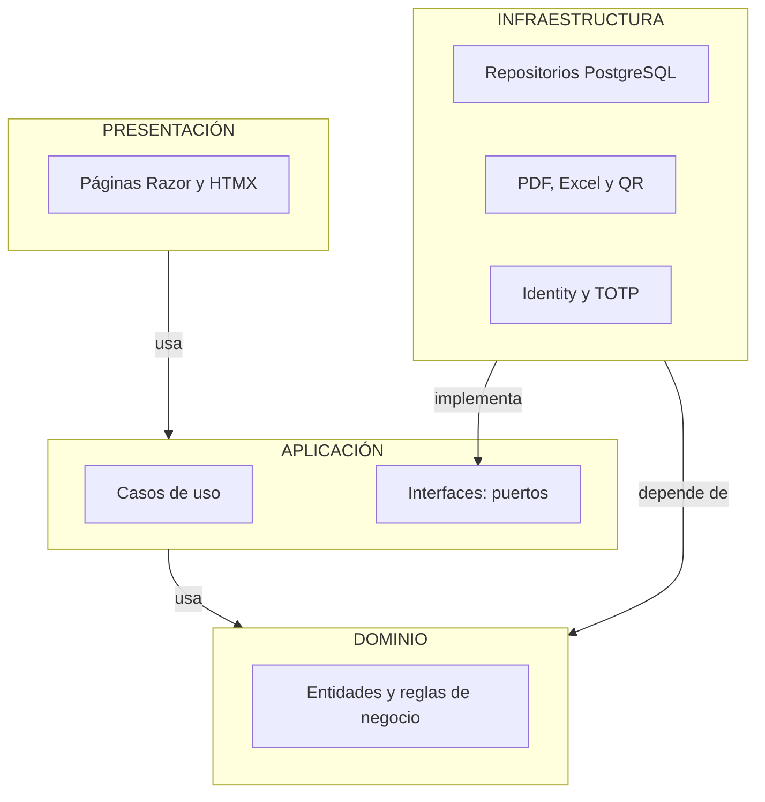

# Organización interna: Clean Architecture por módulo

## 1. Elementos

| Elemento | Descripción aplicada al Sistema de Matrícula |
| :--- | :--- |
| **Enfoque** | Clean Architecture (Arquitectura Limpia) en un monolito modular .NET. |
| **Objetivo** | Separar responsabilidades y controlar las dependencias hacia el dominio. |
| **Problema que resuelve** | Evita que las reglas del negocio queden acopladas a la interfaz web, a la base de datos o a las librerías de documentos. |
| **Capas** | Presentación, Aplicación, Dominio e Infraestructura. |
| **Beneficios** | Facilita el mantenimiento y las pruebas unitarias; permite cambiar una librería (por ejemplo, el generador de PDF) sin modificar las reglas; ordena el código para que lo escriba un equipo estudiantil asistido por IA. |
| **Alcance** | Completo en M3, M4 y M5, que concentran la lógica. Versión reducida en M1, M2 y M6. |

## 2. Dependencias



**Regla de dependencia:** las dependencias apuntan hacia el dominio. El Dominio no conoce a ninguna otra capa; la Aplicación solo conoce el Dominio; la Presentación y la Infraestructura dependen de la Aplicación, nunca al revés. Cuando un caso de uso necesita algo externo (guardar, generar un PDF, consultar la hora), lo pide mediante una interfaz definida en la Aplicación y la Infraestructura la implementa.

## 3. Responsabilidades por capa

| Capa | Responsabilidad | En M4 Matrícula | En M5 Documentos |
| :--- | :--- | :--- | :--- |
| **Presentación** | Recibir solicitudes, validar la forma de la entrada, verificar sesión y permiso. | Páginas de ficha, búsqueda, anulación, ratificación. | Páginas de reportes, descarga y verificación pública. |
| **Aplicación** | Coordinar los casos de uso sin conocer detalles técnicos. | Registrar, editar, anular, ratificar, licencia, convalidar. | Emitir constancia, generar nómina y Anexo 1, generar archivos para AVANZA. |
| **Dominio** | Entidades y reglas del negocio, sin dependencias técnicas. | Estudiante, matrícula, estados, políticas de edad y beca. | Documento emitido, código y *hash*, revocación. |
| **Infraestructura** | Implementar el acceso a tecnologías externas. | Repositorios EF Core, restricciones de la BD. | QuestPDF, ClosedXML, QR. |

## 4. Interfaces (puertos) previstas

| Interfaz (en Aplicación) | Implementación (en Infraestructura) |
| :--- | :--- |
| Repositorios por módulo | EF Core + Npgsql sobre PostgreSQL |
| Unidad de trabajo | Transacción de PostgreSQL con `SET LOCAL` de usuario y origen |
| Servicio de parámetros | Lectura de `parametro_institucional` con caché corta |
| Usuario actual y permisos | *Claims* de la sesión de Identity |
| Reloj | Reloj del sistema |
| Generador de PDF | QuestPDF |
| Generador de Excel | ClosedXML |
| Generador de QR y código | Librería de QR y SHA-256 |
| Registro de auditoría | Inserción en la bitácora |
| Servicio de identidad | ASP.NET Core Identity con TOTP |

Gracias a ellas, cambiar de librería de PDF o de formato de exportación requiere solo una nueva implementación en Infraestructura.

## 5. Organización del código y pruebas

```
src/
├── Cetpro.Domain/          entidades y reglas de negocio, por módulo
├── Cetpro.Application/     casos de uso e interfaces, por módulo
├── Cetpro.Infrastructure/  EF Core, Identity, PDF, Excel, QR, tareas
└── Cetpro.Web/             páginas Razor, HTMX y configuración
```

Los nombres de proyectos son una convención sugerida.

| Capa | Tipo de prueba | Herramienta |
| :--- | :--- | :--- |
| Dominio | Unitarias (por ejemplo, validar la edad mínima o el ciclo Técnico) | xUnit |
| Aplicación | Unitarias de casos de uso con interfaces simuladas | xUnit |
| Arquitectura | Reglas de dependencia | NetArchTest |
| Infraestructura | Integración con la base real | xUnit + Testcontainers |
| Presentación | Flujos completos y accesibilidad | Playwright + axe |
