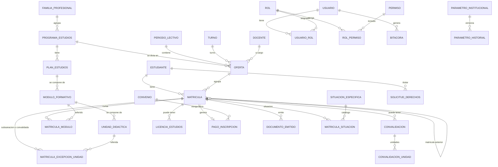

# Modelo de datos lógico

Traduce el [modelo de dominio](../01-analisis-de-sistema/07-modelo-de-dominio.md) a tablas, restricciones e índices. El **script de referencia** es [`db/esquema_matricula_cetpro_v1.1.sql`](../../db/esquema_matricula_cetpro_v1.1.sql), con sus [pruebas de humo](../../db/pruebas_esquema_v1.1.sql) (**ejecutado por el equipo en PostgreSQL con 0 comprobaciones fallidas**). Este documento es su guía de lectura; ante una diferencia manda el script y se corrige este documento. El plan de cada spec fija los nombres definitivos y las migraciones de EF Core.

## 1. Convenciones

| Tema | Regla |
| :--- | :--- |
| Motor | **PostgreSQL 18**; el script usa funciones disponibles desde PostgreSQL 13. |
| Esquemas | `identidad` (usuarios, roles, permisos), `matricula` (negocio) y `auditoria` (bitácora). |
| Identificadores | Clave sustituta `GENERATED ALWAYS AS IDENTITY`; identificador **opaco** `uid` (UUID) para URL; el documento es dato, no clave de URL. |
| Fechas | `timestamptz` en UTC; la interfaz muestra la hora de Lima. |
| Dinero | `numeric(8,2)` en soles. |
| Nombres | Tablas y columnas en español, `snake_case`. |
| Enumerados | Tipos `ENUM` para conjuntos estables definidos por norma; **tablas** de catálogo para lo configurable. |
| Borrado | Baja lógica (`activo`) para el catálogo; la matrícula se **anula** (estado), no se borra. |
| Concurrencia | Columna `version` en `matricula` (control optimista). |
| Permisos | La aplicación se conecta con `cetpro_app`: sin `DELETE` general, solo inserción y lectura en la bitácora. |
| Auditoría | Disparadores de cambio con usuario y origen (`SET LOCAL cetpro.usuario_id` y `cetpro.ip_origen`); sin valores, solo nombres de columnas e identificadores. |
| Datos personales | Marcados en la sección 6; el borrado o la anonimización se prueba. |

## 2. Diagrama entidad-relación

## 3. Identidad y parámetros

| Tabla | Columnas principales | Restricciones |
| :--- | :--- | :--- |
| `identidad.usuario` | id (UUID), nombre de usuario y normalizado, hash de contraseña, segundo factor (activo, secreto cifrado), bloqueo e intentos, último acceso, nombres, apellidos, activo | Nombre normalizado único y con patrón `[A-Za-z0-9._-]{4,40}`; intentos ≥ 0. Mapeada por ASP.NET Core Identity. |
| `identidad.rol` | codigo, nombre, descripcion | `codigo` único: MATRICULA, DIRECTIVO, ADMINISTRADOR. |
| `identidad.usuario_rol` | id_usuario, id_rol | PK compuesta. |
| `identidad.permiso` | codigo, descripcion | `codigo` único (25 permisos iniciales). |
| `identidad.rol_permiso` | id_rol, id_permiso | PK compuesta; auditada. |
| `parametro_institucional` | clave, tipo, valor (JSONB), descripcion, vigente_desde, id_usuario_modifica | Un valor JSON `null` significa «por definir». |
| `parametro_historial` | clave, valor_anterior, valor_nuevo, cambiado_en, id_usuario | Lo escribe un disparador al cambiar un valor. |

## 4. Catálogos y académico

| Tabla | Columnas principales | Restricciones |
| :--- | :--- | :--- |
| `turno` | codigo, nombre, activo | Mañana y tarde. |
| `grado_instruccion` | codigo, nombre, `cumple_primaria_completa`, orden | Valores iniciales por confirmar con la plantilla de AVANZA. |
| `modalidad_servicio`, `modelo_educativo` | codigo, nombre, activo | Valores del Anexo 1. |
| `situacion_especifica` | codigo, nombre, es_sensible | PIR, Transitabilidad, MOT, Discapacidad, otra. Acceso restringido. |
| `ubigeo` | codigo (6 dígitos), departamento, provincia, distrito | Los datos INEI se cargan aparte. |
| `familia_profesional` | nombre, activo | Nombre único. |
| `programa_estudios` | id_familia, nombre, ciclo, creditos_minimos, activo | **CHECK**: Auxiliar Técnico ≥ 40; Técnico ≥ 80. Único por (nombre, ciclo). |
| `plan_estudios` | id_programa, tipo_resolucion, numero_resolucion, anio_resolucion, vigente | Único por programa y resolución. |
| `modulo_formativo` | id_plan, nombre, orden, creditos, horas, activo | Único por plan y nombre. |
| `unidad_didactica` | id_modulo, nombre, creditos, horas, periodo_academico_sugerido, activo | Créditos y horas positivos. |
| `periodo_lectivo` | codigo (2026-I), fechas de periodo y de clases, vigente | **Índice único parcial**: un solo vigente. |
| `docente` | nombres, apellidos, activo | Dato informativo; sin documento. |
| `oferta` | id_programa, id_periodo, id_turno, id_docente, modalidad, modelo, cupo_referencial, activa | Única por programa, periodo y turno; `cupo_referencial` **no es un límite**. |

## 5. Estudiante y matrícula

| Tabla | Columnas principales | Restricciones |
| :--- | :--- | :--- |
| `estudiante` | uid, tipo_documento, numero_documento, apellido_paterno y materno, nombres, sexo, fecha_nacimiento, grado de instrucción, ubigeo, dirección, correo, teléfonos | Único (tipo, número); DNI de 8 dígitos; fecha de nacimiento pasada; formato de correo y teléfonos. **Sin copia del DNI ni evidencia socioeconómica.** |
| `matricula` | uid, codigo_matricula, id_estudiante, oferta (id, programa, periodo), tipo_ingreso, estado, matrícula anterior, institución de origen, `edad_minima_aplicada`, `edad_al_matricular`, motivo y fecha de cambio de estado, requisitos verificados (JSONB), observaciones (hasta 250 caracteres, con advertencia: sin salud ni ingresos), aviso de privacidad, version | **FK compuesta** a la oferta; **índice único parcial** `uq_matricula_vigente` (estudiante, programa, periodo, VIGENTE); anulada exige motivo; trasladado exige institución de origen. |
| `matricula_modulo` | id_matricula, id_modulo, periodo_academico_numero | PK compuesta; disparador: el módulo pertenece al programa de la matrícula. |
| `matricula_situacion` | id_matricula, id_situacion, detalle | Acceso restringido; sin documentos. |
| `convalidacion` | id_matricula, tipo, resolucion_directoral, fecha, justificacion, ruta complementaria, usuario | Resolución y justificación obligatorias. |
| `convalidacion_unidad` | id_convalidacion, id_unidad, similitud_pct | 0 a 100; disparador: en convalidación **entre planes** exige la similitud mínima. |
| `matricula_excepcion_unidad` | id_matricula, id_unidad, condicion, id_convalidacion | `CONVALIDADA` exige convalidación; `SUBSANACION` no la admite. |
| `licencia_estudios` | id_matricula, fechas de inicio, fin prevista y límite de reincorporación, estado, matrícula de reincorporación | **Índice único parcial**: una licencia vigente por matrícula; al insertarla, un disparador pasa la matrícula a LICENCIA. |
| `convenio` | institucion, descripcion, porcentaje_maximo, fechas, activo | Porcentaje entre 0 y 100. |
| `pago_inscripcion` | id_matricula (único), id_convenio, monto_base, tipo_exoneracion, porcentaje_desc, monto_pagado, comprobante, fecha | Coherencia del descuento; `monto_pagado = monto_base × (1 − porcentaje/100)`; disparador: no supera el tope del parámetro ni el del convenio. |

## 6. Documentos y cumplimiento

| Tabla | Columnas principales | Restricciones |
| :--- | :--- | :--- |
| `documento_emitido` | tipo, id_matricula, usuario, codigo_documento, formato, filtros (JSONB), hash_sha256, fecha, revocado_en y motivo | Código único; formato PDF o XLSX; hash de 64 hexadecimales; la constancia exige matrícula; revocar exige motivo. |
| `aviso_privacidad_version` | version, texto, vigente_desde y hasta | Versión única. |
| `solicitud_derechos` | id_estudiante, tipo, estado, fecha_recepcion, plazo_dias_habiles, fecha_limite, ampliado, detalle, respuesta | Plazos 8, 10, 20 (o su ampliación). Auditada. |
| `incidente_seguridad` | fecha_deteccion, descripcion, tipos de datos, personas afectadas, sensibles, perjuicio, requiere notificación, notificaciones, medidas, estado | La notificación a la autoridad solo si el incidente la requiere. Auditado. |
| `alerta` | tipo, clave_dedupe, titulo, detalle (JSONB), roles_destino, estado, creada_en, atendida_en | **Índice único parcial**: una alerta activa por clave; cerrar exige fecha. |
| `auditoria.bitacora` | usuario, accion, entidad, id_registro, detalle (JSONB), ip_origen, fecha_hora | Solo inserción: disparadores impiden `UPDATE`, `DELETE` y `TRUNCATE`; solo la función de depuración autorizada borra lo anterior a la retención. |

## 7. Reglas en la base de datos (doble defensa)

| Regla | Mecanismo | Requisito |
| :--- | :--- | :--- |
| Edad mínima con el parámetro vigente; guarda el valor aplicado | Disparador `BEFORE INSERT` en `matricula` | RN-01 |
| Código de matrícula = documento | Mismo disparador | RN-09 |
| Ciclo Técnico exige primaria completa | Mismo disparador | RN-14 |
| Una matrícula vigente por estudiante, programa y periodo | Índice único parcial | RN-13 |
| Estados y columnas inmutables de la matrícula; incrementa `version` | Disparador `BEFORE UPDATE` | RN-15 |
| El módulo pertenece al programa | Disparador en `matricula_modulo` | AD-28 |
| Tope de beca | Disparador en `pago_inscripcion` | RN-06 |
| Similitud mínima entre planes | Disparador en `convalidacion_unidad` | RN-12 |
| Licencia pasa la matrícula a LICENCIA | Disparador `AFTER INSERT` en `licencia_estudios` | RN-11 |
| Bitácora inmutable | Disparadores `UPDATE`, `DELETE`, `TRUNCATE` | RNF-12 |
| Auditoría automática de cambios | Disparadores `AFTER` en 11 tablas: `estudiante`, `matricula`, `pago_inscripcion`, `convenio`, `convalidacion`, `licencia_estudios`, `parametro_institucional`, `matricula_situacion`, `solicitud_derechos`, `incidente_seguridad` y `identidad.rol_permiso`. **No cubren** `identidad.usuario` ni `identidad.usuario_rol` (las altas, bajas y restablecimientos los registra la aplicación, spec `identidad-seguridad`), ni la emisión de documentos (la registra la aplicación) | RF-34 |
| Historial de parámetros | Disparador `BEFORE UPDATE` | RF-32 |

## 8. Vistas de reporte y de exportación

| Vista | Para qué |
| :--- | :--- |
| `v_nomina_matriculados` | Nómina de vigentes por programa, módulo, periodo y turno. |
| `v_matriculados_por_oferta` | Matriculados frente al cupo referencial. |
| `v_registro_matricula_cabecera` y `v_registro_matricula_unidades` | Datos del Anexo 1 (encabezado y unidades didácticas). |
| `v_exportacion_avanza_estudiantes` y `v_exportacion_avanza_modulos` | Base de los archivos para AVANZA; columnas **provisionales** hasta tener las plantillas (P-01). |
| `v_datos_faltantes_exportacion` | Estudiantes con campos que AVANZA exige y faltan. |

## 9. Índices y rendimiento

| Consulta crítica | Índice |
| :--- | :--- |
| Búsqueda por apellidos y nombres | (`apellido_paterno`, `apellido_materno`, `nombres`) y, si está `pg_trgm`, índice trigrama sobre el nombre completo |
| Documento duplicado | Único (`tipo_documento`, `numero_documento`) |
| Matrículas por estudiante, oferta, fecha y código | Índices individuales |
| Bitácora por fecha, usuario y entidad | `fecha_hora DESC`, `id_usuario`, (`entidad`, `id_registro`) |
| Documentos de una matrícula | `id_matricula` |

## 10. Datos personales y retención

| Tabla | Datos personales | Tratamiento y retención |
| :--- | :--- | :--- |
| `estudiante` | Documento, nombres, nacimiento, dirección, correo, teléfonos | Se conservan según `retencion_matriculas_anios` (**por definir con la UGEL**); luego se anonimizan con constancia. |
| `matricula`, `pago_inscripcion` | Datos de la matrícula y del pago | Igual que el estudiante. |
| `matricula_situacion` | Situación específica (puede incluir discapacidad) | Dato sensible: acceso restringido y solo con permiso. |
| `solicitud_derechos` | Datos del titular | Plazo por definir. |
| `auditoria.bitacora` | Usuario, origen, identificador del registro | ≥ 2 años (`retencion_bitacora_anios`); se depura solo por la función autorizada. |
| Respaldos | Todos | Cifrados; rotan según la retención. |

## 11. Migraciones

Las migraciones son versionadas, hacia adelante y reversibles cuando es posible; se ejecutan con una cuenta distinta de la de aplicación (propietaria). Cada plan incluye su migración y una prueba de integración con la base real (Testcontainers) que verifica las restricciones críticas (edad, unicidad de matrícula vigente, ciclo Técnico, tope de beca, bitácora inmutable). Las tablas auxiliares de ASP.NET Core Identity (reclamos, inicios de sesión externos, fichas) las crea la migración de EF Core.

## 12. Catálogo de parámetros institucionales

Son las claves que crea el script en `parametro_institucional` (26). El valor `null` significa **por definir**: leerlo es un error explícito. Cada spec que usa un parámetro lo nombra en sus criterios; un cambio queda en `parametro_historial` y en la bitácora.

| Clave | Tipo | Valor inicial | Spec que lo usa | Fuente |
| :--- | :---: | :--- | :--- | :--- |
| `edad_minima` | ENTERO | 16 | MAT | RN-01; entrevista (piso nacional 14: LAG 11.2.1) |
| `edad_referencia` | TEXTO | `FECHA_MATRICULA` (o `INICIO_PERIODO`) | MAT | RN-01 |
| `periodo_semanas` | ENTERO | 18 | OFE | LAG 19.1 |
| `periodos_por_anio` | ENTERO | 2 | OFE | Convención de AVANZA (2026-I, 2026-II) |
| `plazo_registro_matricula_dias` | ENTERO | 30 | ALE, AVZ | RN-16; LAG 17.1 |
| `cupo_referencial` | ENTERO | 30 | OFE | RN-04; entrevista |
| `beca_porcentaje_maximo` | DECIMAL | 50 | BEC | RN-06; entrevista |
| `convalidacion_similitud_minima` | DECIMAL | 80 | CON | RN-12; LAG 11.5 |
| `plazo_reserva_licencia_dias` | ENTERO | `null` (por definir) | RAT | RN-11; LAG 11.4 (plazo máximo que fija el CETPRO) |
| `derecho_inscripcion_monto` | DECIMAL | `null` (por definir) | MAT | RN-02; entrevista |
| `retencion_bitacora_anios` | ENTERO | 2 | AUD | DS art. 46 |
| `retencion_matriculas_anios` | ENTERO | `null` (por definir) | PRI | RF-38 |
| `revision_privilegios_meses` | ENTERO | 6 | IDE | DS art. 46 |
| `alerta_dias_antes_plazo_registro` | JSON | `[7,2]` | ALE | Procesos de negocio, sección 11 |
| `alerta_dias_antes_licencia` | JSON | `[15,5]` | RAT, ALE | Procesos de negocio, sección 11 |
| `password_minimo` | ENTERO | 15 | IDE | NIST SP 800-63B-4 |
| `sesion_inactividad_min` | ENTERO | 30 | IDE | RNF-05 |
| `sesion_maxima_horas` | ENTERO | 8 | IDE | RNF-05 |
| `bloqueo_intentos` | ENTERO | 5 | IDE | RNF-05 |
| `bloqueo_minutos` | ENTERO | 15 | IDE | RNF-05 |
| `zona_horaria` | TEXTO | `America/Lima` | WEB | AD-17 |
| `institucion` | JSON | Nombre, DRE, UGEL, tipo de gestión, departamento y provincia; **`codigo_modular` y `distrito` en `null`** | CST, REP, AVZ | Anexo 1 |
| `oficial_datos` | JSON | Todo en `null` (por definir) | PRI | AD-31; DS art. 37 |
| `campos_estudiante` | JSON | Obligatorios y requeridos para exportar | EST, AVZ | RF-01; AD-30 |
| `requisitos_matricula` | JSON | Ficha firmada, certificado de estudios (ciclo Técnico) y fotografías | MAT | RF-43; LAG 11.2.1 |
| `avanza_mapeo_columnas` | JSON | `{}` (pendiente de las plantillas) | AVZ | AD-24; P-01 |

### 12.1 Parámetros que faltan en el esquema v1.1

Las specs los **agregan** con su valor inicial; hasta entonces, el comportamiento descrito en los documentos usa estos valores como **propuesta**. Los marcados «por definir» no tienen fuente: la spec los deja en `null` y el sistema no inventa un valor.

| Clave propuesta | Valor inicial | Spec | Origen |
| :--- | :--- | :--- | :--- |
| `alerta_antes_solicitud_derechos` | A la mitad del plazo y 2 días antes | ALE, PRI | Procesos de negocio, secciones 8 y 11 |
| `alerta_dias_sin_prueba_restauracion` | 90 | ALE, OPS | Procesos de negocio, sección 11 |
| `alerta_dias_antes_retencion` | 30 | ALE, PRI | Procesos de negocio, sección 11 |
| `alerta_umbral_ingresos_fallidos`, `alerta_umbral_exportaciones` | Por definir | ALE | Procesos de negocio, sección 11 («por umbral») |
| `segundo_factor_limite` | 5 códigos incorrectos en 15 minutos | IDE | Superficie expuesta, sección 5 (propuesta) |
| `verificacion_publica_limite` | 30 consultas en 10 minutos por origen | CST | Superficie expuesta, sección 5 (propuesta) |
| `sesion_aviso_min` | 2 | WEB | Estados y accesibilidad, sección 2 |
| `borrador_vigencia_dias` | Por definir | MAT | RF-42 (ver sección 13, brecha 1) |
| `avanza_max_filas_por_archivo` | 500 (por verificar para estudiantes; el manual de AVANZA v3.5, caso 4, lo documenta para notas) | AVZ | Manual de AVANZA v3.5 |

## 13. Brechas conocidas del esquema v1.1

El esquema se probó y es la referencia, pero la auditoría de la documentación (21-oct-2026) encontró lo siguiente. Ninguna invalida lo ya probado; cada brecha la cierra la spec indicada con una migración y su prueba.

| # | Brecha | Qué debe resolver la spec |
| :---: | :--- | :--- |
| 1 | **No hay dónde guardar el borrador de la ficha (RF-42).** | MAT: una tabla de borradores (autor, datos parciales, última actualización). Contiene datos personales: acceso solo del autor, purga al confirmar o al vencer (`borrador_vigencia_dias`), valores fuera de la bitácora y sin copia en los respaldos más allá de su vigencia. |
| 2 | `ck_solicitud_plazo` admite 16 días, que sería el derecho de información ampliado; el **DS art. 71.1 excluye la ampliación del derecho de información**. | PRI: valores válidos 8, 10, 20 y 40 (acceso ampliado), con 20 también para rectificación, cancelación u oposición ampliadas; validar la combinación tipo-plazo. |
| 3 | La auditoría no cubre `identidad.usuario`, `identidad.usuario_rol` ni `aviso_privacidad_version`. | IDE y PRI: registrar altas, bajas, cambios de rol y restablecimientos como eventos de aplicación o con disparadores. |
| 4 | Revocar una constancia (`documento_emitido.revocado_en`) no tiene permiso ni actor definidos. | CST: definir el permiso (propuesta: `CONSTANCIA_REVOCAR`, del Personal de matrícula, con motivo) y registrar la revocación. |
| 5 | El requisito de **NEE** (certificado de discapacidad o informe psicopedagógico del SAANEE, LAG 11.2.1) no está en `requisitos_matricula`. | MAT: agregarlo como requisito condicional; solo se registra que se verificó. |
| 6 | Faltan los parámetros de la sección 12.1. | PAR y las specs de cada uno. |
| 7 | Las vistas de exportación a AVANZA tienen columnas **provisionales**. | AVZ, cuando se consigan las plantillas (P-01). |
| 8 | La matrícula anterior de una reincorporación permanece en `LICENCIA` (la licencia pasa a `REINCORPORADO`). | RAT: dejarlo explícito en el criterio; no requiere cambio. |