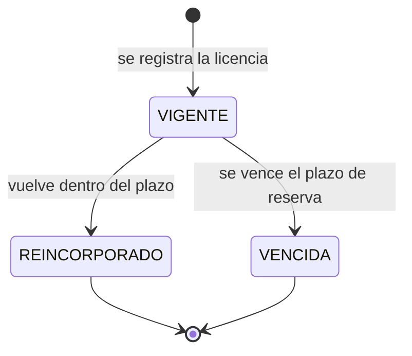
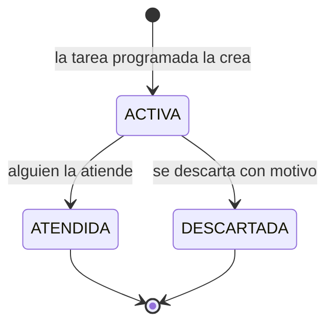
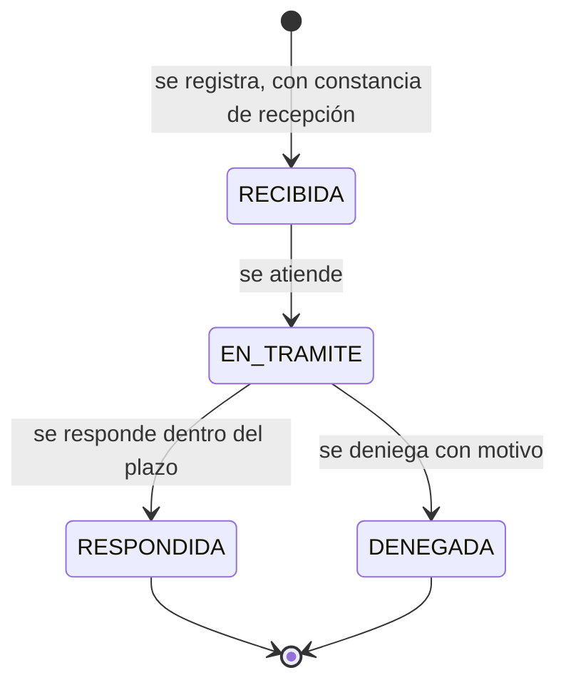
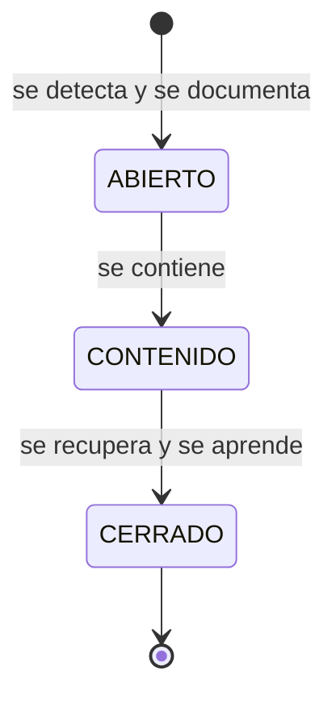

# Estados y concurrencia

Reúne los ciclos de vida del dominio y la forma de garantizar su corrección ante solicitudes simultáneas. Complementa los patrones de [principios y patrones](03-principios-y-patrones.md) y el [modelo de datos](05-modelo-de-datos.md).

## 1. Máquinas de estado

### 1.1 Matrícula

```mermaid
stateDiagram-v2
[*] --> VIGENTE : registro o ratificación
VIGENTE --> ANULADA : error de registro, con motivo
VIGENTE --> RETIRADA : deja los estudios
VIGENTE --> LICENCIA : licencia de estudios
LICENCIA --> RETIRADA : vence el plazo de reserva
LICENCIA --> [*] : permanece así; la reincorporación crea otra matrícula
ANULADA --> [*]
RETIRADA --> [*]
```

- La **ratificación** crea la matrícula del siguiente periodo con tipo RATIFICACIÓN y enlace a la anterior (RN-10).
- Una **reincorporación** crea una matrícula nueva de tipo REINCORPORACIÓN (RN-11).
- Solo las matrículas **VIGENTES** aparecen en la nómina y en los archivos.
- Tras una reincorporación, la matrícula anterior **permanece en LICENCIA** y la licencia pasa a REINCORPORADO; solo la matrícula nueva está VIGENTE. Los estados **ANULADA** y **RETIRADA** son finales. Anular **exige motivo** (RN-15) y no borra.
- Un disparador en la base impide transiciones inválidas (`ANULADA → VIGENTE`, por ejemplo) y cambiar el estudiante, la oferta, el código o la edad aplicada.

### 1.2 Licencia de estudios

Al registrar la licencia, la matrícula pasa a LICENCIA. Una matrícula solo puede tener **una licencia vigente**. Reincorporado exige la matrícula de reincorporación; si la licencia vence, la matrícula pasa a RETIRADA y la persona puede volver a inscribirse como nuevo ingreso.

### 1.3 Alerta

Solo puede haber **una alerta activa por clave** (no se duplica); cerrar exige fecha y quién la atendió. Una alerta atendida permite que el mismo evento vuelva a avisar más tarde.

### 1.4 Solicitud de derechos

El plazo (8, 20 o 10 días hábiles) se calcula por tipo y es ampliable **una sola vez** por igual plazo, con justificación, **salvo el derecho de información** (DS art. 71.1).

### 1.5 Incidente de seguridad

Todo incidente se documenta. La notificación a la autoridad (48 h) solo se registra si el incidente cumple las condiciones del art. 34.

### 1.6 Documento emitido

`emitido → revocado` (la revocación exige motivo). Una constancia revocada deja de verificarse como válida.

### 1.7 Parámetro institucional

Un parámetro tiene un valor vigente; cada cambio escribe el anterior en el historial. El valor `null` significa **por definir**: leerlo lanza un error explícito.

## 2. Concurrencia

### 2.1 Qué puede competir

| Recurso | Competencia | Riesgo |
| :--- | :--- | :--- |
| Matrícula vigente de un estudiante | Dos personas registran la misma persona al mismo tiempo | Dos matrículas vigentes en el mismo programa y periodo (RN-13) |
| Ficha de una matrícula | Dos personas editan o anulan a la vez | Pérdida de cambios o estado inconsistente |
| Parámetros | Dos administradores cambian el mismo valor | Valor aplicado impredecible |
| Alerta | La tarea programada y una persona actúan a la vez | Alerta duplicada o cerrada dos veces |
| Licencia | Dos registros de licencia para una matrícula | Dos licencias vigentes |
| Código de documento | Dos emisiones simultáneas | Código repetido |
| Respaldo y restauración | Una tarea mientras se restaura | Copia inconsistente |

### 2.2 Estrategia

| Mecanismo | Uso |
| :--- | :--- |
| **Transacción única por caso de uso** | El cambio, el pago y la bitácora se confirman juntos o ninguno. |
| **Restricciones en la base** | Índices únicos parciales (matrícula vigente, licencia vigente, alerta activa, periodo vigente) y `CHECK`: son la última defensa. |
| **Control optimista** | Columna `version` en `matricula`; la aplicación actualiza con `WHERE version = @version`; un conflicto se informa a la persona («alguien modificó esta matrícula») mostrando qué cambió. |
| **Disparadores de estado** | La base valida las transiciones aunque falle la aplicación. |
| **Idempotencia de la interfaz** | El botón se desactiva tras el primer envío; el reenvío del mismo formulario no crea otra matrícula. |
| **Unicidad del código** | `codigo_documento` único y generado en el servidor. |
| **Tareas programadas idempotentes** | Las alertas se crean con una clave de deduplicación. |

### 2.3 Fallos parciales

| Situación | Resultado |
| :--- | :--- |
| Falla la escritura de la bitácora | La operación sensible no se aplica. |
| Se corta la conexión durante la ficha | El borrador queda en el servidor; al volver se retoma. |
| Falla la generación del PDF | Se informa el error; no se registra una emisión incompleta. |
| Falla un respaldo | Alerta técnica al Administrador. |
| La BD no responde | Mensaje claro; no se pierde lo escrito en pantalla. |

### 2.4 Pruebas obligatorias

| Prueba | Qué demuestra | Criterio |
| :--- | :--- | :--- |
| Dos solicitudes simultáneas para registrar la misma matrícula | Solo una prospera; la otra recibe un rechazo claro | `AC-MAT-xx` |
| Dos anulaciones simultáneas de la misma matrícula | Solo una se aplica; la otra recibe conflicto de versión | `AC-MAT-xx` |
| Intento de transición inválida (`ANULADA → VIGENTE`) | Rechazo por el disparador | `AC-MAT-xx` |
| Dos licencias vigentes para una matrícula | La segunda falla por el índice único | `AC-RAT-xx` |
| Una alerta duplicada | Un solo registro activo por clave | `AC-ALE-xx` |
| Intento de actualizar o borrar la bitácora | Rechazado por el disparador | `AC-AUD-xx` |

Estas pruebas corren con PostgreSQL real (Testcontainers) y reflejan las comprobaciones de las [pruebas de humo SQL](../../db/pruebas_esquema_v1.1.sql).
