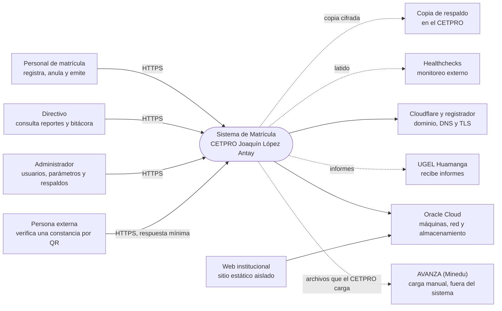
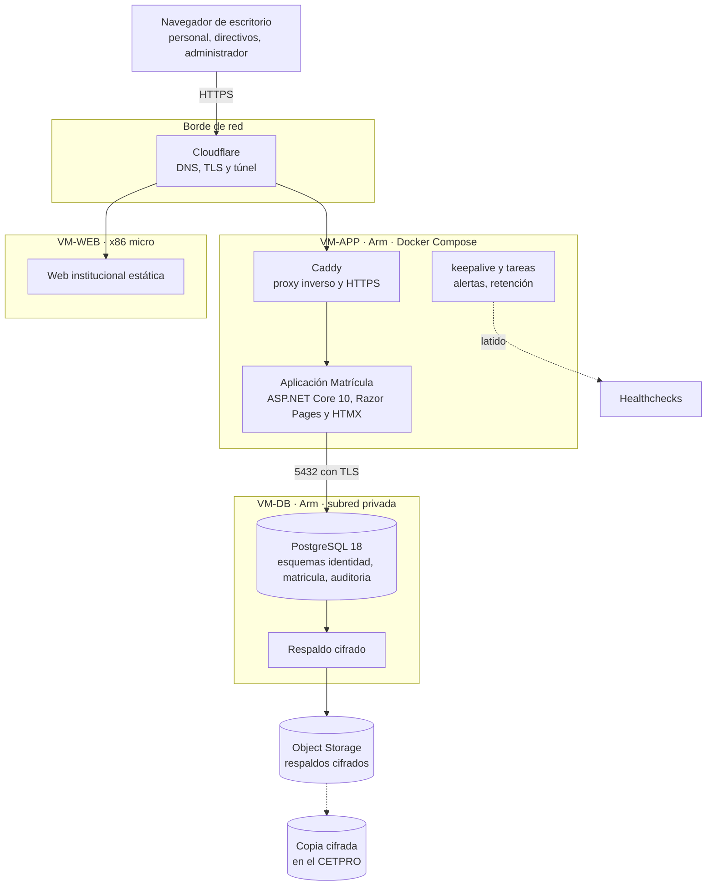

# Contexto y contenedores (niveles 1 y 2)

## 1. Nivel 1: contexto del sistema

El Sistema de Matrícula es un único sistema de software (monolito modular) usado por personas de cuatro perfiles y apoyado en servicios de infraestructura. **AVANZA no es un sistema conectado**: el CETPRO carga allí los archivos que el sistema genera, de forma manual.

| Actor o sistema | Relación | Fuente |
| :--- | :--- | :--- |
| Personal de matrícula | Registra, edita y anula matrículas; emite constancias y reportes. | [actores y permisos](../01-analisis-de-sistema/05-actores-y-permisos.md) |
| Directivo | Consulta reportes, nóminas y bitácora; responde solicitudes de derechos. | Ídem |
| Administrador | Usuarios, parámetros, respaldos y tareas técnicas; sin datos de estudiantes por defecto. | Ídem |
| Persona externa | Verifica una constancia. | RF-28 |
| AVANZA | Destino del registro oficial; **no se conecta**. | Límites del sistema |
| UGEL / DRE | Supervisa; recibe informes si corresponde. | LAG 17.1 |
| Oracle Cloud | Aloja las tres máquinas, el almacenamiento y la red. | RC-02 |
| Cloudflare y registrador | DNS, TLS y protección del tráfico; el dominio lo asume el equipo. | AD-06 |
| Healthchecks | Aviso externo ante un latido que no llega. | AD-09 |
| Web institucional | Sistema 2, aislado, sin acceso a la base de matrícula. | RC-04, AD-14 |

## 2. Nivel 2: contenedores

Un contenedor es una aplicación o un almacén de datos desplegable por separado. Las VM, los límites de memoria y la red están en el [despliegue](../02-arquitectura-de-software/05-despliegue.md).

| Contenedor | Tecnología | Responsabilidad | Specs principales |
| :--- | :--- | :--- | :--- |
| **Aplicación Matrícula** | ASP.NET Core 10, Razor Pages, HTMX, EF Core, Identity, QuestPDF, ClosedXML | Interfaz por rol, casos de uso, reglas de negocio, documentos y tareas programadas. Sin acceso directo desde fuera: todo pasa por Caddy. | `matricula-registro`, `docs-*`, `identidad-seguridad`, `web-base` |
| **Caddy** | Caddy | Proxy inverso, HTTPS automático y cabeceras. | `operacion-despliegue` |
| **PostgreSQL 18** | PostgreSQL | Datos, restricciones, disparadores de doble defensa, bitácora inmutable y vistas; sin acceso desde Internet. | `transversal-auditoria`, esquema SQL |
| **`keepalive` y tareas** | Script en la VM y servicios programados | Evita la reclamación, envía el latido, ejecuta alertas y retención. | `operacion-despliegue`, `transversal-alertas` |
| **Respaldo** | Volcado cifrado | Copia diaria a Object Storage y al CETPRO. | `operacion-despliegue` |
| **Web institucional** | Servidor estático mínimo | Información pública, sin ruta a la BD. | `operacion-despliegue` |
| **Cloudflare** | Servicio externo gratuito | Entrada única, TLS y protección del borde. | AD-06 |

Los elementos transversales de **auditoría** y **seguridad** (límites, errores, cabeceras, eventos) no son contenedores: se implementan dentro de la aplicación y de la base de datos con un contrato único.

## 3. Fronteras de confianza

Se dibujan sobre este nivel en el [modelo de amenazas](../05-seguridad/01-modelo-de-amenazas.md): Internet → borde, borde → aplicación, aplicación → datos, datos → respaldos y administración → servidores. **La web institucional no tiene ningún camino a la base de datos de matrícula.**
