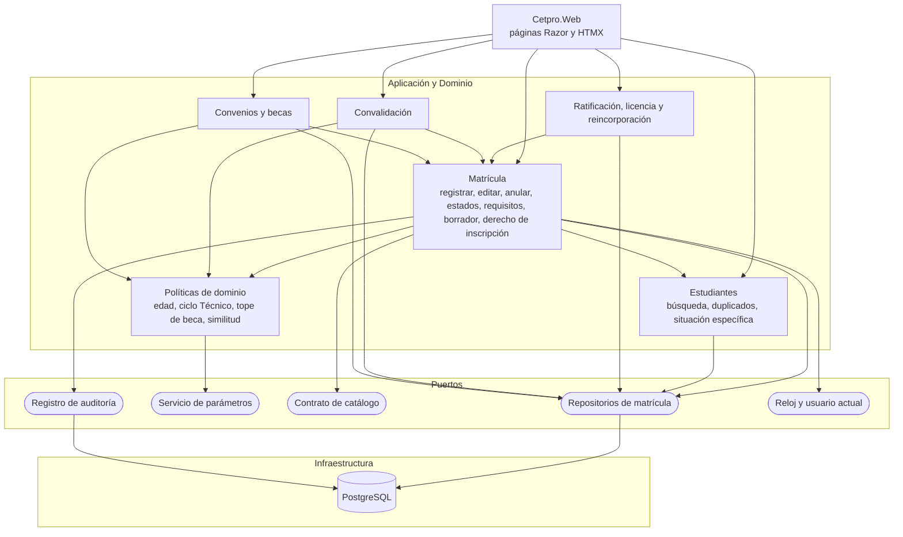
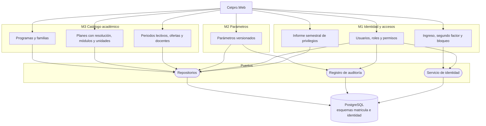
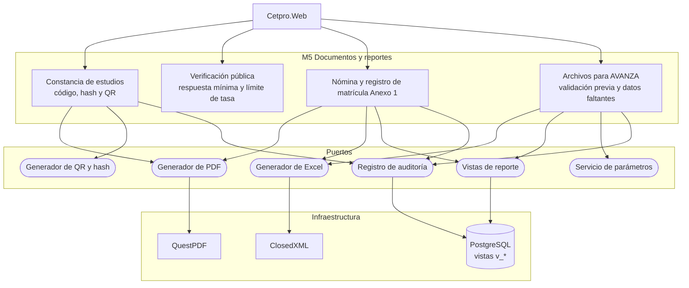
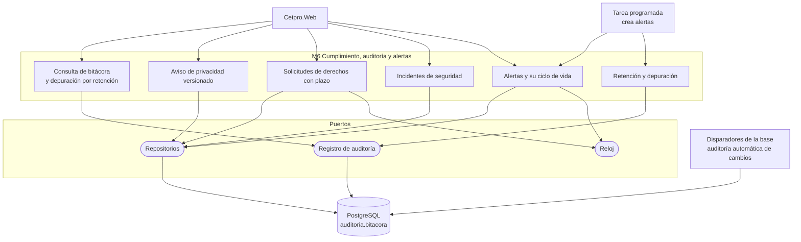
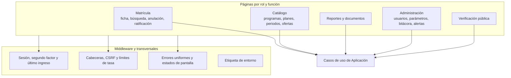

# Componentes (nivel 3)

Cada diagrama abre el contenedor **Aplicación Matrícula** del [nivel 2](01-contexto-y-contenedores.md) y muestra sus **módulos** (casos de uso y reglas agrupados) y los **puertos** que usan, con la Infraestructura que los implementa. Son vistas de referencia a nivel de módulo: los nombres de clases y proyectos los fija el `plan.md` de cada spec. Convención: rectángulo = módulo; cilindro = almacén; óvalo = puerto.

## 1. M4 Matrícula

| Componente | Responsabilidad | Spec |
| :--- | :--- | :--- |
| Estudiantes | Datos personales mínimos, búsqueda por documento o apellidos, aviso de duplicado, situación específica restringida. | `estudiantes` |
| Matrícula | Registro, edición y anulación con motivo; código = documento; estados; requisitos verificados; borrador; módulo cursado; derecho de inscripción (RF-07). | `matricula-registro` |
| Ratificación, licencia y reincorporación | Matrícula nueva enlazada; fechas límite; alertas. | `matricula-ratificacion-licencia` |
| Convalidación | Resolución directoral, justificación y similitud mínima. | `matricula-convalidacion` |
| Convenios y becas | Tope del parámetro; solo el resultado, sin evidencia de ingresos. Se apoyan en el pago de inscripción que registra Matrícula. | `matricula-becas` |
| Políticas de dominio | Edad mínima, ciclo Técnico, tope de beca, similitud: leen parámetros por el puerto. | RN-01, RN-06, RN-12, RN-14 |

## 2. M3 Catálogo académico, M2 Parámetros y M1 Identidad

| Componente | Responsabilidad | Spec |
| :--- | :--- | :--- |
| Programas y familias | Alta, baja y activación; ciclo y créditos mínimos. | `catalogo-academico` |
| Planes, módulos y unidades | Plan con resolución de autorización; módulos con créditos y horas. | `catalogo-academico` |
| Periodos, ofertas y docentes | Periodo lectivo vigente; oferta por programa y turno. | `periodos-ofertas` |
| Parámetros versionados | Valor, vigencia, historial y aviso de cambios críticos. | `parametros-institucionales` |
| Ingreso y segundo factor | Usuario individual, TOTP, bloqueo temporal, último ingreso. | `identidad-seguridad` |
| Usuarios, roles y permisos | Altas, bajas, permisos granulares editables con auditoría. | `identidad-seguridad` |
| Informe de privilegios | Revisión semestral aprobada por el Directivo. | `identidad-seguridad` |

## 3. M5 Documentos y reportes

| Componente | Responsabilidad | Spec |
| :--- | :--- | :--- |
| Constancia | PDF con código único, *hash* SHA-256 y QR; revocable con motivo. | `docs-constancia` |
| Verificación pública | Página con respuesta mínima («válida», programa, periodo, nombre parcial) y límite de tasa. | `docs-constancia` |
| Nómina, Anexo 1 y matriculados | PDF y Excel filtrables por programa, módulo, periodo y turno; matriculados por oferta frente al cupo referencial. | `docs-reportes` |
| Archivos para AVANZA | Excel con el formato de la plantilla; valida antes y lista qué falta; **no carga en AVANZA**. | `docs-archivos-avanza` |

## 4. M6 Cumplimiento, auditoría y alertas

| Componente | Responsabilidad | Spec |
| :--- | :--- | :--- |
| Bitácora | Consulta por fecha, usuario y entidad; registra lecturas y exportaciones; **solo inserción**. | `transversal-auditoria` |
| Aviso de privacidad | Texto con los diez elementos del art. 6; versionado; evidencia de aceptación. | `cumplimiento-privacidad` |
| Solicitudes de derechos | Plazo por tipo, alerta, respuesta. | `cumplimiento-privacidad` |
| Incidentes | Registro, evaluación de notificación y medidas. | `cumplimiento-privacidad` |
| Alertas | Creación por tarea, panel por rol, atender o descartar. | `transversal-alertas` |
| Retención | Depuración o anonimización por plazo, con constancia. | `cumplimiento-privacidad` |

## 5. Presentación (Cetpro.Web)

`Cetpro.Web` aloja las páginas Razor, los fragmentos HTMX, el middleware (errores, cabeceras, límites de tasa, autorización) y la **raíz de composición**. No contiene reglas de negocio.

| Aspecto | Regla |
| :--- | :--- |
| Referencias | Solo a Application y Domain; a Infrastructure únicamente para registrar servicios. |
| Llamadas | Las páginas no acceden a `DbContext`. |
| Autorización | Cada página exige su permiso; sin permiso, la función no aparece y la URL directa muestra «sin permiso». |
| Errores | Mensajes que dicen qué pasó y qué hacer; sin trazas; con identificador de seguimiento. |

## 6. Elementos compartidos

| Elemento | Dónde vive | Regla |
| :--- | :--- | :--- |
| Auditoría y eventos | Disparadores de la base + puerto de la aplicación | La aplicación registra lecturas y exportaciones; la base registra los cambios. |
| Parámetros | M2 | Se leen por puerto; el valor aplicado se guarda en cada acto. |
| Errores uniformes y límites | `Cetpro.Web` | Un mismo formato en toda la aplicación. |
| Kernel compartido | `Cetpro.Domain/Compartido` | Solo tipos de valor genéricos (resultado, identificadores); sin reglas de negocio. |
