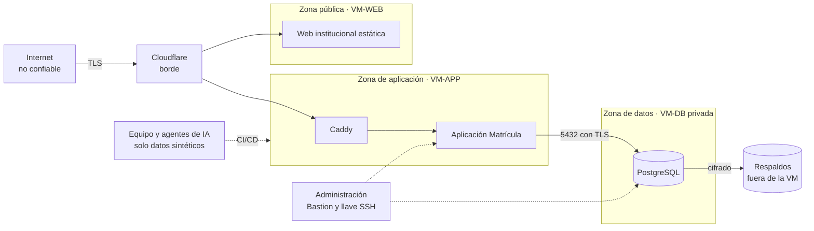

# Modelo de amenazas

Identifica qué se protege, de quién y con qué controles. Sirve de insumo para las specs, los planes y las pruebas de seguridad. Es un modelo **proporcionado a un sistema de cinco usuarios**: se priorizan las amenazas más probables y de mayor impacto para una institución educativa pública que guarda datos de estudiantes, y no se pretende cubrir un adversario con recursos de un Estado.

## 1. Activos

| Activo | Por qué importa | Dueño |
| :--- | :--- | :--- |
| **Registros de estudiantes y matrículas** (documento, nacimiento, dirección, correo, celular) | Datos personales de menores y adultos; atractivos para fraude y suplantación. | M4 |
| **Situación específica y becas** | Pueden revelar discapacidad (dato de salud) o situación económica (dato sensible). | M4 |
| **Constancias de estudios** | Documento con el membrete de la institución: falsificable. | M5 |
| **Credenciales de las cuentas** (cinco del personal y una o dos de administración) | Dan acceso a todo lo anterior. | M1 |
| **Bitácora** | Su valor depende de que no se pueda alterar. | M6 |
| **Copias de respaldo** | Contienen todo; deben estar cifradas y fuera de la VM. | Despliegue |
| **Parámetros institucionales** | Cambiar la edad mínima o el tope de beca altera decisiones. | M2 |
| **Cuenta de Oracle y dominio** | Su pérdida deja el sistema sin servidor o sin dirección. | Infraestructura |
| **Código, specs y secretos del proyecto** | Su filtración o corrupción expone el sistema (incluido el uso de IA). | Equipo |
| **Disponibilidad del servicio** | Una caída durante la temporada de matrícula bloquea el trabajo. | Todos |

## 2. Fronteras de confianza

Se cruzan fronteras: (1) Internet → borde; (2) borde → aplicación; (3) aplicación → datos; (4) datos → respaldos; (5) administración → servidores; (6) equipo y herramientas de IA → entornos. Cada cruce exige autenticación o validación explícita. **La web institucional no tiene ningún camino a la base de datos.**

## 3. Catálogo de amenazas

**Riesgo = probabilidad × impacto** con tres niveles (A alto, M medio, B bajo). **STRIDE:** S suplantación, T alteración, R repudio, I divulgación de información, D denegación de servicio, E elevación de privilegios.

| ID | Amenaza | STRIDE | Activo | Riesgo | Controles | Residual |
| :--- | :--- | :---: | :--- | :---: | :--- | :---: |
| **AM-01** | **Abuso interno**: una persona del personal consulta o vende listas de estudiantes. Es el caso más probable. | I | Estudiantes | A | Bitácora de lecturas y exportaciones (RF-34); mínimo privilegio; documento enmascarado en listados; revisión semestral de privilegios; acuerdo de confidencialidad; alerta de exportaciones inusuales. **Controles:** CTL-24, CTL-38, CTL-40. | M |
| **AM-02** | **Falsificación de constancias** con el membrete del CETPRO. | S, T | Constancias | A | Código único, *hash* y verificación pública mínima por QR con límite de tasa (RF-16, RF-28); revocación con motivo. **Controles:** CTL-10, CTL-14. | B |
| **AM-03** | **Relleno de credenciales o phishing** contra las cinco cuentas. | S | Credenciales | A | MFA obligatoria (RN-07); bloqueo temporal; contraseña de 15+ caracteres sin reglas de composición; alertas; capacitación breve. **Controles:** CTL-15, CTL-17, CTL-19, CTL-40. | B |
| **AM-04** | **Exfiltración** por una vulnerabilidad de la aplicación. | I | Estudiantes | A | Cuenta de BD de mínimo privilegio; BD privada; límites de paginación; registro de exportaciones; ASVS L2; escaneos en CI. **Controles:** CTL-03, CTL-04, CTL-31, CTL-37. | M |
| **AM-05** | **Pérdida o cifrado de datos** (ransomware, falla, error humano). | D | Estudiantes, respaldos | A | Respaldo cifrado en dos lugares; restauración probada; infraestructura como código; RPO ≤ 24 h, RTO ≤ 4 h. **Controles:** CTL-29. | M |
| **AM-06** | **Enumeración** de documentos mediante la búsqueda o la verificación pública. | I | Estudiantes | M | Límite de tasa; respuestas uniformes; la verificación no revela datos más allá de lo mínimo; búsqueda solo con sesión. **Controles:** CTL-10, CTL-25. | B |
| **AM-07** | **Inyección en exportaciones** (fórmulas en Excel, HTML en PDF o en campos libres). | T | Documentos | M | Sanear celdas al exportar; plantillas fijas; codificación automática de Razor; campos libres con advertencia y límite. **Controles:** CTL-02, CTL-12. | B |
| **AM-08** | **Cadena de suministro** (NuGet, imágenes, acciones de GitHub) y **secretos en el repositorio**. | T, E | Código | M | Versiones fijas; Dependabot; Trivy; gitleaks; SBOM; acciones fijadas por *hash*; secretos fuera de Git. **Controles:** CTL-20, CTL-37. | M |
| **AM-09** | **Caída del Internet** del CETPRO o de Oracle. | D | Disponibilidad | M | Contingencia en papel y carga posterior; modo degradado local; respaldo reciente. **Controles:** —. | M |
| **AM-10** | **Pérdida del acceso a la cuenta de Oracle o al dominio.** | D | Cuenta, dominio | M | Dos administradores; correo institucional neutro; MFA; respaldo fuera de Oracle. **Controles:** —. | B |
| **AM-11** | **Ingeniería social**: pedir por teléfono «la lista» o una constancia. | S, I | Estudiantes | M | Procedimiento de verificación de identidad; sin entrega de datos por teléfono. **Controles:** — (procedimiento del CETPRO y capacitación). | M |
| **AM-12** | **Elevación de privilegios**: un Directivo edita matrículas o un usuario abre funciones fuera de su rol. | E | Todos | A | Permisos granulares en cada caso de uso; denegar por defecto; pruebas por rol; identificadores opacos. **Controles:** CTL-23, CTL-24, CTL-26, CTL-27. | B |
| **AM-13** | **Alteración o borrado de la bitácora.** | R, T | Bitácora | M | Disparadores que impiden `UPDATE`, `DELETE` y `TRUNCATE`; la cuenta de aplicación solo inserta; copia en el CETPRO. **Controles:** CTL-38. | B |
| **AM-14** | **Robo de sesión** (XSS) o **solicitudes falsas entre sitios** (CSRF). | S, T | Sesiones | M | Cookie `HttpOnly`, `Secure`, `SameSite`; CSP; protección CSRF en formularios; codificación de salida. **Controles:** CTL-02, CTL-05, CTL-06, CTL-21. | B |
| **AM-15** | **Inyección SQL.** | T, I | Datos | A | EF Core con parámetros; sin SQL concatenado; privilegios mínimos de la cuenta de BD. **Controles:** CTL-03. | B |
| **AM-16** | **Reclamación de una VM por inactividad** (Oracle). | D | Disponibilidad | M | `keepalive` calibrado; trabajo real programado; latido externo; reconstrucción desde Git. **Controles:** —. | M |
| **AM-17** | **Datos reales en herramientas de IA**, pruebas o repositorio. | I | Estudiantes | A | AD-36: datos sintéticos; el agente no accede a producción ni a secretos; herramientas aprobadas; gitleaks. **Controles:** CTL-35. | B |
| **AM-18** | **Código o dependencias generados por IA con defectos** (paquetes inexistentes, licencias dudosas, vulnerabilidades). | T | Código | M | Pruebas primero; revisión independiente; pruebas de arquitectura y seguridad; verificación de paquetes y licencias. **Controles:** CTL-37. | M |
| **AM-19** | **Instrucciones incrustadas en contenido externo** (páginas, PDF, correos) que manipulan al agente de desarrollo. | T, E | Código | M | El contenido externo es dato, no instrucción; puertas humanas; el agente no tiene secretos ni producción. **Controles:** —. | B |
| **AM-20** | **Uso indebido del acceso del Administrador** (hoy, el equipo desarrollador) a datos reales. | I | Estudiantes | M | Sin acceso a datos de estudiantes por defecto; bitácora técnica; acuerdo de encargo y confidencialidad; traspaso posterior a la Dirección. **Controles:** CTL-26, CTL-38. | M |
| **AM-21** | **Fuga de datos sensibles** (situación específica, becas) a roles sin necesidad. | I | Datos sensibles | M | Permiso `SITUACION_ESPECIFICA_VER` solo para Personal de matrícula; sin documentos; campo `observaciones` con advertencia y límite. **Controles:** CTL-33. | B |
| **AM-22** | **Cuenta compartida o segundo factor perdido.** | S | Credenciales | B | Credenciales individuales; códigos de respaldo; restablecimiento por el Administrador con registro. **Controles:** CTL-17, CTL-19, CTL-30. | B |

## 4. Casos de abuso destacados

| Caso | Secuencia del atacante | Defensa que lo corta |
| :--- | :--- | :--- |
| **Vender una lista** | Una persona con acceso exporta la nómina de un programa y la entrega a un tercero. | La exportación queda en la bitácora (quién, qué, cuándo); la alerta de exportaciones inusuales; el Directivo revisa; el acuerdo de confidencialidad habilita la sanción. |
| **Constancia falsa** | Se imprime una constancia con el membrete y un código inventado. | La página de verificación responde «no válida» de forma uniforme; el límite de tasa frena la prueba masiva de códigos. |
| **Adivinar contraseñas** | Prueba de listas filtradas contra los usuarios. | Bloqueo tras 5 fallos; contraseña fuera de listas comunes; respuesta uniforme; segundo factor. |
| **Editar el pasado** | Alguien intenta cambiar la bitácora para ocultar una consulta. | El disparador rechaza `UPDATE`, `DELETE` y `TRUNCATE`; la cuenta de aplicación solo inserta. |
| **Pegar datos reales en una IA** | Una persona del equipo copia una ficha real a una herramienta para «arreglar un error». | Regla de `AGENTS.md`; datos sintéticos; escaneo; tratamiento como incidente. |
| **Reclamación de la VM** | Oracle reclama una instancia inactiva. | `keepalive`, latido externo y reconstrucción desde Git y respaldo. |

## 5. Supuestos y límites

- Se asume que Cloudflare, Oracle Cloud y los demás proveedores cumplen sus propias garantías de seguridad.
- No se cubren ataques físicos, amenazas con acceso a los servidores de Oracle ni adversarios con recursos de un Estado.
- No se realizan pruebas de penetración externas; sí revisión automática (SAST, DAST básico, escaneo de dependencias y de secretos).
- Se acepta que el Administrador, mientras sea el equipo desarrollador, es una persona de confianza con acceso técnico (AM-20); se mitiga y se traspasará a la Dirección.
- Un incidente con datos de estudiantes se trata con el procedimiento del [documento de privacidad](04-privacidad-y-datos-personales.md).

## 6. Revisión

El modelo se revisa al aprobar cada spec que cambia una frontera de confianza (nueva integración, nuevo rol o nuevo dato personal) y antes de cada despliegue mayor. Una amenaza nueva recibe el siguiente `AM` disponible; los identificadores no se renumeran.
