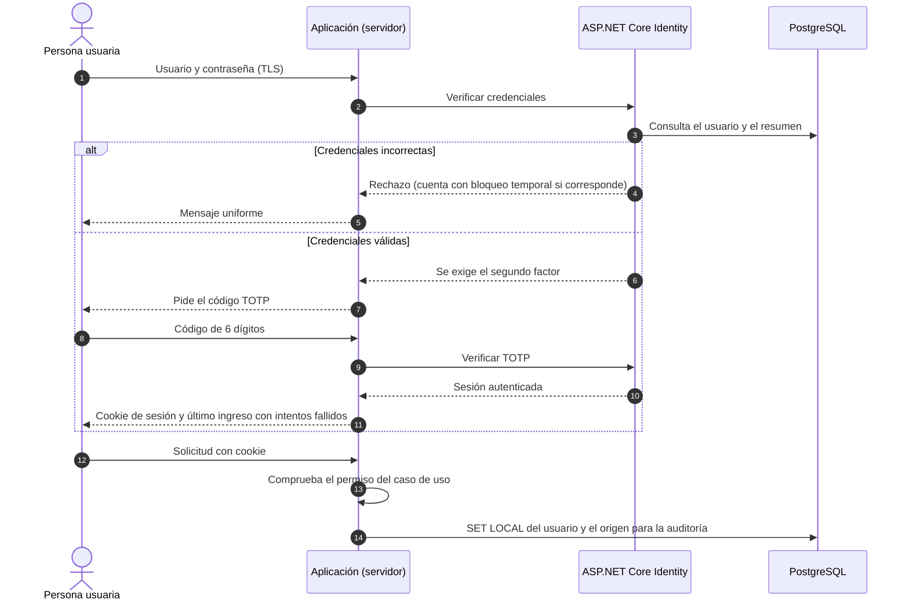

# Autenticación y autorización

Describe cómo se identifica a las personas, cómo se mantiene la sesión y cómo se decide qué puede hacer cada una. Desarrolla AD-04 y AD-33 y los requisitos RN-07, RNF-05 y RF-19 a RF-30. El comportamiento exacto estará en la spec `identidad-seguridad` (IDE).

## 1. Modelo

La sesión es una **cookie de servidor** (no un token en el navegador). La aplicación decide el permiso en cada caso de uso y avisa a la base de datos quién actúa para que los disparadores de auditoría lo registren.

## 2. Credenciales de las personas

| Elemento | Decisión | Fuente |
| :--- | :--- | :--- |
| Contraseña | Mínimo **15 caracteres** (parámetro `password_minimo`); acepta espacios y pegar; se rechazan valores de listas de contraseñas comunes o filtradas; **sin reglas de composición** y sin vencimiento periódico (se cambia ante sospecha). | NIST SP 800-63B-4 |
| Almacenamiento | Resumen robusto con sal (PBKDF2 de Identity o Argon2id); nunca en claro. | A04 |
| Segundo factor | **TOTP obligatorio para todo el personal** (Personal de matrícula, Directivo y Administrador); códigos de respaldo de un solo uso; el secreto TOTP se guarda cifrado y los códigos de respaldo solo como resumen; recuperar la contraseña no desactiva el segundo factor; el Administrador puede restablecerlo con registro. | RN-07; ISO 27002 8.2 |
| Bloqueo | **5 fallos** (`bloqueo_intentos`) bloquean la cuenta **15 minutos** (`bloqueo_minutos`); la respuesta no distingue si la cuenta existe. | OWASP A07 |
| Último ingreso | Tras ingresar se muestran la fecha del último ingreso y los intentos fallidos desde entonces. | ISO 27002 8.5; RF-19 |
| Altas | **Sin autorregistro.** Las altas las hace el Administrador, con contraseña temporal que debe cambiarse en el primer ingreso. | RF-29 |
| Bajas | Se **desactiva** (no se borra); conserva el historial; no puede ingresar ni renovar. | Mínimo privilegio |
| Accesibilidad | Se permite pegar y usar administradores de contraseñas; el ingreso no usa pruebas cognitivas (WCAG 3.3.8). | WCAG 2.2 |

## 3. Sesión web

| Elemento | Decisión |
| :--- | :--- |
| Cookie | `HttpOnly`, `Secure`, `SameSite`; identificador nuevo al ingresar e invalidado al cerrar sesión o al vencer. |
| Vencimiento | **30 minutos** de inactividad (`sesion_inactividad_min`) y **máximo de 8 horas** absolutas (`sesion_maxima_horas`). |
| Aviso | Aviso **2 minutos antes** del vencimiento con opción de continuar; si vence, el **borrador** se conserva y se retoma al volver a ingresar. |
| Cambios de permisos | Cambiar el rol o los permisos surte efecto en la siguiente renovación de sesión. |
| Cierre | Cerrar sesión invalida la cookie; el mostrador no deja fichas abiertas: la sesión vence a los 30 minutos de inactividad (parámetro `sesion_inactividad_min`) y el borrador se conserva. |

## 4. Autorización

1. **Rol:** define qué funciones existen para la persona (menús, páginas, casos de uso).
2. **Permiso granular:** cada caso de uso exige su permiso (`MATRICULA_ANULAR`, `REPORTE_GENERAR`, `PARAMETROS_EDITAR`…). La asignación inicial por rol está en [actores y permisos](../01-analisis-de-sistema/05-actores-y-permisos.md).
3. **Denegación:** todo acceso fuera de alcance se rechaza, se registra en la bitácora y suma al umbral de alerta.
4. **Por defecto se niega:** una página o función sin política explícita no está disponible.
5. **Recurso:** los identificadores en la URL son opacos; un recurso sin acceso responde igual que uno inexistente cuando revelar su existencia sería una fuga.
6. **Administrador:** no ve datos de estudiantes por defecto; usa la bitácora técnica sin datos del estudiante.
7. **Editar la matriz de permisos** (RF-39) es una función del Administrador y queda en la bitácora.

### Matriz de verificación

| Escenario | Resultado esperado |
| :--- | :--- |
| Un Directivo intenta registrar o anular una matrícula | Rechazo y registro del intento. |
| El Personal de matrícula abre la pantalla de usuarios | Pantalla «sin permiso». |
| El Administrador intenta abrir la ficha de un estudiante | Rechazo; la bitácora técnica no muestra datos. |
| Un usuario sin segundo factor intenta ingresar | No recibe sesión. |
| Alguien edita la bitácora | El disparador lo rechaza. |
| Persona externa abre una ruta de administración | Redirige al ingreso o muestra «sin permiso». |

## 5. Identidades que no son personas

| Caso | Mecanismo |
| :--- | :--- |
| Aplicación → PostgreSQL | Cuenta `cetpro_app` de mínimo privilegio; sin propiedad de tablas, sin `DELETE` general, solo inserción y lectura en la bitácora. |
| Migraciones | Cuenta propietaria distinta, usada solo en el despliegue. |
| Respaldos y reportes de solo lectura | Cuenta de solo lectura; la clave de cifrado es del CETPRO. |
| Tareas programadas | Corren dentro de la aplicación o de la VM con permisos mínimos; registran su actividad. |
| CI/CD | Secretos en los secretos del repositorio; despliegue con aprobación de un segundo integrante. |
| Agentes de IA | **Sin credenciales de producción ni de la base real**; solo datos sintéticos (AD-36). |

Los secretos viven en el entorno de cada contenedor, nunca en el repositorio, y se rotan al cambiar de integrante del equipo o ante sospecha de filtración.

## 6. Recuperación de acceso

| Caso | Procedimiento |
| :--- | :--- |
| Olvidó la contraseña | El Administrador restablece con una contraseña temporal de un solo uso, auditada; la persona la cambia al ingresar. |
| Perdió el dispositivo del segundo factor | Usa un código de respaldo o el Administrador restablece el segundo factor con registro. |
| Cuenta sospechosa | El Administrador la desactiva; se registra y, si corresponde, se trata como incidente. |
| Pérdida de acceso del Administrador | Un segundo administrador (dos personas con la cuenta de Oracle y la aplicación). |

## 7. Decisiones pendientes

- Dónde y cómo se custodian las claves de cifrado de respaldo (clave del CETPRO): definir en `operacion-despliegue`.
- Confirmación de la matriz de permisos con la Dirección y quién será el Administrador a largo plazo (P-03).
