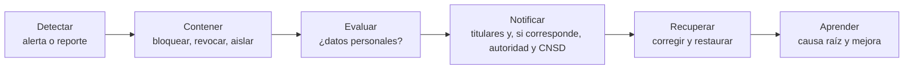

# Operación segura

Cubre lo que sucede después de escribir el código: cómo se construye, se configura, se despliega, se vigila, se respalda y se responde a un incidente. Apoya RNF-06, RNF-08, RNF-09, RNF-15 y RNF-17 y las decisiones AD-07, AD-08, AD-09 y AD-31. Las herramientas son gratuitas (RC-01).

## 1. Ciclo de desarrollo seguro

Se sigue una versión reducida del **NIST SSDF**, integrada al flujo de [Spec-Driven Development](../07-proceso-de-desarrollo/01-flujo-sdd.md):

| Práctica | Cómo se aplica |
| :--- | :--- |
| Preparar la organización | Constitución (`AGENTS.md`) con reglas de seguridad no negociables; esta carpeta como referencia. |
| Proteger el código | Repositorio privado; ramas protegidas; secretos fuera del repositorio; revisión de cambios; despliegue con aprobación de un segundo integrante. |
| Producir software bien protegido | Requisitos de seguridad en las specs; pruebas de seguridad por criterio; revisión de arquitectura y de seguridad por agentes antes de cerrar un plan. |
| Responder a vulnerabilidades | Dependabot y avisos de seguridad del repositorio; corrección priorizada por severidad. |

## 2. Canalización de integración continua

| Control | Herramienta | Cuándo | Falla si |
| :--- | :--- | :--- | :--- |
| Validación de specs y enlaces | `SpecCheck` | Cada cambio | Hay un error. |
| Compilación sin advertencias | `dotnet build -warnaserror` | Cada cambio | Hay una advertencia. |
| Pruebas y arquitectura | `dotnet test` | Cada cambio | Falla una prueba. |
| Pruebas de la base | Pruebas de humo SQL y de integración con PostgreSQL | Cada cambio de esquema | Falla una comprobación. |
| Análisis estático (SAST) | CodeQL | Cada cambio y semanal | Hay un hallazgo crítico o alto. |
| Dependencias vulnerables | Dependabot y `dotnet list package --vulnerable` | Semanal y cada cambio | Hay una vulnerabilidad alta o crítica sin excepción registrada. |
| Imágenes de contenedor | Trivy | Al construir imágenes | Hay una vulnerabilidad crítica o alta corregible. |
| Detección de secretos | `gitleaks` | Cada cambio | Aparece un secreto. |
| Inventario de componentes | SBOM (CycloneDX o SPDX) | Al liberar | No se genera. |
| Pruebas dinámicas básicas | OWASP ZAP *baseline* contra el entorno local | Antes de cada despliegue mayor | Hay una alerta media o superior sin revisar. |
| Accesibilidad | axe en las pruebas E2E | Cada cambio de interfaz | Hay incumplimientos críticos. |

> Estado: **pendiente de implementar**. Se agrega como tareas de infraestructura (spec `operacion-despliegue`) sin bloquear la aprobación de las specs de negocio.

## 3. Configuración y endurecimiento

| Área | Regla |
| :--- | :--- |
| Contenedores | Imágenes multi-arquitectura con versión fija; usuario sin privilegios; sistema de archivos de solo lectura cuando se pueda; *healthcheck*; límites de memoria y CPU. |
| Red | Base de datos sin puerto publicado; solo la VM-APP alcanza el 5432; SSH solo por OCI Bastion con llave; reglas de red de Oracle y firewall del sistema. |
| PostgreSQL | Autenticación SCRAM; TLS entre la aplicación y la BD; `pg_hba` restringido a la IP de la VM-APP; **tres roles** (migraciones, aplicación y solo lectura); la aplicación no modifica la bitácora. |
| Sistema operativo | Ubuntu Server LTS mínimo sin entorno gráfico; actualizaciones de seguridad automáticas; hora sincronizada (NTP). |
| Secretos | Variables de entorno por contenedor o `sops` y `age`; OCI Vault opcional; `.env` ignorado por Git; rotación ante cambios del equipo o sospecha. |
| Entornos | Desarrollo, pruebas y producción separados; **datos sintéticos** fuera de producción; etiqueta visible del entorno. |
| Cuentas | Dos administradores de la cuenta de Oracle, correo institucional neutro, MFA. |

## 4. Registro y alertas

| Qué | Dónde | Notas |
| :--- | :--- | :--- |
| Sesión, lecturas, modificaciones, eliminaciones, importaciones y exportaciones | `auditoria.bitacora` (aplicación y disparadores) | Sin contraseñas ni valores sensibles; ≥ 2 años. |
| Intentos de ingreso fallidos y bloqueos | Bitácora | Alerta ante ingresos fallidos masivos. |
| Registros técnicos | Salida estándar de los contenedores, con identificador de seguimiento | Rotación por tamaño; retención corta. |
| Latido de las VM | Healthchecks | Aviso si falta el latido. |
| Copia de la bitácora | Copia cifrada periódica en el CETPRO | Recomendación de la guía de nube de la PCM. |

Las alertas de negocio y de seguridad para el personal se ven **dentro del sistema**. Los avisos técnicos al equipo (caídas, respaldo fallido) salen por el correo del servicio de monitoreo, **fuera del sistema**.

## 5. Respaldo y recuperación (RNF-06, AD-08)

| Elemento | Decisión |
| :--- | :--- |
| Objetivos | **RPO ≤ 24 h** (≤ 4 h en temporada) y **RTO ≤ 4 h**, por validar con la Dirección. |
| Qué se respalda | La base PostgreSQL (esquemas `identidad`, `matricula` y `auditoria`), la configuración y los archivos de Compose sin secretos. |
| Frecuencia | Volcado diario (el reglamento exige mínimo semanal). |
| Cifrado | Antes de salir de la VM-DB; la **clave la custodia el CETPRO**. |
| Destino | Object Storage de Oracle y copia en el CETPRO. |
| Retención | Escalonada (por ejemplo 7 diarios, 4 semanales y 3 mensuales *(propuesta)*). |
| Prueba | Restauración completa en un entorno limpio **antes de cada despliegue mayor y cada trimestre**, con registro del tiempo real. |
| Contingencia | Si Oracle pierde la VM o la cuenta, se levanta el mismo Compose en otra máquina desde Git y el respaldo. |

## 6. Respuesta a incidentes

| Paso | Qué se hace |
| :--- | :--- |
| Detectar | Alerta de seguridad, reporte de una persona usuaria o hallazgo de un escáner. |
| Contener | Revocar credenciales, desactivar la cuenta afectada, bloquear el origen en Cloudflare. |
| Evaluar | Determinar qué datos y cuántas personas se afectaron. |
| Notificar | Informar a las personas afectadas y, **cuando corresponda**, a la autoridad dentro de las 48 horas de conocido (DS art. 34). |
| Recuperar | Corregir la causa, restaurar desde el respaldo si hace falta y volver a probar. |
| Aprender | Registrar el incidente en `progress/` y en el registro de incidentes del sistema (RF-37); actualizar el modelo de amenazas. |

La Dirección decide; el equipo documenta cada incidente aunque sea menor.

## 7. Gestión de cambios y vulnerabilidades

- Las actualizaciones de dependencias críticas se aplican en una rama, con pruebas y `SpecCheck`.
- Una vulnerabilidad sin corrección disponible se registra en `progress/blockers.md` con su mitigación y fecha de revisión.
- Antes de cada despliegue mayor: pruebas completas, escaneo de imágenes, ZAP *baseline* y restauración de prueba.
- Los cambios en producción se autorizan por un segundo integrante y quedan registrados (ISO 27002, 8.32).

## 8. Acciones pendientes

| Pendiente | Responsable | Relacionado |
| :--- | :--- | :--- |
| Agregar CodeQL, Dependabot, Trivy, `gitleaks` y SBOM a CI | Equipo | CTL-37 |
| Definir cifrado y custodia de la clave de los respaldos | Equipo y Dirección | CTL-29, CTL-30 |
| Designar al ODP y los dos administradores de la cuenta de Oracle | Dirección | AD-31, AM-10 |
| Probar el `keepalive` en una VM de Oracle durante una semana y medir | Equipo | AM-16 |
| Documento de seguridad con fecha cierta | Equipo y Dirección | RNF-LEG-11 |
| Capacitación breve a las cinco personas usuarias | Equipo | DS art. 46.2 |
