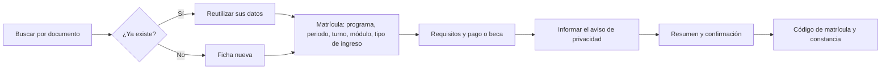

# Pantallas y recorridos

> **Origen:** este mapa se derivó de los requisitos (RF), los casos de uso y las atribuciones por rol. El prototipo de Figma es **referencia**: ya se contrastó con este mapa (ver [revisión del prototipo](10-revision-del-prototipo.md)) y se afinará. No hay diseño de pantallas finales todavía.

## 1. Mapa de pantallas por rol

| Área | Rol | Pantallas |
| :--- | :--- | :--- |
| **Acceso** | Todos | Ingreso (usuario y contraseña), código TOTP, configuración del segundo factor en el primer ingreso, cambio de la contraseña temporal, aviso de sesión por vencer, «sin permiso». |
| **Inicio** | Cada rol | Panel con alertas y accesos rápidos según el rol: *Personal de matrícula* (nueva matrícula, buscar, ratificaciones pendientes, datos faltantes); *Directivo* (matriculados por programa y turno frente al cupo referencial, alertas, bitácora); *Administrador* (salud técnica, respaldos, usuarios). |
| **Matrícula** | Personal de matrícula | Buscar estudiante (documento o apellidos), **ficha de matrícula** por secciones (datos personales, contacto, matrícula, requisitos, pago y beca, situación específica, aviso de privacidad informado), resumen y confirmación, detalle de la matrícula con su historial, anular (motivo obligatorio), ratificar (lista con selección múltiple), licencia y reincorporación, convalidación. |
| **Catálogo** | Personal de matrícula (edita) y Directivo (consulta) | Programas y familias, planes con resolución, módulos y unidades didácticas, periodos lectivos, ofertas por turno, docentes, convenios. |
| **Documentos y reportes** | Personal de matrícula y Directivo | Constancia de estudios (vista previa, impresión, PDF), nómina de matriculados con filtros, registro de matrícula (Anexo 1), **archivos para AVANZA** (validación previa, lista de datos faltantes y lista informativa del orden de carga), matriculados por oferta. |
| **Cumplimiento** | Directivo y Administrador; el Personal de matrícula solo **registra** solicitudes de derechos | Alertas, aviso de privacidad (versiones), solicitudes de derechos con fecha límite (el Personal de matrícula las registra; el Directivo las responde), incidentes, informe semestral de privilegios, bitácora. |
| **Administración** | Administrador | Usuarios y roles (alta, baja, restablecer contraseña y segundo factor), matriz de permisos, parámetros institucionales con historial (el Personal de matrícula y el Directivo solo los consultan), respaldos y salud del servicio. |
| **Pública** | Persona externa | Verificación de una constancia por código (respuesta mínima). |

El menú y las acciones visibles dependen del rol y de los permisos: quien no tiene permiso no ve la acción, y si llega por la URL recibe la pantalla de «sin permiso».

### Pantallas por especificación

| Spec | Pantallas principales |
| :--- | :--- |
| `identidad-seguridad` | Ingreso, TOTP, usuarios y roles, permisos, informe de privilegios. |
| `parametros-institucionales` | Lista de parámetros, edición con vigencia, historial. |
| `catalogo-academico` | Programas, planes, módulos y unidades. |
| `periodos-ofertas` | Periodos lectivos, ofertas y docentes. |
| `estudiantes` | Búsqueda, ficha del estudiante, situación específica. |
| `matricula-registro` | Ficha de matrícula, resumen, detalle, anulación, borrador. |
| `matricula-ratificacion-licencia` | Ratificación (lista), licencia, reincorporación. |
| `matricula-convalidacion` | Registro de convalidación con resolución y similitud. |
| `matricula-becas` | Convenios, beca y derecho de inscripción. |
| `docs-constancia` | Vista previa, impresión, PDF y verificación pública. |
| `docs-reportes` | Nómina, Anexo 1 y matriculados por oferta frente al cupo referencial. |
| `docs-archivos-avanza` | Validación previa, faltantes y descarga. |
| `cumplimiento-privacidad` | Aviso, solicitudes de derechos, incidentes. |
| `transversal-alertas` | Panel de alertas con atender o descartar. |
| `transversal-auditoria` | Consulta de la bitácora con filtros. |
| `web-base` | Estructura, sesión, errores, estados, cabeceras y etiqueta de entorno. |

## 2. Recorrido principal: registrar una matrícula

| Aspecto | Comportamiento |
| :--- | :--- |
| Pasos | Una sola página con secciones; el resumen final reúne todo antes de confirmar. |
| Validaciones visibles | Edad («tiene 15 años; la edad mínima es 16»), duplicado, ciclo Técnico, matrícula vigente, requisitos. |
| Datos de AVANZA | Si faltan, se permite guardar y se muestra un aviso con lo que falta. |
| Borrador | Se guarda automáticamente; si se corta la conexión o vence la sesión, se retoma la misma ficha. |
| Resultado | Se muestra el código de matrícula (el número de documento) y se ofrece la constancia. |

## 3. Otros recorridos

| Recorrido | Pasos |
| :--- | :--- |
| **Anular una matrícula** | Abrir el detalle, elegir «Anular», escribir el motivo (obligatorio), confirmar; la matrícula pasa a ANULADA y queda el historial. |
| **Ratificar** | Abrir «Ratificaciones pendientes», revisar la lista, seleccionar uno o varios, confirmar; se crean las matrículas nuevas. |
| **Licencia y reincorporación** | En la ficha, «Registrar licencia» con la fecha límite; al volver, «Reincorporar» dentro del plazo. |
| **Emitir constancia** | En el detalle, «Constancia de estudios»: vista previa, imprimir o descargar PDF con QR. |
| **Generar nómina o Anexo 1** | Elegir programa, módulo, periodo y turno; vista previa; descargar PDF o Excel; la exportación queda registrada. |
| **Preparar archivo para AVANZA** | Elegir programa, módulo y periodo; el sistema valida y lista lo que falta; se corrige; se descarga el Excel. **La carga en AVANZA no es parte del sistema.** |
| **Responder una solicitud de derechos** | Abrir la solicitud, ver la fecha límite, responder; queda registrada. |
| **Aprobar el informe de privilegios** | El Directivo revisa la lista de usuarios y permisos y lo aprueba. |

## 4. Elementos de pantalla con reglas

| Elemento | Regla |
| :--- | :--- |
| Listado de estudiantes | Documento parcialmente oculto, y el código de matrícula también (es el documento); «mostrar» queda registrado; resultados paginados. |
| Situación específica | Visible solo para quien tenga `SITUACION_ESPECIFICA_VER`; sin documentos. |
| Campo `observaciones` | Advertencia: «no registre salud ni ingresos»; límite de caracteres. |
| Estado de la matrícula | Insignia con texto e icono. |
| Entorno | Etiqueta visible del entorno (desarrollo, pruebas, producción). |
| Alertas | Contador por rol en la barra superior. |

## 5. Contingencia

Si no hay Internet, se matricula en papel con la **ficha oficial** y se carga después. El sistema no tiene modo sin conexión; el procedimiento en papel está en [procesos de negocio](../01-analisis-de-sistema/06-procesos-de-negocio.md).

## 6. Lista de revisión de cada pantalla (se aplicó al prototipo de Figma)

El resultado de aplicar esta lista al prototipo está en la [revisión del prototipo](10-revision-del-prototipo.md); se repite cuando el prototipo se afine.

- ¿El orden y los nombres coinciden con la ficha física y el Anexo 1?
- ¿Se puede completar una matrícula solo con el teclado?
- ¿Se avisa del documento duplicado y de la edad mínima antes de guardar?
- ¿Se ve el estado de guardado y de conexión?
- ¿Los mensajes dicen qué pasó y qué hacer?
- ¿Cumple contraste AA, foco visible, tamaño de objetivos y etiquetas?
- ¿Qué ve cada rol (Personal de matrícula, Directivo, Administrador)?
- ¿Están las pantallas de ratificación, licencia, convalidación, archivos para AVANZA, alertas, solicitudes de derechos y bitácora?
- ¿La interfaz sugiere (sin querer) que el sistema carga en AVANZA? **No debe.**
