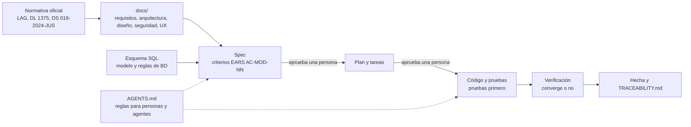
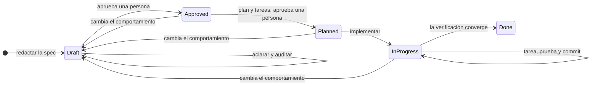

# Flujo de trabajo con Spec-Driven Development

Cómo se construye el Sistema de Matrícula: el ciclo de cada feature, las validaciones que lo protegen, las skills y agentes que lo guían, la estructura del repositorio y el plan de trabajo. Las reglas obligatorias estarán en `AGENTS.md`; este documento explica el porqué y el cómo. Decisiones: **AD-35** y **AD-36**; restricción **RC-07**; requisito **RNF-18**.

## 1. Idea central

**La spec manda y el código la demuestra.** Ninguna línea de producción existe sin una especificación aprobada y un plan aprobado; ningún criterio de aceptación existe sin una prueba; ninguna feature se da por terminada sin una verificación que converge. **Dos decisiones las toma siempre una persona** (aprobar la spec y aprobar el plan); todo lo demás se valida de forma automática o por revisión independiente.

El método se inspira en el flujo de GitHub Spec Kit (constitución, especificar, planificar, tareas, implementar y converger) y en el marco que el equipo ya usó en otro proyecto (carpeta `DocumentacionEjemplo`, solo de referencia). La constitución es `AGENTS.md`, los criterios se escriben en EARS y la convergencia se registra en `verificacion.md`.

**La documentación va antes que las specs.** Esta carpeta `docs/` es el contexto de entrada: el ERS, la arquitectura y el esquema ya están distribuidos aquí. Una spec nace de `docs/`; si el comportamiento cambia, la spec vuelve a Draft y se actualiza `docs/` en el mismo cambio.

## 2. De los documentos al código



**Precedencia si hay conflicto:** normativa oficial, `docs/`, spec, plan, código (RC-08). Si el código y la spec difieren, uno de los dos está mal y se decide; no se «ajusta en silencio».

## 3. Ciclo de una feature



| Paso | Skill o agente | Entrega | Quién decide |
| :---: | :--- | :--- | :--- |
| 1 | `spec-new` | `spec.md` en Draft | IA |
| 2 | `spec-clarify`, agente `spec-auditor` | Spec sin ambigüedad ni preguntas abiertas | IA y persona (respuestas) |
| 3 | — | Spec **Approved** (`aprobado_por`, `aprobado_en`) | **Persona** |
| 4 | `spec-plan`, agentes `arch-reviewer` y `security-reviewer` | `plan.md` y `decisions.md` | IA |
| 5 | `spec-tasks` | `tasks.md` con cada criterio cubierto | IA |
| 6 | — | Plan **Planned** (`plan_aprobado_en`) | **Persona** |
| 7 | `spec-implement`, `dotnet-feature`, `ui-screen` | Código y pruebas, una tarea y un commit a la vez | IA, con revisión |
| 8 | `spec-verify`, `arch-review`, `security-review`, `ui-review` | `verificacion.md` con `Resultado: Converge` | IA (reglas fijas) |
| 9 | `progress-log` | Bitácora y CHANGELOG | IA |

**«Persona»** es el integrante del equipo designado responsable de esa spec. **Las decisiones de negocio no las toma la IA ni el equipo solo**: un valor, plazo o texto legal que no esté en `docs/` queda como parámetro configurable o pendiente (P-xx) hasta que la Dirección lo defina. Las specs que tocan datos personales (EST, MAT, PRI, AUD, IDE) pasan además por revisión de seguridad y privacidad antes de aprobar el plan.

## 4. Cómo se valida cada cosa

| Capa | Qué atrapa | Herramienta | Cuándo |
| :--- | :--- | :--- | :--- |
| **Estructura de la spec** | Secciones faltantes, frontmatter incompleto, prefijos o identificadores repetidos, dependencias con ciclos. | `tools/SpecCheck` | Cada edición y en CI |
| **Calidad EARS** | Plantilla incorrecta, ausencia de «deberá», tecnología en un requisito. | `SpecCheck` | Igual |
| **Cobertura** | Requisitos sin criterio; criterios que cubren requisitos inexistentes; orígenes (`RF`, `RN`, `RNF`, `RNF-LEG`, `RC`, `CU`) que no existen en `docs/`; RF del negocio sin spec. | `SpecCheck` y `TRACEABILITY.md` | Igual |
| **Límites del sistema** | Una spec que implementa algo de la columna «Fuera» (carga en AVANZA, notas, correo…). | Agente `spec-auditor` y la persona | Antes de aprobar |
| **Sustancia de la spec** | Requisitos no probables, casos límite ausentes, contradicciones con `docs/`, decisiones de negocio asumidas. | `spec-auditor` y la persona | Antes de aprobar |
| **Puertas del ciclo** | Una spec sin aprobar con plan, un plan sin tareas, una spec `Done` sin verificación. | `SpecCheck` | Cada edición y en CI |
| **Arquitectura del plan** | Piezas en la capa equivocada, referencias indebidas, secretos. | Agente `arch-reviewer` | Antes de aprobar el plan |
| **Seguridad y privacidad** | Datos personales sin control, permisos faltantes, bitácora sin cubrir. | Agente `security-reviewer` | Antes de aprobar el plan |
| **Lógica de negocio** | Regresiones en reglas e invariantes. | xUnit, **pruebas primero** | Cada tarea |
| **Estructura del código** | Referencias de proyecto indebidas, infraestructura en Dominio o Aplicación. | `Cetpro.Architecture.Tests` (NetArchTest) | Cada compilación y en CI |
| **Base de datos** | Restricciones, disparadores y vistas. | Pruebas de humo SQL y de integración con PostgreSQL | Cada cambio de esquema |
| **Compilación estricta** | Advertencias, estilo, nulabilidad. | `dotnet build -warnaserror` | Cada tarea y en CI |
| **Trazabilidad hacia las pruebas** | Un criterio de una spec en ejecución que ninguna prueba nombra (`[Trait("Criterio", "AC-XXX-NN")]`). | `SpecCheck` | Desde `InProgress` |
| **Convergencia** | Diferencias entre spec, código y pruebas; funcionalidad de más. | Skill `spec-verify` | Antes de `Done` |
| **Interfaz** | Contraste, teclado, estados, paridad con el prototipo. | Skill `ui-review` y Playwright + axe | Pantallas de cada feature |

`SpecCheck` y la prueba de arquitectura se prueban contra violaciones deliberadas, para confirmar que fallan cuando deben.

## 5. Estructura del repositorio

```
SisJoaquin/
├── AGENTS.md  CLAUDE.md  README.md
├── .claude/               skills y agentes del proyecto
├── docs/                  7 carpetas temáticas y glossary.md
├── specs/                 README.md, speccheck.json, TRACEABILITY.md, _template/ y una carpeta por spec
├── progress/              CHANGELOG.md, blockers.md, log/
├── src/                   Cetpro.Domain, Cetpro.Application, Cetpro.Infrastructure y Cetpro.Web
├── tests/                 dominio, aplicación, arquitectura, integración, E2E y load/ (k6)
├── tools/SpecCheck/       validador de specs
├── infra/                 Compose, Caddy, OpenTofu, cloud-init, respaldo, keepalive
├── db/                    esquema SQL de referencia, pruebas de humo y migraciones
├── Entregables/           línea base del ERS y de la arquitectura, y la propuesta en .docx
└── Contexto/ Investigacion/   material de partida (solo referencia)
```

## 6. Specs previstas

Son 17. La [matriz de trazabilidad](../01-analisis-de-sistema/08-matriz-de-trazabilidad.md) fija, para cada una, sus requisitos, reglas, decisiones, amenazas, controles, parámetros, pendientes y dependencias. Prefijos: `transversal-auditoria` (AUD), `identidad-seguridad` (IDE), `parametros-institucionales` (PAR), `catalogo-academico` (CAT), `periodos-ofertas` (OFE), `estudiantes` (EST), `matricula-registro` (MAT), `matricula-ratificacion-licencia` (RAT), `matricula-convalidacion` (CON), `matricula-becas` (BEC), `docs-constancia` (CST), `docs-reportes` (REP), `docs-archivos-avanza` (AVZ), `cumplimiento-privacidad` (PRI), `transversal-alertas` (ALE), `operacion-despliegue` (OPS) y `web-base` (WEB).

Algunas specs cruzan iteraciones (por ejemplo, CST cubre RF-16 en la iteración 1 y RF-28 en la 2). **Propuesta:** cada criterio lleva su iteración y `SpecCheck` exige prueba solo para los de la iteración en curso; la spec llega a Done al cerrarse su última iteración. Se decide al adaptar la plantilla.

## 7. Skills y agentes

### 7.1 Del proyecto (`.claude/`)

Se copian y adaptan desde el marco del equipo en la fase 0.

| Skill | Para qué |
| :--- | :--- |
| `spec-new` | Redactar el borrador de una spec desde `docs/` y el esquema. |
| `spec-clarify` | Resolver ambigüedades y preguntas abiertas con la persona responsable. |
| `spec-plan` | Convertir una spec aprobada en `plan.md` y `decisions.md`. |
| `spec-tasks` | Dividir el plan en tareas atómicas, con cada criterio cubierto. |
| `spec-implement` | Implementar una tarea a la vez con pruebas primero. |
| `spec-verify` | Comprobar la convergencia y escribir `verificacion.md`. |
| `progress-log` | Registrar la sesión, el CHANGELOG y los bloqueos. |
| `arch-review` | Revisar un cambio o un plan contra las reglas de arquitectura. |
| `security-review` | Revisar contra el modelo de amenazas, los controles y la privacidad. |
| `dotnet-feature` | Guía para casos de uso, puertos, adaptadores y pruebas (Razor Pages, HTMX, EF Core). |
| `ui-screen` | Construir una pantalla Razor desde su prototipo y el sistema de diseño. |
| `ui-review` | Revisar una pantalla (contraste, teclado, estados). |

| Agente | Para qué |
| :--- | :--- |
| `spec-auditor` | Segunda opinión independiente sobre una spec, en contexto aislado y de solo lectura. |
| `arch-reviewer` | Revisión de arquitectura de un cambio o plan, de solo lectura. |
| `security-reviewer` | Revisión de seguridad y privacidad contra `docs/05-seguridad/`, de solo lectura. |

**Adaptaciones:** vocabulario oficial (AD-25); un monolito modular, no varios servicios; privacidad (AD-36) y marco legal peruano; `ui-*` esperan los prototipos de Figma.

### 7.2 Externas recomendadas

Se **recomiendan, no se instalan** automáticamente: son instrucciones que cambian el comportamiento del agente y conviene revisarlas antes. Las skills del proyecto mandan en caso de diferencia. Ejemplo: `dotnet/skills` (MIT) para pruebas y EF Core. Para Playwright y k6 se usa su documentación oficial.

## 8. Plan de trabajo

| Fase | Contenido | Entregable verificable | Estado |
| :---: | :--- | :--- | :---: |
| **Doc** | Análisis (ERS v1.1), arquitectura v0.4, esquema SQL v1.1 con pruebas y **esta carpeta `docs/`**. | Documentación revisada y aceptada por el equipo. | **Hecha** (esquema y pruebas de humo ejecutadas) |
| **0** | Marco SDD: `AGENTS.md`, `CLAUDE.md`, plantillas, `SpecCheck`, skills y agentes, CI, esqueleto de la solución. | `SpecCheck` pasa; `dotnet build -warnaserror` y `dotnet test` en verde; Compose local válido. | Pendiente |
| **1** | `transversal-auditoria`, `parametros-institucionales`, `web-base` (estructura técnica con tokens de diseño provisionales: plantilla, sesión, errores, estados y cabeceras) e `identidad-seguridad`; `operacion-despliegue` en paralelo. | Ingreso con MFA, roles, parámetros y bitácora inmodificable, dentro de la estructura web base. | Pendiente |
| **2** | `catalogo-academico`, `periodos-ofertas`. | Catálogo con plan y resolución; periodos y ofertas. | Pendiente |
| **3** | `estudiantes`, `matricula-registro`. | Matricular, anular y ver el historial con trazabilidad. | Pendiente |
| **4** | `docs-constancia`, `docs-reportes`, `cumplimiento-privacidad` (aviso); la identidad visual definitiva se incorpora a `web-base` con el prototipo afinado y el documento de UI/UX. | Constancia y nómina con trazabilidad (MVP). | Pendiente |
| **5** | `matricula-ratificacion-licencia`, `matricula-convalidacion`, `matricula-becas`. | Ciclo completo por periodo. | Pendiente |
| **6** | `docs-archivos-avanza`, `transversal-alertas`, resto de CST, REP y PRI. | Exportación validada, alertas y derechos de titulares. | Pendiente |
| **7** | Retención y depuración (RF-38) y mejoras. | Cumplimiento sostenido. | Pendiente |
| **8** | Despliegue en Oracle, pruebas de restauración, E2E, accesibilidad y carga ligera; puertas de salida a producción. | Criterios verificados; puertas cerradas. | Pendiente |

Cada fase repite el ciclo de la sección 3 por cada spec. Las specs de una misma fase pueden planificarse juntas si comparten decisiones técnicas.

## 9. Definición de «terminado»

**Una tarea:** compila sin advertencias, su prueba falló antes y pasa ahora, las pruebas de arquitectura pasan, `SpecCheck` pasa, la tarea está marcada y hay un commit pequeño con el tipo correcto.

**Una feature:** todas sus tareas marcadas, cada criterio de aceptación nombrado en una prueba, `verificacion.md` con `Resultado: Converge`, la spec en `Done`, la matriz `TRACEABILITY.md` actualizada y la bitácora al día.

## 10. Cómo empezar una feature

1. Pida a la IA: «escribe la spec de *X*» (usa `spec-new`) y luego «aclara la spec» (`spec-clarify`).
2. Responda las preguntas, revise y **apruebe**: escriba en el frontmatter `aprobado_por`, `aprobado_en` y cambie `estado: Approved`.
3. Pida el plan y las tareas (`spec-plan` y `spec-tasks`), revíselos y **apruebe**: `plan_aprobado_en` y `estado: Planned`.
4. Pida implementar (`spec-implement`), tarea por tarea.
5. Pida verificar (`spec-verify`); si converge, la spec queda en `Done`.

## 11. Fuentes

- [GitHub Spec Kit](https://github.com/github/spec-kit): flujo de Spec-Driven Development (MIT).
- EARS: *Easy Approach to Requirements Syntax* (Mavin y otros).
- Documentación de subagentes y skills de Claude Code.
